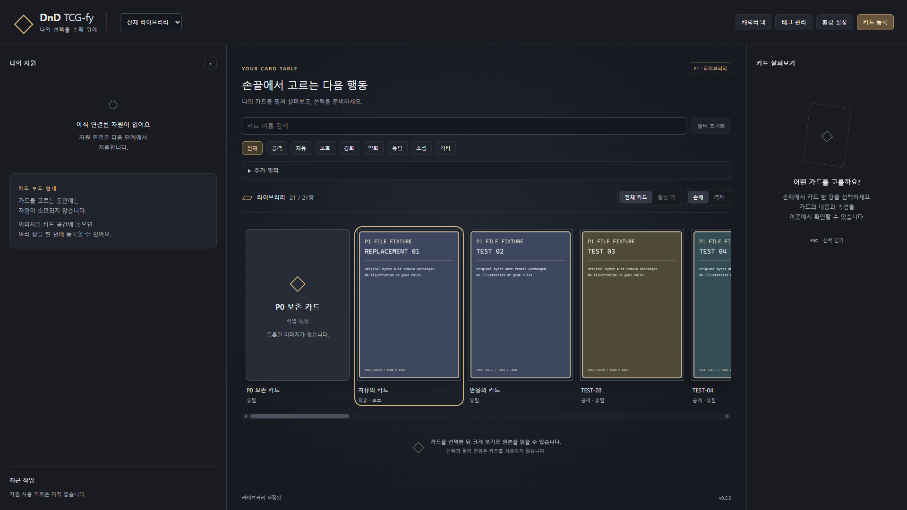

# P1 카드 라이브러리·필터 구현 및 검수 보고

검수일: 2026-11-16 (Asia/Seoul). 앱 버전: **0.2.0**, SQLite 버전: **2**. 판정: **P1 통과**.

P2 자원 소비 엔진과 v1.0 전체 완료를 의미하지 않습니다. 기존 네 계약 문서는 수정하지 않았습니다.

## Git 이력과 실행 산출물

- P0 기준 보존: `2e36d82` — 검증된 기존 소스·명세·보고서를 최초 커밋으로 보존.
- P1 구현: `88ec5bf` — 카드 등록/수정/교체, 필터, 태그, 캐릭터별 덱, SQLite v2 및 회귀 테스트.
- 이미지 표시 보완: `66a41cd` — 원본 모서리를 가리지 않도록 표시하고 실제 CSS 속성 검사 추가.
- README, 이 보고서, 검증 JSON과 스크린샷도 후속 문서 커밋으로 보존합니다. 저장소는 로컬이며 원격 전송은 하지 않았습니다.

**실제 빌드하고 실행한 파일:** `release/win-unpacked/DnD TCG-fy.exe`.

Windows x64 OS 빌드 `10.0.26200`, Electron 45.3.3 / 내장 Node.js 24.22.3에서 실행했습니다. `app.isPackaged=true`와 Sharp Windows native 모듈의 실제 이미지 디코딩을 확인했습니다. exe만 옮기지 말고 win-unpacked 폴더 전체를 유지해야 합니다.

소스 커밋·exe/asar 해시와 포함된 native 파일: [빌드 증거](docs/validation/p1-build.json).

## 구현 결과

| 요구 영역 | 구현 동작 |
| --- | --- |
| 등록 | 파일 선택/드롭, PNG/JPEG/WebP, 여러 장 이름 개별 지정 및 속성 공통 적용, 잘못된 파일별 오류 |
| 수정·교체 | 영구 UUID, 이름·유형·역할·행동·사거리·태그·메모·주문 레벨 편집, 동일 카드 ID로 이미지 교체 |
| 등록 해제 | 확인 후 표시에서 제외, 원본·카드 행·덱/과거 참조 보존 |
| 속성 | 요청한 6유형/8역할/5사거리, 다중 역할/행동/태그, 기존 no_action 값도 호환 유지 |
| 태그 | UUID 연결, 카드별 연결 편집 독립, 공통 이름 수정/삭제의 영향 범위와 연결 수 표시 |
| 필터 | 역할/행동/유형/사거리/태그 및 이름 검색, 분류 내 OR·분류 간 AND, 즉시 표시 갱신 |
| 표시 | 손패 가로 탐색/격자, lazy 썸네일, object-fit contain, 모서리 비가림, 원본 확대/원본 크기/ESC 복귀 |
| 덱 | 캐릭터/기본 덱 생성, 추가 덱 생성·선택, 카드 공유·독립 덱 구성, 라이브러리/활성 덱 범위 |
| 저장 | SQLite 카드/속성/태그/덱, 별도 원본과 썸네일, 검색/필터/캐릭터 선택 복원, P0 환경 설정 유지 |
| 후속 연결 | 기존 castOptions/costs/createdAt/ID를 편집 시 보존. 비용 문자열이나 잔여량을 카드에 새로 저장하지 않음 |

원본은 복사한 바이트의 SHA-256을 저장합니다. 썸네일은 원본과 다른 캐시 파일입니다. 확장자·시그니처·실제 디코딩·픽셀 수·크기를 메인에서 검사합니다. 한 번에 100장, 장당 32 MiB, 총 4천만 픽셀 제한입니다. 경로 순회, UNC, 폴더, 포맷 위장, 손상 및 초과 입력을 거부합니다.

## 실행 명령과 최종 결과

이 환경에는 npm 명령이 없어 `.\scripts\bootstrap-npm.ps1`를 사용했습니다. 최종 품질 게이트는 같은 npm 스크립트의 Node 진입점을 직접 호출해서도 종료 코드 0을 확인했습니다.

| 명령 / 검증 | 결과 |
| --- | --- |
| `bootstrap-npm.ps1 ci --offline --no-audit --no-fund --cache .tools/npm-cache` | 성공, 529개 패키지 및 Electron postinstall, 잠금 파일 재현 |
| `npm run lint` / `node node_modules/eslint/bin/eslint.js . --max-warnings 0` | 성공, 린트 경고 0 |
| `npm run typecheck` / `node node_modules/typescript/bin/tsc --noEmit` | 성공 |
| `npm test` / `node scripts/test.mjs --reporter=verbose` | **5개 파일 / 43개 테스트 성공**, 종료 코드 0 |
| `npm run build` | 성공, renderer와 main/preload 생성 |
| `npm run pack:win` | 성공, Sharp DLL/.node를 포함한 Windows x64 폴더 배포 패키지 |
| `node scripts/e2e.mjs` | 성공, 로컬 production 번들 전체 흐름 |
| `node scripts/e2e.mjs --dev` | 성공, 개발 CSS nonce와 원본 표시를 포함한 전체 흐름 |
| `DND_TCG_EXECUTABLE` 지정 후 `node scripts/e2e.mjs` | 성공, **최종 packaged exe 실제 실행·종료·재시작** |
| `npm audit --omit=dev --json` | 알려진 런타임 취약점 **0** |
| `npm audit --json` | high 0, critical 0, moderate 12 — 개발 도구의 전이 minimatch 및 영향 패키지 |

빌드 중 Zod 주석의 PURE annotation 두 건을 Rollup이 제거한다는 경고가 있습니다. 빌드는 성공했고 실제 renderer 예외와 Electron 보안 경고는 0입니다. 패키징 로그의 native dependency 중복 참조는 포함 파일과 실제 디코딩으로 재확인했습니다.

검증 원본 JSON:

- [최종 Windows exe E2E](docs/validation/p1-packaged.json)
- [최종 개발 모드 E2E](docs/validation/p1-development.json)
- [런타임 보안 감사](docs/validation/p1-runtime-audit.json)
- [전체 보안 감사](docs/validation/p1-full-audit.json)

실행법과 조작법은 [README](README.md)에 정리했습니다.

## 자동 테스트 43개

- 기존 저장·호환성 **10개**: P0 설정, FK/WAL, 미래 버전·잘못된 데이터 보존, 트랜잭션과 마이그레이션 롤백 등.
- 보안·기본 카드 계약 **4개**: IPC 문서 URL, 외부 요청, 경로 순회와 번들 형식, 카드에 live 자원 상태 저장 거부.
- 라이브러리·필터·v1→v2 **15개**: OR/AND/검색/덱 필터, 20장과 필터 재시작, 수정/교체 독립성, 기존 비용·바인딩·덱 유지, 배치 실패 원자성, 태그 연결/공통 변경, 등록 해제 참조 보존, 잘못된 카드 행 경고, 마이그레이션 성공·실패 백업/롤백.
- 이미지 **7개**: PNG/JPEG/WebP 바이트 보존, 별도 썸네일, 동일 이름 독립성, 손상·포맷 위장·SVG·폴더·UNC·크기/픽셀 초과, 경로 변조, 누락 캐시 재생성, 원본 무결성 실패.
- UI **7개**: P0 선택/ESC/설정/오류 회귀, 저장 응답을 기다리지 않는 필터 즉시 갱신, 메타데이터 편집 요청의 ID 유지 및 비용 미전송, 누락 이미지에서 편집 유지.

## Windows 인수 시나리오

각 E2E는 실제 앱을 새 격리 userData로 실행합니다. 시작 전 v1 DB에 P0 설정·문자열 ID 카드·태그·캐릭터·덱·자원 잔여량 3·기존 비용·바인딩·이벤트를 넣어 업그레이드했습니다.

1. v2 백업이 1회 생성되고 P0 환경 설정/ID/비용/덱이 보존되는지 확인.
2. 파일 선택을 통해 **PNG 12 + JPEG 4 + WebP 4 = 20장** 등록. 손상 파일 1개는 거부하고 정상 파일은 유지.
3. 일괄 속성 적용 후 개별 카드의 이름·역할·행동·사거리·태그를 수정. 다른 카드가 그대로인지 비교.
4. 첫 카드의 이미지를 WebP로 교체하고 ID/createdAt/속성/비용/다른 카드가 유지되는지 비교.
5. 공통 태그 이름 변경 시 ID 유지, 카드별 태그 연결 해제는 다른 카드에 영향이 없는지 확인.
6. 원본 확대의 contain, 원본 크기, 모서리 비가림, ESC 복귀와 손패/격자를 확인.
7. `(공격 OR 치유) AND 보너스 행동 AND 주문 AND 원거리 AND 공유 태그`가 19장을 표시하고, 이름 검색 `치유` 추가 시 1장으로 즉시 갱신되는지 확인.
8. 완전 종료 후 재실행해 카드 21장(가져온 20장 + 기존 P0 카드), 태그, 필터, 보기 설정이 같은지 확인.
9. 배포 모드에서 Chromium offline 재로딩·이미지 표시·이후 SQLite 편집을 실행. 외부 fetch 거부 확인.
10. 두 캐릭터가 같은 카드 정의를 공유하며 덱 구성이 독립적인지, 추가 덱과 범위 전환이 정상인지 확인.
11. 디스크 기반 File의 실제 드롭 이벤트로 별도 카드 1장을 등록.
12. 격리된 관리 이미지 하나를 임시로 옮겨 누락을 만들고 안전한 안내·메타데이터·편집 기능을 확인한 후 복원.
13. 공통 태그 삭제 확인 후 해당 연결과 저장 필터만 정리되는지 확인. 드롭 카드는 등록 해제하고 원본/행 보존 확인.
14. 1280×720, Chromium 확대 125%/150%에서 문서 가로 넘침이 없고 세로 스크롤로 조작에 접근되는지 확인.
15. **모든 원본/관리 복사본/DB SHA-256 일치**, 교체 전·등록 해제 이미지 보존, FK 무결성, P0 자원 잔여량과 이벤트 불변을 확인.

최종 활성 카드는 21장입니다. 최종 renderer 예외 0, Electron 보안 경고 0입니다. 일반 사용자 데이터는 사용하지 않았습니다.

## 스크린샷

최종 패키징 exe에서 촬영한 화면입니다. 원본·손패·격자·필터·오류·고배율 화면을 열어 검수했습니다.

- [격자](docs/screenshots/p1-grid.png)
- [원본 확대](docs/screenshots/p1-original.png)
- [복합 필터와 검색](docs/screenshots/p1-filters.png)
- [이미지 누락 대응](docs/screenshots/p1-missing-image.png)
- [1280×720 / Chromium 150%](docs/screenshots/p1-150pct.png)

이미지는 테스트 문서(문자와 테두리)입니다. 사용자 실제 카드 삽화가 아직 제공되지 않아 이를 생성하거나 수정하지 않았습니다. 실제 PNG/JPEG/WebP 파일의 등록 경로와 해시 검증을 수행했으며, 사용자 원본 삽화의 개별 시각 검수는 추후 필요합니다.

## 변경 파일과 호환성

| 영역 | 파일 |
| --- | --- |
| 도메인/저장 | `electron/library-store.ts`, `assets.ts`, `errors.ts`, `migrations.ts` |
| IPC/보안 | `electron/main.ts`, `preload.ts`, `security.ts`, `index.html` |
| UI | `src/App.tsx`, `styles.css`, `components/CardEditor.tsx`, `CardFace.tsx`, `Filters.tsx`, `Managers.tsx`, `Modal.tsx` |
| 계약/필터 | `src/shared/contracts.ts`, `library.ts`, `DATA_SCHEMA_P1.md` |
| 도구/의존성 | `package.json`, `package-lock.json`, `.npmrc`, `vite.config.ts`, `scripts/build-electron.mjs`, `e2e.mjs` |
| 회귀 테스트 | `tests/library.test.ts`, `assets.test.ts`, `App.test.tsx`, `store.test.ts` |
| 문서/증거 | `README.md`, `DECISIONS.md`, 이 보고서, `docs/screenshots/p1-*`, `docs/validation/p1-*` |

P0 preferences는 세 필드 그대로 유지했습니다. 검색과 필터는 별도 library_state 키입니다. SQLite v2는 태그 테이블/연결, archived_at, original_name만 추가하며 기존 카드를 리셋하거나 비용/자원을 재계산하지 않습니다. 기존 문자열 ID도 유지합니다. 원본 계약 해석은 [P1 스키마 보충](DATA_SCHEMA_P1.md)과 [결정 기록](DECISIONS.md)에 명시했습니다.

## 남은 검수와 다음 단계의 주요 위험

- **P2 비용 연결:** P1에서 보존한 castOptions를 실제 자원 인스턴스에 연결할 때 소유 캐릭터·중복 비용 합계·부족 자원·원자적 차감·Undo를 검증해야 합니다. P1은 비용을 계산/소비하지 않았습니다.
- **편집 후 비용 유효성:** 카드 유형/주문 레벨을 바꿔도 기존 비용은 자동 변경하지 않습니다. P2/P3에서 새 메타데이터와 기존 시전 옵션의 양립 가능성을 명시적으로 검증해야 합니다.
- **저장 용량과 복구:** 취소·교체·등록 해제된 원본도 보존하므로 용량이 증가할 수 있습니다. ZIP 내보내기/가져오기, 복원과 미참조 원본의 보존 정책은 P5에서 검토합니다. 이번 단계에서 정리 기능을 임의로 추가하지 않았습니다.
- **배포 환경:** 현재 Windows x64에서 native Sharp를 실제 검증했습니다. 깨끗한 Windows 10/11 설치 환경, NSIS 설치·제거·업그레이드, 코드 서명은 P5 검수 대상입니다.
- **검증 한계:** Windows OS 배율 자체와 물리적 네트워크 어댑터는 변경하지 않았습니다. Chromium 확대/offline을 사용했습니다. 200장 전체 UI 성능, 특수 ICC/EXIF/애니메이션 카드의 개별 시각 검수는 완료로 주장하지 않습니다.
- **개발 의존성:** 런타임 감사는 0이지만 개발 도구의 moderate 보고 12개가 남습니다. 검증되지 않은 메이저 override는 하지 않았으며 후속 유지보수에서 재검토합니다.

다음 단계는 **P2 범용 자원 엔진**입니다. 명세에 없는 주사위/명중/피해/턴 자동화, OCR, 카드 삽화 생성, 네트워크 기능은 추가하지 않았습니다.
