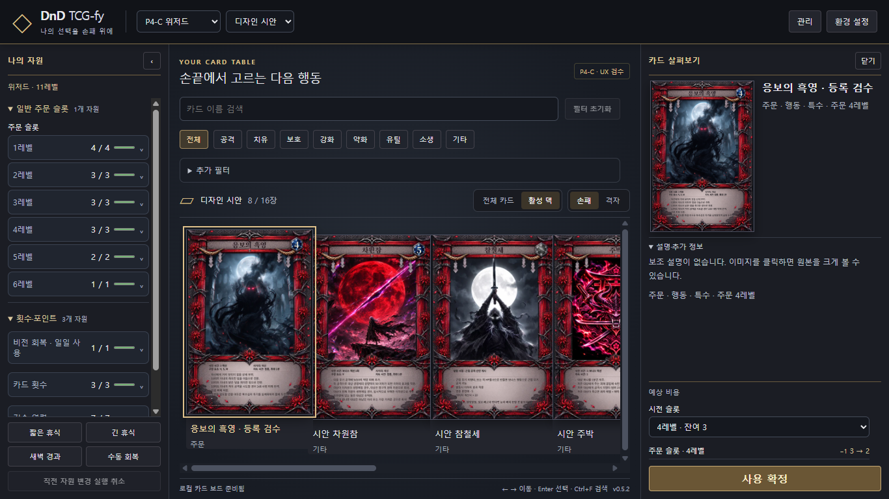
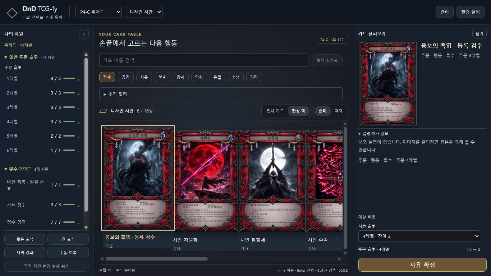

# P4-C 디자인 방향 제안 — 승인 전 미적용

기준은 미니멀 다크 판타지와 현대적인 디지털 TCG다. 아래는 동일한 1366×768/100% Windows 검수 창, 같은 실제 카드 이미지 8장·자원·선택 상태에서 비교한 시안이다. 카드 삽화는 수정하지 않았다.

시안 CSS는 `docs/design/`에만 있으며 앱에서 import하거나 패키징하지 않는다. 검수 스크립트가 Windows 창에 일시 삽입해 캡처한 뒤 제거했다. 현재 제품의 전체 테마는 P4-B와 같다. 등록 폼과 확대 화면의 기능 변경만 제품에 반영했다.

## 현재 화면

장점은 익숙한 3패널과 명확한 박스형 조작이다. 자원 행·필터·버튼에 비슷한 강도의 경계가 반복돼 관리 대시보드처럼 보이는 부분이 있다. 카드가 아닌 컨트롤도 시선을 나누는 것이 개선 대상이다.

## A — 흑연 바탕과 얇은 세공 금선

- 변경: 헤더·패널 제목·사용 영역에만 얇은 금선, 무광 흑연 바탕, 절제된 4~6px 모서리, 폰트 굵기/계층 정리. 기본·호버·선택 버튼의 경계 차이를 강조한다.
- 자원/관리: 기존 박스 구조를 유지해 클릭 가능 영역이 익숙하다. 관리 대화상자도 같은 흑연 바탕과 얇은 금선으로 맞춘다. [관리 화면 시안](docs/screenshots/p4-c/design-direction-a-management.png).
- 장점: 기존 사용자에게 변화가 작고 자원/관리 가독성을 유지하기 쉽다. 서로 다른 캐릭터·카드 테마와 섞어도 과한 장식이 없다.
- 단점: 박스 구조가 남아 관리 화면의 인상을 크게 줄이지는 못한다. 금선이 여러 곳에 반복되지 않도록 수량을 제한해야 한다.
- 적용 범위: 색상·선·모서리·제목 계층 중심. 레이아웃·데이터·규칙 변경 없음.

## B — 안개빛 테이블과 평면 자원 목록

- 변경: 테이블과 보조 패널을 낮은 명도 차이로 구분하고, 자원 행의 상자 대신 얇은 구분선과 숫자 정렬을 사용한다. 버튼은 부드러운 모서리, 금색은 선택·포커스·확정에 한정한다. 카드 주변의 그림자를 줄인다.
- 자원/관리: 자원은 상태 목록처럼 보이게 하고, 편집은 기존 클릭/펼침으로 유지한다. 관리 폼은 같은 중성 배경·간격·타이포를 사용한다. [관리 화면 시안](docs/screenshots/p4-c/design-direction-b-management.png).
- 장점: 반복되는 박스가 줄어 카드 테이블이 시각적 중심이 된다. 디지털 TCG에 가까운 가벼운 탐색 분위기다.
- 단점: 자원 행이 클릭 가능하다는 표시가 약해질 수 있어 호버·포커스·펼침 안내를 승인 후 검증해야 한다. 차가운 중성색이 일부 따뜻한 카드와 어울리는지도 추가 검수가 필요하다.
- 적용 범위: A의 시각 토큰 범위에 자원 행의 경계 처리까지 포함한다. 계산·사용 방식·3패널 동선 변경 없음.

## 비교와 권고

| 기준 | 현재 | A | B |
| --- | --- | --- | --- |
| 카드 중심성 | 컨트롤 박스와 경쟁 | 금선 범위를 줄여 개선 | 평면 자원 목록으로 더 강조 |
| 자원 편집 발견성 | 높음 | 기존 구조 유지 | 추가 호버/포커스 검수 필요 |
| 변경 규모 | 없음 | 작음 | 중간 |
| 특정 캐릭터 장식 강요 | 없음 | 없음 | 없음 |
| 과도한 발광·배경 삽화 | 없음 | 추가하지 않음 | 추가하지 않음 |

목표인 대시보드 인상 완화에는 **B를 우선 검토**할 것을 제안한다. 기존 조작 익숙함을 우선하면 A가 더 보수적인 선택이다. 실제 적용은 선택한 방향에 대해 키보드 포커스·문자 대비·작은 창·다른 카드 테마를 검수한 뒤 별도 변경으로 진행한다. 이 시안은 해당 디자인의 최종 접근성/사용성 승인을 의미하지 않는다.

**A/B 적용, 다른 방향 수정, 현재 테마 유지 모두 사용자 선택 사항이다. 승인 전에는 제품 전체 테마를 바꾸지 않는다. P5도 시작하지 않는다.**
