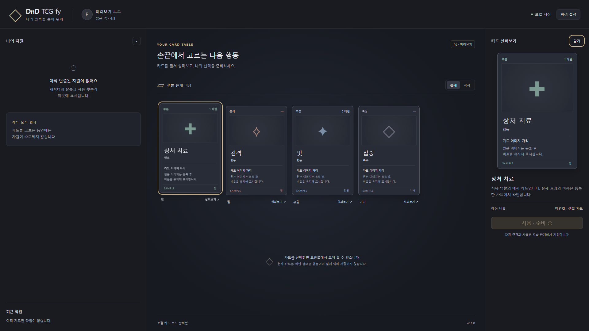

# P0 구현 및 검수 보고

검수일: 2026-11-16 (Asia/Seoul). 판정: **P0 통과**. P1 이후 및 v1.0 전체 완료를 의미하지 않습니다.

## 환경과 실제 실행 산출물

- Windows x64, OS 빌드 `10.0.26200`에서 실행.
- 개발 Node.js 24.22.1, 로컬 npm 11.6.2.
- 실제 앱 런타임: Electron 45.3.3 / 내장 Node.js 24.22.3.
- electron-builder 26.18.0으로 `release/win-unpacked/DnD TCG-fy.exe`를 빌드하고 **그 exe 자체를 실제 실행**했습니다. `app.isPackaged === true`를 검사했습니다.
- 설치형 NSIS exe는 P0에서 생성/실행하지 않았습니다. 해당 빌드 명령과 설정만 제공합니다.
- 최초 폴더에는 인계 문서와 ZIP만 있었습니다. 기존 구현/실사용 DB는 제공되지 않았고, 원래 네 계약 문서는 수정하지 않았습니다.

## 구현한 기능

- Electron + React + TypeScript + Vite + electron-builder 프로젝트와 잠금 파일, npm 없는 환경용 로컬 부트스트랩.
- 한국어 중립 다크 테마의 자원/카드 보드/선택 카드 3패널.
- 샘플 4장, 가로 스크롤 손패/격자, 카드 선택/확대/다시 클릭·ESC·닫기, 키보드 포커스.
- 보기 방식, 모션 감소, 자원 패널 접기 설정의 즉시 SQLite 저장.
- 샌드박스·context isolation·Node integration 차단, 허용 목록 IPC 2개, 메인 프레임·입력 스키마 검증, 로컬 번들 프로토콜, CSP 및 외부 요청 차단.
- 사용자 데이터와 개발/테스트 경로 분리, 독립 도메인 테이블, FK/인덱스, WAL/FULL, 트랜잭션, 버전 마이그레이션, 기존 DB 마이그레이션 전 백업, 미래 버전/불명 DB 보존 및 거부.
- 사용자 원본 이미지는 없으므로 텍스트 플레이스홀더만 사용했습니다. 샘플은 메모리에만 존재하며 실제 카드 테이블을 채우지 않습니다. 선택에는 저장 변경이나 자원 차감이 없습니다.

## 실행한 명령과 결과

실제 명령은 이 환경에서 `npm` 대신 `.\scripts\bootstrap-npm.ps1`를 사용했습니다. 아래 npm 표기는 README의 표준 실행법과 대응됩니다.

| 명령 / 검증 | 최종 결과 |
| --- | --- |
| `ci --offline --no-audit --no-fund --cache .tools/npm-cache` | 성공, 잠금 파일과 로컬 캐시로 522개 패키지 재설치, Electron postinstall 성공 |
| `npm run lint` | 성공, 경고 0 |
| `npm run typecheck` | 성공 |
| `npm test` | 성공, 테스트 파일 3개 / 테스트 18개, 종료 코드 0 |
| `npm run build` | 성공, Vite renderer 및 CommonJS main/preload 생성 |
| `npm run pack:win` | 성공, Windows x64 배포용 폴더와 exe 생성 |
| `node scripts/e2e.mjs --dev` | 성공, 실제 Vite 개발 모드 Electron 창 및 재시작 검증 |
| `DND_TCG_EXECUTABLE` 지정 후 `node scripts/e2e.mjs` | 성공, 실제 패키징 exe 실행·종료·재시작 및 오프라인 검증 |
| `npm audit --omit=dev --json` | 알려진 런타임 취약점 0 |
| `npm audit --json` | high 0 / critical 0 / moderate 12. 남은 보고는 개발 도구의 전이 minimatch 및 영향 패키지에 한정 |

개발 모드 E2E 결과: [result.json](artifacts/e2e-WQ0Nof/result.json).
최종 패키지 E2E 결과: [result.json](artifacts/e2e-c4ePH3/result.json).
전체 의존성 검사: [audit JSON](artifacts/dependency-audit-final.json), [runtime JSON](artifacts/runtime-audit-final.json).

## 자동화 검증 상세

### 단위·UI 테스트 18개

- SQLite 10개: 독립 테이블·FK·WAL·단일 마이그레이션, 한국어 데이터·설정 재시작 유지, 잘못된 입력 보존, 손상 설정 오류 및 무리셋, 미래 버전 DB 바이트 보존, 기존 v0 DB 사전 백업, 미인식 DB/이력 불일치 거부, 다중 쓰기 롤백, 마이그레이션 DDL/버전 롤백, 다른 캐릭터 자원 바인딩 거부.
- 보안/계약 4개: 정확한 IPC 문서 URL, 외부 요청 제한, 번들 경로 순회·형식 검사, 샘플 카드 계약 및 카드 정의 내 live 자원 상태 거부.
- React UI 4개: 3패널·선택·비활성 사용·ESC 포커스, 보기 설정 저장, 저장 실패 시 기존 UI 상태 유지, 초기 연결 오류와 재시도.

### 실제 Windows Electron E2E

- 창 생성 및 샘플 4장 렌더, 선택/확대/ESC, 선택 전후 초기 상태 동일.
- `sandbox=true`, `contextIsolation=true`, `nodeIntegration=false`, `webSecurity=true`.
- 렌더러의 `require`/`process` 미노출, preload 함수 두 개만 노출.
- 불필요한 IPC 필드 거부 후 설정 유지.
- 손패/격자·모션 감소·패널 접기 저장 → 완전 종료 → 같은 격리 DB로 재시작 → 3종 값과 UI 유지.
- 1920×1080 및 1280×720, Chromium 확대 125%/150%에서 문서 가로 넘침 검사와 캡처. 높은 확대에서는 세로 스크롤로 상세 항목에 접근합니다.
- Chromium offline 상태에서 페이지 재로딩, 카드 선택, SQLite 설정 읽기·쓰기 성공. 외부 fetch는 거부.
- 최종 패키지 테스트에서 renderer 예외 0, Electron 보안 경고 0.

## 스크린샷

최종 패키징 exe를 Electron native capture로 촬영했습니다. 스크린샷을 직접 열어 카드/상세/패널 배치를 확인했습니다.

- [1280×720](docs/screenshots/p0-1280x720.png)
- [1280×720 / Chromium 확대 150%](docs/screenshots/p0-150pct.png)

## 검증 중 수정한 문제

- Node만 있고 npm이 없는 환경: 프로젝트 내부 npm 부트스트랩과 Windows 자식 도구용 `scripts/npm.cmd`를 제공했습니다. 최종 패키징에서 npm 목록 조회 fallback 없이 성공했습니다.
- 의존성 최초 실행 시 Electron 바이너리가 없던 문제: 명시적 postinstall로 설치를 재현하게 했습니다.
- 첫 typecheck의 preload 인수 타입 누락: 명시적 Settings 타입을 추가했고 이후 통과했습니다.
- 보안 검사에서 발견한 runtime Zod 및 개발 도구 high/critical 보고: 수정 버전으로 교체한 후 빌드·테스트·실제 실행을 다시 확인했습니다.
- 제한된 OS 임시 폴더의 Vitest rename EPERM: 변환 임시 폴더를 프로젝트 내부로 격리했습니다.
- Vite가 테스트 Chromium Cookies 파일을 감시하던 Windows EBUSY: 산출물/도구 캐시를 감시에서 제외하고 개발 E2E를 재통과했습니다. 수정 전 남아 있던 테스트 실행은 중단했습니다.
- 비동기 설정 체크박스의 E2E 즉시 상태 단언: 클릭 → SQLite 저장 완료 → 체크 상태 확인으로 검증 순서를 보정했습니다.
- 확대 상태에서 Playwright fullPage PNG가 잘리던 캡처 문제: Electron native viewport capture로 교체했습니다.

## 변경 파일

| 영역 | 추가 파일 |
| --- | --- |
| 설정 | `package.json`, `package-lock.json`, `.gitignore`, `tsconfig.json`, `eslint.config.mjs`, `vite.config.ts`, `index.html` |
| 데스크톱 | `electron/main.ts`, `preload.ts`, `security.ts`, `store.ts`, `migrations.ts` |
| 화면·계약 | `src/main.tsx`, `App.tsx`, `styles.css`, `env.d.ts`, `shared/contracts.ts`, `shared/sample-cards.ts` |
| 도구 | `scripts/bootstrap-npm.ps1`, `npm.cmd`, `build.mjs`, `build-electron.mjs`, `dev.mjs`, `test.mjs`, `e2e.mjs` |
| 테스트 | `tests/store.test.ts`, `security.test.ts`, `App.test.tsx` |
| 문서·검수 | `README.md`, `DECISIONS.md`, `TEST_REPORT.md`, `docs/screenshots/` |

빌드 결과는 `dist`, `dist-electron`, `release`에 있고, 테스트별 로그·격리 DB는 `artifacts`에 있습니다. 자동 삭제하지 않습니다.

## 제한과 다음 단계

- **P1 미구현:** 실제 이미지 가져오기, 필터, 카드 CRUD, 캐릭터/덱 관리.
- **P2~P4 미구현:** 자원 비용/사용/회복/업캐스팅/다운캐스팅/Undo. 관련 도메인 인수 테스트도 아직 통과 대상으로 삼지 않았습니다.
- **P5 미검증:** NSIS 설치·제거·업그레이드, ZIP 백업 복원, 실사용 구버전 데이터 마이그레이션, 예외 종료 복구. 마이그레이션 구조와 P0 회귀 테스트를 제공한 상태입니다.
- OS 디스플레이 배율 변경 및 물리적인 네트워크 차단 검수는 하지 않았습니다. Chromium 확대/offline 검수와 혼동하지 않습니다.
- Windows 코드 서명과 전용 앱 아이콘/실행 파일 메타데이터 편집은 적용하지 않았습니다.
- 최신 개발 도구에도 전이 minimatch moderate 보고 12개가 남습니다. 임의의 메이저 override는 적용하지 않았으며, 런타임/배포 동작에는 이 glob 처리를 사용하지 않습니다. 후속 의존성 유지보수에서 재검토합니다.

다음 마일스톤은 P1입니다. 카드 원본 바이트와 ID/참조를 유지하면서 등록·메타데이터·복합 필터·덱을 추가합니다. 명세 외 기능 확장이나 전투 판정 자동화는 추가하지 않았습니다.
