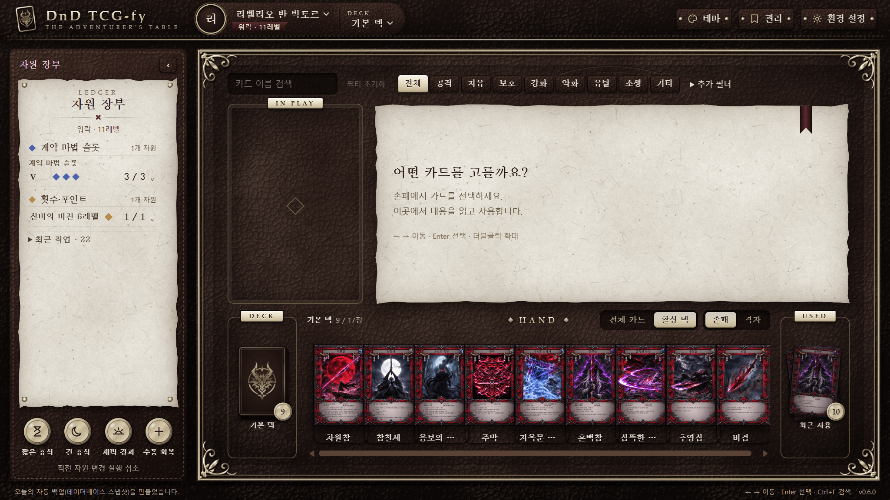
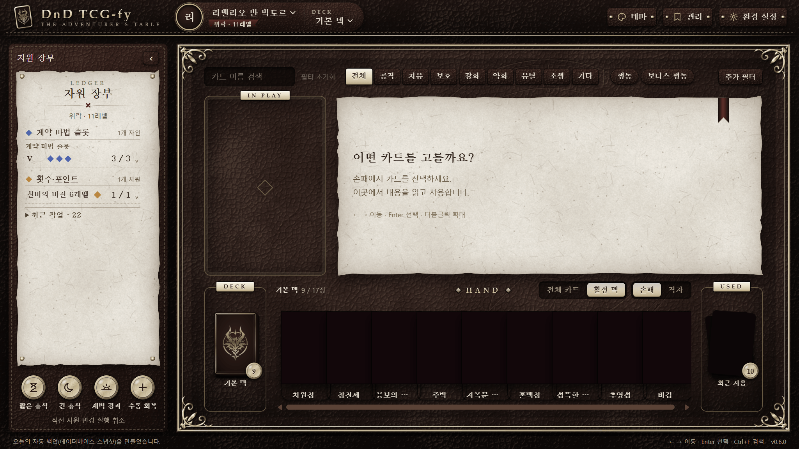
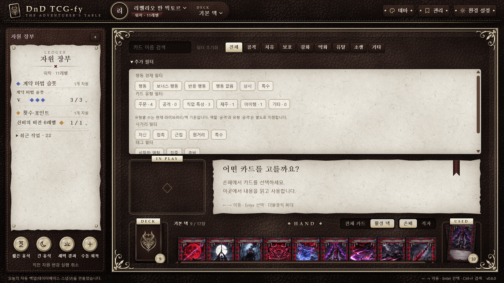
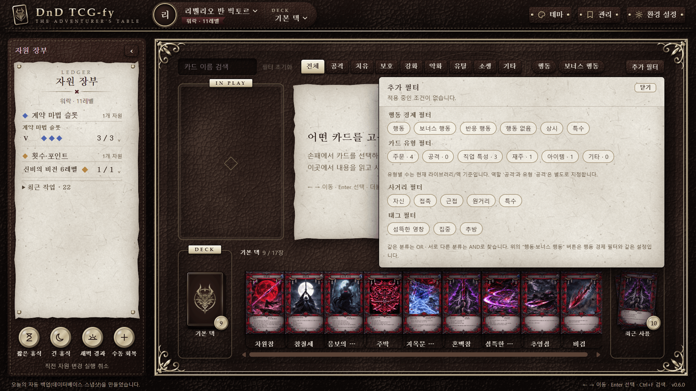
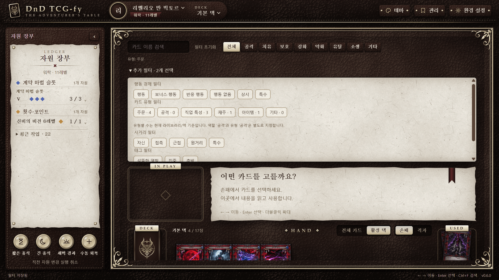
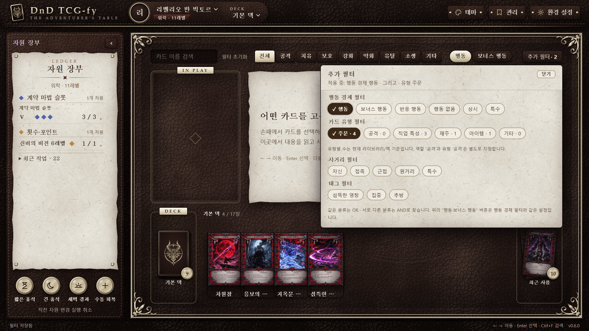
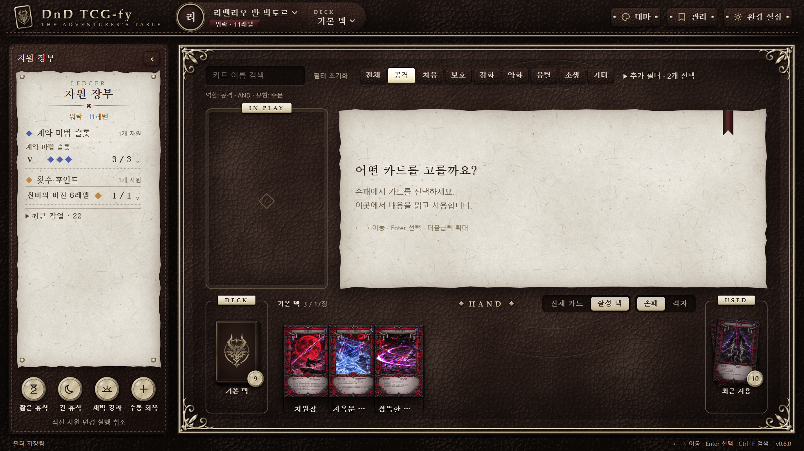
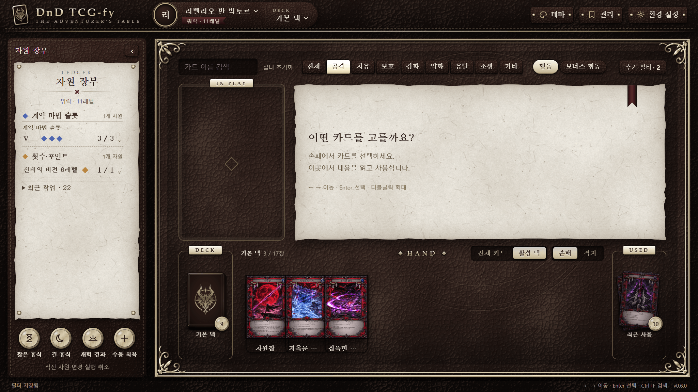

# v1.1 Phase 1 보고서 — 필터 UI·화면 배치

- 기준: `4122033`(P5, 0.6.0) → 브랜치 `feat/v1.1-phase1`
- 범위: [V1_1_PLAN.md](V1_1_PLAN.md)의 Phase 1 네 항목만. DB·스키마·IPC·설정 형식 변경 없음, 앱 버전 0.6.0 유지.
- 상태: **구현·검증 완료, 사용자 승인 대기.** Phase 2는 승인 전까지 시작하지 않는다.

## 1. 바뀐 점

| 항목 | 변경 전 | 변경 후 |
| --- | --- | --- |
| 추가 필터 | `<details>`가 아래로 펼쳐져 IN PLAY·손패를 밀어냄 | 브라우저 기본 팝오버(`popover="auto"`)로 위에 겹쳐 표시. 버튼에 붙어 화면 안쪽으로 자동 배치(아래 공간이 없으면 위·왼쪽으로 뒤집음), 최대 높이를 넘으면 내부 스크롤 |
| 닫기 | 다시 클릭 | 바깥 클릭·ESC·“닫기” 버튼. 칩을 여러 개 고르는 동안에는 열려 있음. 닫으면 “추가 필터” 버튼으로 포커스 복귀 |
| 필터 줄 높이 | 선택 요약 줄이 생기면 33 → 59px로 늘어남 | 38px 한 줄 고정. 칩이 넘치면 칩 영역만 가로 스크롤. 요약은 팝오버 상단과 버튼 툴팁(`적용 중: …`)으로 이동 |
| 선택 표시 | 스타일 우선순위 충돌로 선택해도 거의 구분되지 않음 | 진한 잉크 바탕 + 흰 굵은 글자 + 테두리 + **✓** (색만으로 구분하지 않음). 모든 그룹 같은 규칙 |
| 행동 빠른 선택 | 없음 | 역할 칩 옆에 구분선으로 나눈 **행동 · 보너스 행동** 그룹. 추가 필터의 행동 경제와 같은 `actions` 상태를 쓰므로 항상 같은 값이 보이고 중복 적용이 없음. 역할과는 AND |

수정 파일: `src/components/Filters.tsx`, `src/theme-playmat.css`. E2E 도우미는 `scripts/navigation-helpers.mjs`(팝오버 열기·닫기)로 바꿨고 기존 검사 의도는 그대로다. 결정 기록은 [DECISIONS.md](DECISIONS.md) 2026-11-18 항목.

## 2. 변경 전후

같은 데이터(`repository-data` 사본), 1366×768, 100%.

| 상태 | 변경 전 | 변경 후 |
| --- | --- | --- |
| 기본 |  |  |
| 추가 필터 열림 |  |  |
| 추가 필터 선택(행동·주문) |  |  |
| 역할·유형 적용 후 닫힘 |  |  |

높이(px, 위치/높이) — 원본 수치: `before-metrics.json`, `after-metrics.json`

| 상태 | 필터 줄 전 → 후 | 손패 줄 전 → 후 |
| --- | --- | --- |
| 기본 | 33 → 38 | 227 → 223 |
| 추가 필터 열림 | 306 → **38** | 130 → **223** |
| 추가 필터 선택 | 331 → **38** | 130 → **223** |
| 역할·유형 적용 | 59 → **38** | 202 → **223** |

변경 후에는 네 상태 모두 필터 줄·IN PLAY·손패의 위치와 크기가 같다. 대가로 기본 상태의 필터 줄이 5px 높아져(알약형 버튼 수용) 손패 줄이 4px 줄었다.

## 3. 검증 결과

| 지시서 체크 항목 | 방법 | 결과 |
| --- | --- | --- |
| 추가 필터 팝오버 표시 및 닫기 | E2E: 열기, 바깥 클릭 닫기, Enter 열기 → Tab 진입 → ESC 닫기 → 버튼 포커스 복귀, 칩 3개 선택 중 열림 유지 | 통과 |
| 팝오버가 손패·주변 레이아웃을 밀지 않음 | E2E: 열기 전·연 뒤·선택 중·닫고 역할+빠른 선택 적용 후 필터 줄/IN PLAY/손패 사각형이 정확히 같은지 비교(9개 크기·배율 조합) | 통과 |
| 필터 추가·삭제 시 중앙 영역 높이 유지 | 위와 같음 + 손패 가로 스크롤 위치 유지(150%, 넘침 338px에서 위치 91px → 필터 변경 후 91px) | 통과 |
| 선택된 필터 버튼 활성 표시 | E2E: 선택 칩의 `::before`가 “✓”, 비선택은 없음, 배경색 다름(`rgb(58,40,23)` vs `rgba(255,252,244,.45)`), 굵기 700 / 단위 테스트: 네 그룹 모두 `aria-pressed` 표시 | 통과 |
| 필터 초기화 및 상태 복원 | E2E: 초기화 즉시 선택 표시 0개, 닫았다 다시 열어도 선택 유지 / 기존 E2E: 앱 재시작 후 필터 복원 | 통과 |
| 행동·보너스 행동 필터 | E2E: 빠른 선택 ↔ 추가 필터 양방향 동기화, 같은 표시 카드 수, 역할과 AND로 결과가 줄어듦 / 단위 테스트 | 통과 |
| 기본·추가 필터 상태 동기화 | 위와 같음 | 통과 |
| 역할·유형·태그 복합 필터 회귀 | 기존 E2E(역할 OR + 행동·유형·사거리·태그·이름 AND, 재시작 복원), `filterCards` 단위 테스트 | 통과 |
| ESC가 팝오버만 닫는지 | E2E: 카드 선택 상태에서 팝오버를 ESC로 닫아도 카드 선택 유지 | 통과 |
| Windows 실행·화면 배율 | 아래 표 | 통과(배율은 아래 제한 참고) |

### 실행 환경별

`scripts/v11-p1-e2e.mjs` 8개 검사, 각 실행은 `repository-data` 사본만 사용(실제 `%APPDATA%` 미접촉).

| 환경 | 결과 |
| --- | --- |
| 빌드 번들(`dist/`) | 8/8 통과 |
| Windows 개발 모드(Vite `--dev`) | 8/8 통과 |
| 패키징 EXE(`release/win-unpacked/DnD TCG-fy.exe`, `npm run pack:win`) | 8/8 통과 |

크기·배율 매트릭스(모든 조합에서 팝오버가 화면 안, 레이아웃 불변):

| 창 크기 | 100% | 125% | 150% |
| --- | --- | --- | --- |
| 1280×720 | 통과 | 통과(팝오버 내부 스크롤) | 통과(팝오버 내부 스크롤) |
| 1366×768 | 통과 | 통과 | 통과(팝오버 내부 스크롤) |
| 1920×1080 | 통과 | 통과 | 통과 |

### 회귀·품질 게이트

- `npm run lint` 통과(경고 0), `npm run typecheck` 통과.
- `npm test`: **423/423 통과**(새 `tests/FiltersUI.test.tsx` 5개 포함). 단, 테스트 파일 2개(`tests/p11.test.tsx`, `tests/P4BUI.test.tsx`)는 이 PC의 Node 22.20에서 `node:sqlite`를 묶지 못해 **로드되지 않았다**(변경 전 `4122033`에서도 같음, 프로젝트 요구는 Node 24). 두 파일은 필터 UI를 다루지 않는다.
- 기존 E2E(빌드 번들): 메인 38개 PASS, P4-A, P4-B(200장 성능 포함), P4-C, P5 모두 통과. 메인 E2E는 패키징 EXE에서도 38개 PASS.

## 4. 미검증·제한

- **실제 Windows 디스플레이 배율 설정:** 125%·150%는 Chromium `--force-device-scale-factor`로 재현했다. Windows 설정에서 배율을 바꾼 실제 모니터 확인은 **미검증**.
- **테스트 파일 2개(Node 24 필요):** 위 `p11`·`P4BUI`는 Node 22 환경 문제로 **미검증**(필터와 무관).
- **NSIS 설치 파일:** 이번 단계에서 다시 만들지 않았다(폴더형 EXE만 검증). 설치·업그레이드는 **미검증**.
- **스크린 리더 실사용·터치 입력:** 역할·이름(접근성 트리)만 확인했고 실제 낭독기·터치 화면은 **미검증**.
- 검색 칸에 포커스가 있을 때 ESC는 브라우저가 검색어 지우기로 먼저 처리한다(팝오버는 바깥 클릭·“닫기”·다시 ESC로 닫힘).
- 팝오버 위치는 CSS 앵커 배치를 쓴다. Electron 45(Chromium 140)에서 지원되며 다른 브라우저 엔진은 대상이 아니다.

## 5. 재현

```powershell
npm run build; node scripts/v11-p1-e2e.mjs            # 빌드 번들
node scripts/v11-p1-e2e.mjs --dev                       # 개발 모드
npm run pack:win
$env:DND_TCG_EXECUTABLE = "$PWD\release\win-unpacked\DnD TCG-fy.exe"; node scripts/v11-p1-e2e.mjs
```
