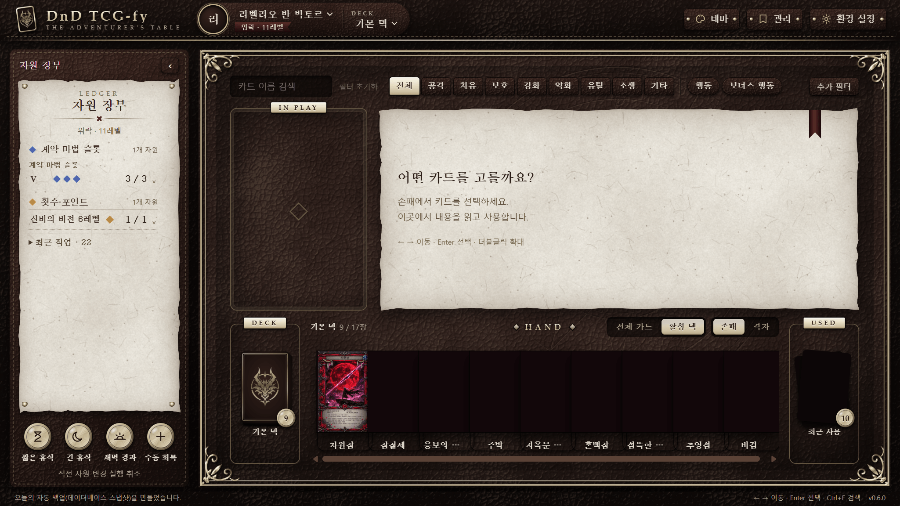
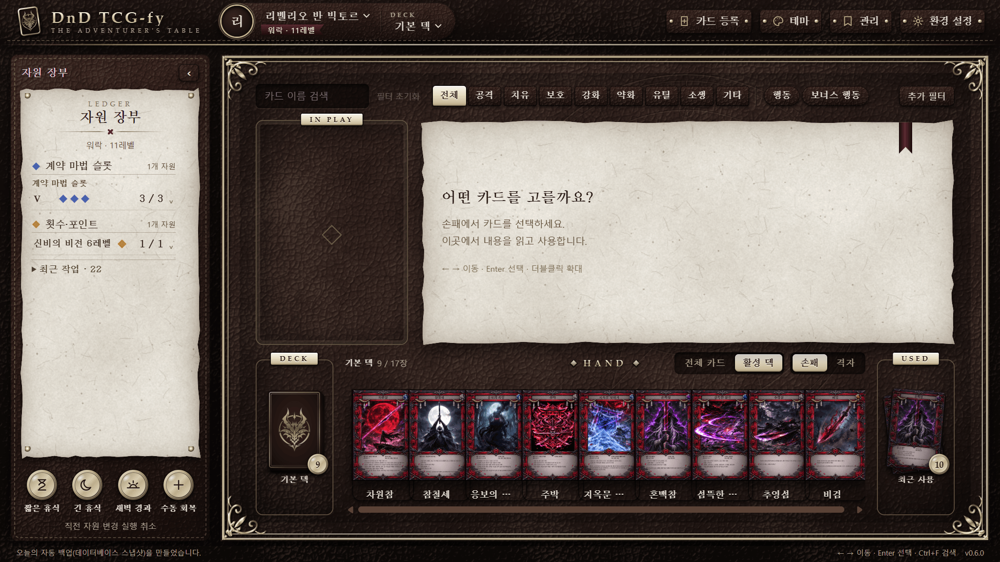
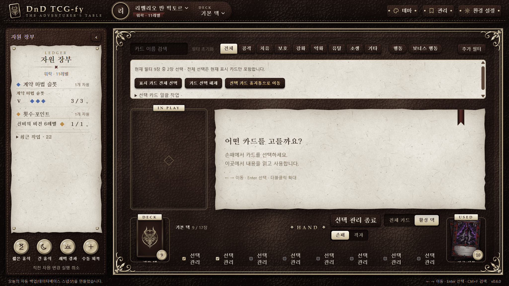
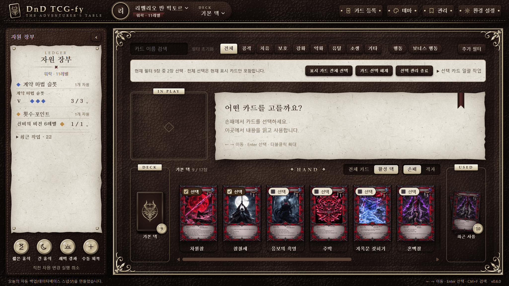
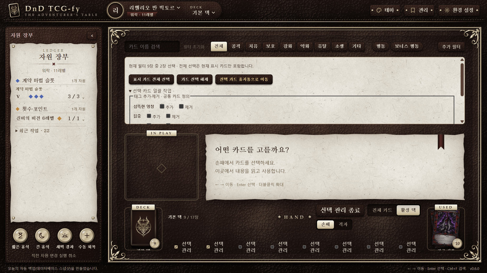
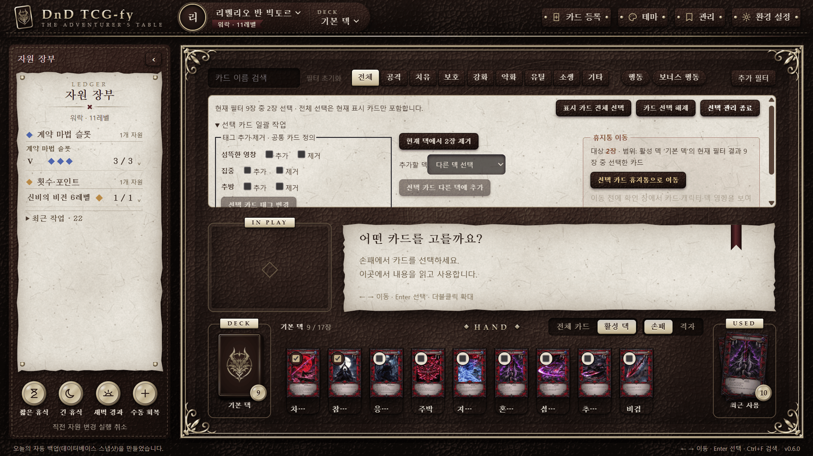
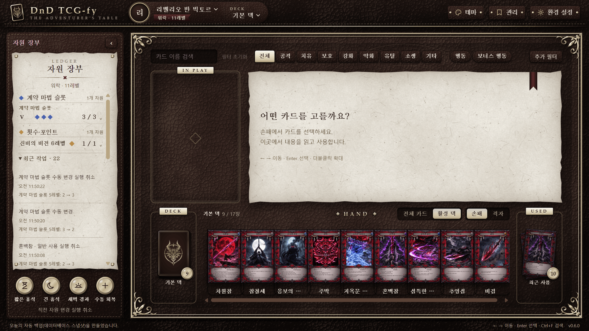
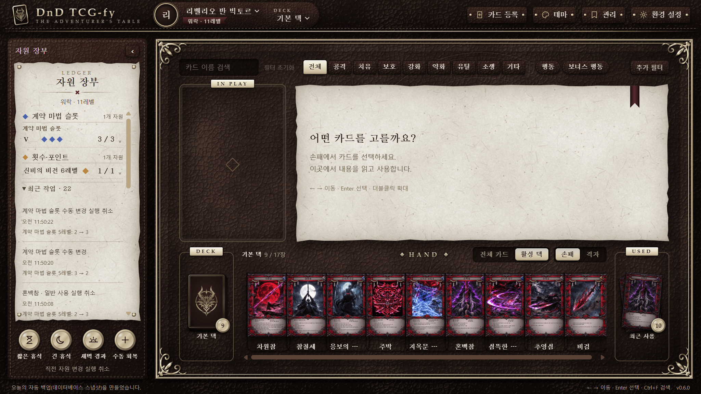

# v1.1 Phase 2 보고서 — 카드·기록 관리 UI

- 기준: Phase 1 `ca02eba` → 브랜치 `feat/v1.1-phase2`
- 범위: [V1_1_PLAN.md](V1_1_PLAN.md)의 Phase 2 네 항목. SQLite v6·IPC 채널 변경 없음, 앱 버전 0.6.0 유지.
- 상태: **구현·검증 완료, 사용자 승인 대기.** Phase 3은 승인 전까지 시작하지 않는다.

## 1. 바뀐 점

| 항목 | 변경 전 | 변경 후 |
| --- | --- | --- |
| 카드 등록 | 관리 메뉴 안에서만 열 수 있음 | 상단 버튼 줄에 **카드 등록**(테마·관리·환경 설정 옆). 기존 등록 창을 그대로 열고, 저장하면 활성 캐릭터의 활성 덱에 자동 연결. 버튼 툴팁에 등록 대상 표시. 취소는 아무것도 바꾸지 않음. 관리 메뉴의 항목도 유지 |
| 선택 카드 휴지통 이동 | 선택 관리 첫 줄에 항상 노출 | “선택 카드 일괄 작업”을 펼쳤을 때만 보이는 **휴지통 이동** 구역으로 이동. `대상 N장 · 범위: <전체 라이브러리/활성 덱 ‘이름’>의 현재 필터 결과 M장 중 선택한 카드` 표시. 확인 창·휴지통 복원·하단 실행 취소는 그대로 |
| 선택 관리 종료 | 손패 도구줄(전체 카드/활성 덱 옆) | 휴지통 버튼이 있던 자리(선택 관리 첫 줄 셋째)로 이동. 종료하면 선택 해제, 체크박스·일괄 작업 UI 숨김, 손패로 포커스 복귀. 데이터는 바꾸지 않음 |
| 최근 작업 | 비울 수 없음 | **기록 비우기**: 확인 창에서 범위를 안내한 뒤 목록 표시만 정리. 자원 현재량·사용 기록·Undo는 그대로. 재시작해도 유지되며 **숨긴 기록 다시 표시**로 되돌릴 수 있음 |

### 함께 고친 것(같은 흐름의 결함)

- **선택 관리 중 카드가 가려짐:** 카드마다 “선택 관리” 체크 줄이 카드 위에 쌓여 플레이 매트 손패에서 카드 그림이 밀려 보이지 않았다(변경 전 스크린샷 참고). 체크를 카드 왼쪽 위 모서리에 겹쳐 “선택”으로 줄였다(접근성 이름 `<카드> 일괄 선택`은 유지).
- **선택 관리 줄 공간:** 접힌 상태에서는 상태·버튼·“선택 카드 일괄 작업”을 한 줄로 두고, 펼치면 태그 | 덱 | 휴지통 세 칸으로 나란히 보인다. 선택 관리 중에는 IN PLAY 영역이 먼저 줄어 손패가 공간을 갖고, 공간이 부족하면 카드가 작아져(최소 너비 84 → 56px) 잘리지 않는다.

### 데이터

- 기록 비우기는 `play_events`를 지우지 않는다. 캐릭터별 표시 지점(`{clearedEventId, clearedAt}`)을 `settings`의 새 `history_view` 키에 저장한다. 계약은 [DATA_SCHEMA_V1_1.md](DATA_SCHEMA_V1_1.md). 기존 키는 그대로라 0.6.0도 같은 DB를 연다.
- 결정 기록은 [DECISIONS.md](DECISIONS.md) 2026-11-18 Phase 2 항목.

## 2. 변경 전후

같은 데이터(`repository-data` 사본), 1366×768, 100%.

| 화면 | 변경 전 | 변경 후 |
| --- | --- | --- |
| 메인(상단 카드 등록) |  |  |
| 선택 관리(접힘, 2장 선택) |  |  |
| 선택 카드 일괄 작업 펼침 |  |  |
| 최근 작업 |  |  |

변경 후 추가 화면: [카드 등록 창](docs/screenshots/v1.1-p2/after-register.png) · [기록 비우기 확인](docs/screenshots/v1.1-p2/after-history-confirm.png) · [비운 뒤](docs/screenshots/v1.1-p2/after-history-cleared.png)

## 3. 검증 결과

`scripts/v11-p2-e2e.mjs` 9개 검사(사본 데이터, 재시작 포함):

| 지시서 체크 항목 | 확인한 내용 | 결과 |
| --- | --- | --- |
| 메인 화면 카드 등록 | 상단 버튼이 기존 등록 창을 엶, 툴팁 `리벨리오 반 빅토르 · 기본 덱에 등록`, 취소 시 카드·덱 완전 동일 | 통과 |
| 카드 비용 및 활성 덱 연결 | 이미지·이름·태그(섬뜩한 영창)·비용(신비의 비전 6레벨 1회)을 한 번에 등록 → 활성 덱 포함, 다른 카드 불변, 그 카드로 실제 사용·자원 차감 | 통과 |
| 선택 관리 진입·종료 | 첫 줄 [표시 카드 전체 선택][카드 선택 해제][선택 관리 종료], 손패 도구줄에서 제거, 종료 시 체크·막대 사라짐·포커스 손패 복귀·카드/덱 불변, 다시 들어가면 선택 해제 상태 | 통과 |
| 일괄 작업 영역의 휴지통 이동 | 접힌 동안 버튼 안 보임, 펼치면 `대상 2장 · 범위: 활성 덱 ‘기본 덱’의 현재 필터 결과 10장 중 선택한 카드` | 통과 |
| 삭제 확인·복원 및 기존 휴지통 기능 | 확인 창 ESC 취소 시 불변, 확정 시 덱에서 숨김, 하단 “실행 취소 · 2장”으로 같은 ID·덱 소속 복원, 휴지통 관리자에서 개별 복원 | 통과 |
| 최근 작업 비우기 | 확인 창에 범위 안내(자원·사용 기록·Undo·재시작), 취소 시 불변, 확정 시 `최근 작업 · 0` | 통과 |
| 자원 상태·Undo 보존 | 비우기 전후 자원·이벤트·revision·Undo 대상 동일, 숨긴 카드 사용을 Undo로 되돌림, 재시작 후에도 비운 상태 유지, 전체 카드 사용 기록에 그 사용이 남아 있음, 다시 표시로 24건 복원 | 통과 |
| 기존 카드·덱·데이터 유지 | 각 단계에서 카드·덱 전체 비교, 마지막에 카드 ID 집합 비교 | 통과 |
| 화면 배율 | 100/125/150%에서 상단 버튼이 화면 안·이름판과 겹치지 않음, 선택 관리(접힘·펼침)에서 카드가 일반 화면 이상으로 보임 | 통과(아래 제한 참고) |

### 실행 환경별

| 환경 | Phase 2 E2E |
| --- | --- |
| 빌드 번들(`dist/`) | 9/9 통과 |
| Windows 개발 모드(Vite `--dev`) | 9/9 통과 |
| 패키징 EXE(`release/win-unpacked/DnD TCG-fy.exe`, `npm run pack:win`) | 9/9 통과 |

### 회귀·품질 게이트

- `npm run lint` 통과(경고 0), `npm run typecheck` 통과.
- `npm test`: **431/431 통과**(새 `tests/ManagementUI.test.tsx` 5개, `App.test` 2개, `store.test` 1개 추가). Phase 1 보고서와 같이 `tests/p11.test.tsx`·`tests/P4BUI.test.tsx`는 이 PC의 Node 22.20에서 `node:sqlite`를 묶지 못해 **로드되지 않았다**(변경 전에도 같음, 프로젝트 요구는 Node 24).
- 기존 E2E(빌드 번들): 메인 38개 PASS, P4-A, P4-B, P4-C, P5, v1.1 Phase 1 모두 통과. 메인 E2E는 패키징 EXE에서도 38개 PASS.
- E2E 변경: 휴지통 이동이 접힌 영역 안으로 옮겨져 `scripts/trash-scenarios.mjs`·`bulk-scenarios.mjs`가 `openBulkActions` 도우미로 먼저 펼친다. 검사 의도는 그대로다.
- 첫 패키징 시도는 EXE 파일 잠금(`EBUSY`)으로 실패했다. 실행 중인 앱은 없었고, 다시 패키징해 성공한 EXE로 위 EXE 검사를 다시 실행했다.

## 4. 미검증·제한

- **1366×768에서 125%·150% 배율:** 일반 플레이 화면에서도 손패 카드가 일부만 보인다(첫 카드 기준 56%·47%). Phase 2 이전부터 있던 상태로, 이번 변경 범위가 아니어서 고치지 않았다. 선택 관리 화면은 이보다 더 많이 보인다(71~87%). 100%와 1920×1080 계열은 전부 보인다.
- **실제 Windows 디스플레이 배율 설정:** Chromium `--force-device-scale-factor`로 재현했고, Windows 설정을 바꾼 실제 화면은 **미검증**.
- **NSIS 설치 파일:** 다시 만들지 않았다(폴더형 EXE만 검증). **미검증**.
- **스크린 리더·터치:** 접근성 이름과 포커스 이동만 확인했고 실제 낭독기·터치는 **미검증**.
