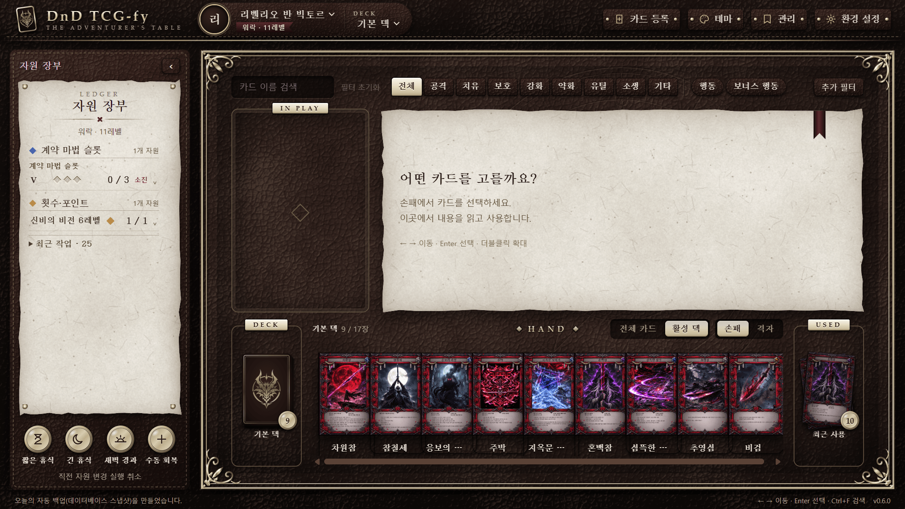
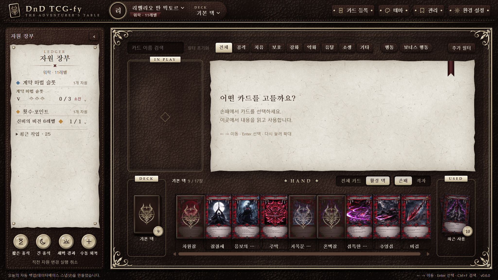
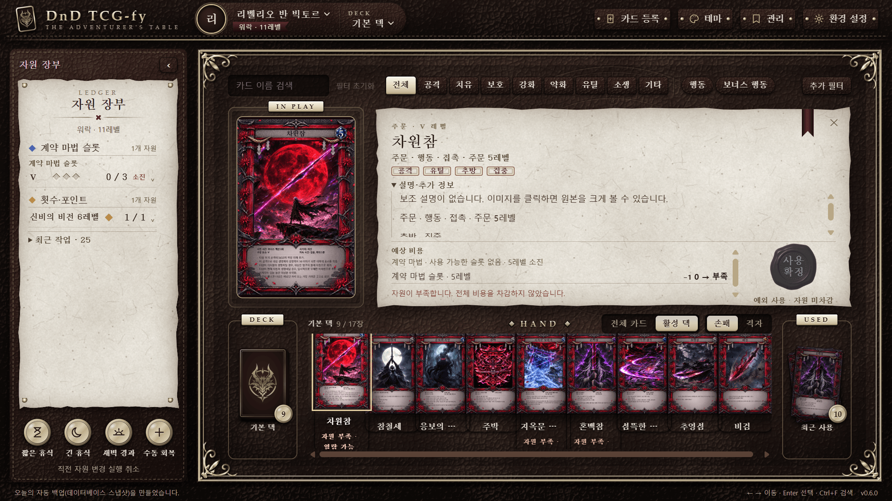
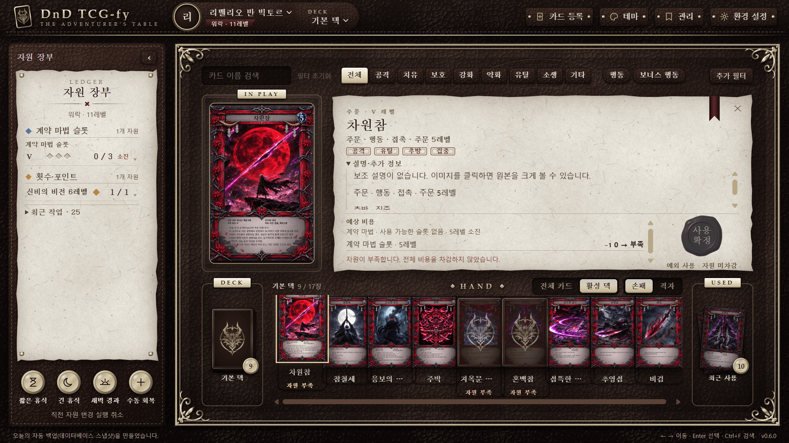
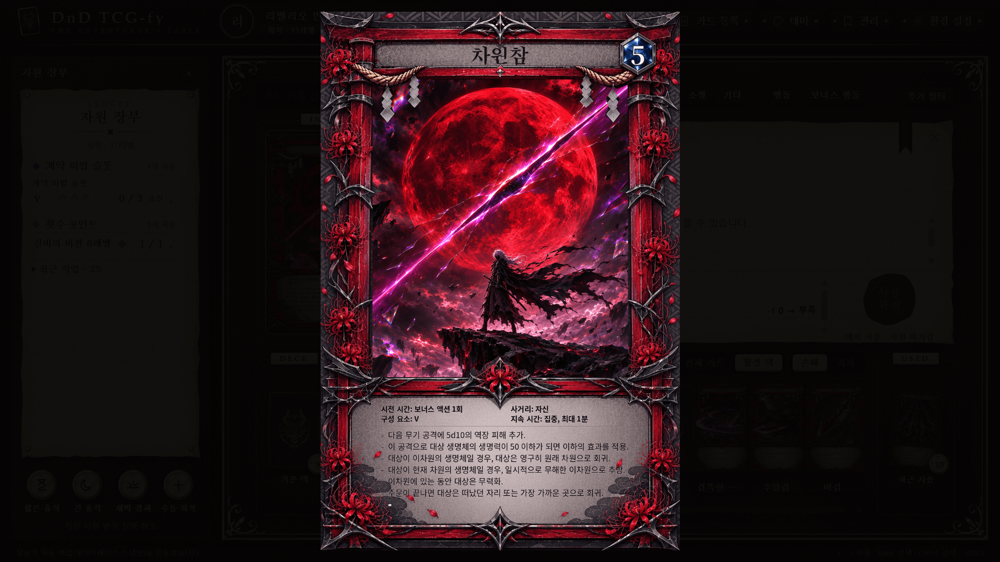
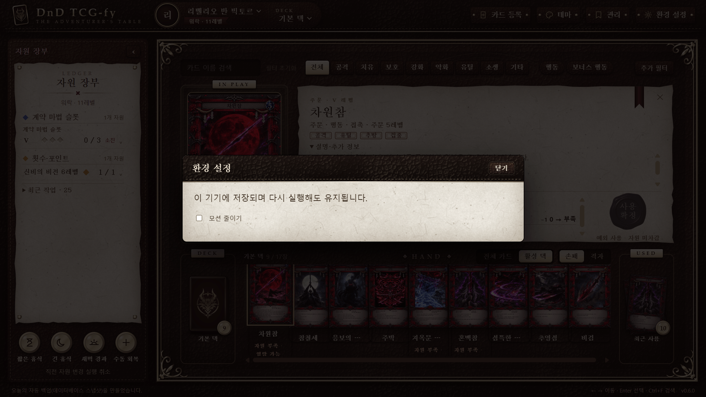
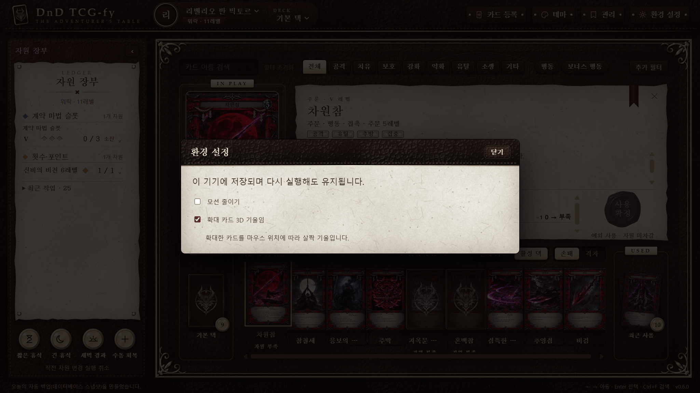

# v1.1 Phase 3 보고서 — 카드 조작·시각 효과

- 기준: Phase 2 `dd93779` → 브랜치 `feat/v1.1-phase3`
- 범위: [V1_1_PLAN.md](V1_1_PLAN.md)의 Phase 3 네 항목. SQLite v6·IPC 채널 변경 없음, 앱 버전 0.6.0 유지.
- 상태: **구현·검증 완료, 사용자 승인 대기.** Phase 4는 승인 전까지 시작하지 않는다.

## 1. 바뀐 점

| 항목 | 변경 전 | 변경 후 |
| --- | --- | --- |
| 확대 | 손패 카드 **더블클릭**. 선택한 카드를 다시 누르면 선택 해제 | 누르면 선택, **선택한 카드를 다시 누르면 확대**(마우스·Enter·Space 동일). 다른 카드를 누르면 선택만 바뀜. IN PLAY 미리보기는 한 번에 확대. 손패 드래그는 재클릭이 아님. 닫아도 선택·포커스 유지. 선택 해제는 ✕ 또는 ESC |
| 사용 불가 카드 | 손패에서 겉모습이 같음(격자·선택 시 “자원 부족 · 열람 가능” 문구만) | 활성 캐릭터가 지금 쓸 수 없는 카드에 **현재 덱의 카드 뒷면**(DECK 더미와 같은 에셋)을 불투명도 75%로 겹침. 선택하면 사라져 원본이 보이고, 확대·IN PLAY는 항상 원본. 자원을 쓰거나 회복하면 바로 반영. 문구는 “자원 부족”으로 줄임 |
| 선택 효과 | 8px 상승(0.16초) | 12px 상승 + 테두리·빛 전환(0.2초, 완만한 감속) |
| 확대·축소 전환 | 없음(바로 표시) | 누른 카드(또는 IN PLAY 미리보기) 위치에서 같은 비율로 커지며 중앙으로, 닫으면 그 자리로 줄어듦(0.22초). 회전·흔들림·파티클 없음 |
| 3D 기울임 | 없음 | 확대 카드가 커서 쪽으로 최대 6° 기울고, 커서가 나가면 원위치. 환경 설정 “확대 카드 3D 기울임”(기본 켬, 재시작 후 유지) |
| 모션 줄이기 | 선택 상승 없음 | 상승·확대 전환·기울임 모두 끔(기울임 옵션은 꺼진 채 잠김). Windows의 동작 줄이기 설정도 따름 |

### 구현 메모

- 사용 가능 여부는 `usable`·`unconfigured`(비용 미설정)·`insufficient`(자원 부족)·`unbound`(비용 연결 확인)·`unknown`(캐릭터 없음)으로 내부 구분한다. 앞의 셋이 사용 불가이며 카드에 `data-usability`와 화면 읽기 설명(`사용 불가 · 자원 부족` 등)으로 남는다. 캐릭터가 없으면 판단할 수 없어 덮지 않는다.
- 오버레이는 원본 위에 겹친 별도 이미지라 원본 파일·표시는 그대로이고 클릭을 막지 않는다.
- 기울임은 이미지에만 걸고, 기울지 않는 카드 틀이 클릭 영역을 맡아 “카드 밖 클릭으로 닫기” 판정이 바뀌지 않는다.
- 닫는 중 다시 닫기 요청은 무시하고, 여는 중에 닫으면 현재 모습에서 이어서 돌아간다.
- 기울임 선택은 `settings`의 새 `effects` 키에 저장한다(0.6.0도 DB를 읽음). 계약은 [DATA_SCHEMA_V1_1.md](DATA_SCHEMA_V1_1.md), 결정은 [DECISIONS.md](DECISIONS.md) Phase 3 항목.

## 2. 변경 전후

같은 데이터(`repository-data` 사본), 1366×768, 100%. 계약 마법 슬롯을 0/3으로 소진한 상태.

| 화면 | 변경 전 | 변경 후 |
| --- | --- | --- |
| 사용 불가 카드(슬롯 소진) |  |  |
| 사용 불가 카드 선택 |  |  |
| 확대(원본) |  |  |
| 환경 설정 |  |  |

전환·기울임은 움직임이라 정지 화면으로 담기지 않는다. 아래 E2E가 시작·끝 상태를 수치로 확인했다.

## 3. 검증 결과

`scripts/v11-p3-e2e.mjs` 11개 검사(사본 데이터, 재시작 포함):

| 지시서 체크 항목 | 확인한 내용 | 결과 |
| --- | --- | --- |
| 카드 클릭 및 재클릭 확대 | 첫 클릭은 선택만, 재클릭·Enter로 확대, IN PLAY 미리보기 한 번에 확대, Space·다른 카드는 선택만, 자원 revision·이벤트 불변 | 통과 |
| 손패 드래그와 클릭 구분 | 선택한 카드에서 시작해 같은 카드 위에서 놓는 드래그는 확대하지 않음(선택 유지) | 통과 |
| 확대 종료 및 선택 상태 유지 | ESC·바깥 클릭 후 같은 카드 선택·포커스 유지 | 통과 |
| 사용 불가 카드 오버레이 | 슬롯 소진 시 해당 카드에 DECK과 같은 뒷면, 불투명도 0.75, `insufficient`, 원본 썸네일 주소 그대로 | 통과 |
| 자원 소모 후 카드 상태 변경 | 카드를 실제로 3번 사용해 슬롯이 바닥나자 오버레이가 다시 생김 | 통과 |
| 자원 회복 후 오버레이 제거 | 긴 휴식 확정 즉시 모든 오버레이 제거 | 통과 |
| 카드 확대·축소 애니메이션 | 여는 전환이 손패 카드 위치·크기(약 0.17배)에서 시작해 `none`으로, 닫는 전환이 그 자리로 끝남, 선택 카드 12px 상승 | 통과 |
| 연속 클릭 및 빠른 카드 전환 | 빠른 선택 전환, 여는 중 ESC, 세 번 연속 클릭 후에도 확대 창 1개 이하·선택 일관·이후 정상 확대 | 통과 |
| 3D 기울임 효과 ON/OFF | 커서 쪽으로 기울고(측정 4.8°, 최대 6°) 나가면 원위치, 기운 카드 모서리 클릭은 닫히지 않음, 끄면 기울지 않음, 재시작 후 유지 | 통과 |
| 모션 감소 설정 | 상승 없음(`transform: none`), 전환 없이 열고 즉시 닫힘, 기울임 없음, 옵션 잠김 | 통과 |
| 원본 카드 이미지 보존 | 전체 과정 전후 `assets/` 파일 SHA-256 동일, 확대는 원본 주소 | 통과 |
| 화면 배율 | 125%·150%에서 확대 카드가 창 안 | 통과 |

### 실행 환경별

| 환경 | Phase 3 E2E |
| --- | --- |
| 빌드 번들(`dist/`) | 11/11 통과 |
| Windows 개발 모드(Vite `--dev`) | 11/11 통과 |
| 패키징 EXE(`release/win-unpacked/DnD TCG-fy.exe`, `npm run pack:win`) | 11/11 통과 |

### 회귀·품질 게이트

- `npm run lint` 통과(경고 0), `npm run typecheck` 통과.
- `npm test`: **437/437 통과**(새 `tests/CardEffectsUI.test.tsx` 5개, `store.test` 1개 추가, P4-C 클릭 테스트를 새 동작으로 교체). 이전 보고서와 같이 `tests/p11.test.tsx`·`tests/P4BUI.test.tsx`는 이 PC의 Node 22.20에서 **로드되지 않았다**(변경 전에도 같음, 프로젝트 요구는 Node 24).
- 기존 E2E(빌드 번들): 메인 38개 PASS, P4-A, P4-B, P4-C, P5, v1.1 Phase 1·2 모두 통과. 메인 E2E는 패키징 EXE에서도 38개 PASS.
- 새 동작에 맞춘 E2E 변경(검사 의도는 유지):
  - P4-C: 더블클릭 확대 → 재클릭 확대. 드래그 검사는 “선택한 카드에서 시작해 같은 카드 위에서 놓기”로 더 엄격하게 바꿨다.
  - P4-B: 선택한 카드에서 Enter → 선택 해제 대신 확대 → ESC 후 선택·포커스 유지를 확인한다. 카드 선택은 이미 선택돼 있으면 다시 누르지 않는다.
  - P4-B·P4-C: 확대를 ESC로 닫은 뒤 닫힘 전환(0.22초)이 끝나기를 기다린 다음 포커스·창 수를 확인한다.
  - Phase 2 E2E: 다시 눌러 선택 해제하던 단계를 ✕(카드 선택 닫기)로 바꿨다.
- 첫 전체 실행에서 P4-B·P4-C가 위의 옛 동작 가정 때문에 실패했고, 스크립트를 고친 뒤 빌드 번들에서 다시 통과했다. 앱 코드는 바뀌지 않았으므로 그 전에 만든 EXE의 검사 결과(Phase 3·메인 E2E)는 유효하다.

## 4. 미검증·제한

- **실제 Windows 디스플레이 배율·Windows 동작 줄이기 설정:** 배율은 Chromium `--force-device-scale-factor`로, 모션 줄이기는 앱 설정으로 확인했다. Windows 설정 자체를 바꾼 상태는 **미검증**.
- **전환의 체감 품질:** 시작·끝 상태와 시간은 수치로 확인했지만 부드러움은 사람이 봐야 한다. 직접 확인을 권한다.
- **NSIS 설치 파일:** 다시 만들지 않았다(폴더형 EXE만 검증). **미검증**.
- **터치·펜 입력:** 기울임은 마우스에서만 동작하도록 했고 터치 화면은 **미검증**.
- 확대를 닫으면 포커스는 닫힘 전환(0.22초)이 끝난 뒤 카드로 돌아간다(모션 줄이기면 즉시).
- Phase 2 보고서의 1366×768 125%·150% 손패 카드 잘림(이전부터 있던 문제)은 이번 범위가 아니어서 그대로다.
