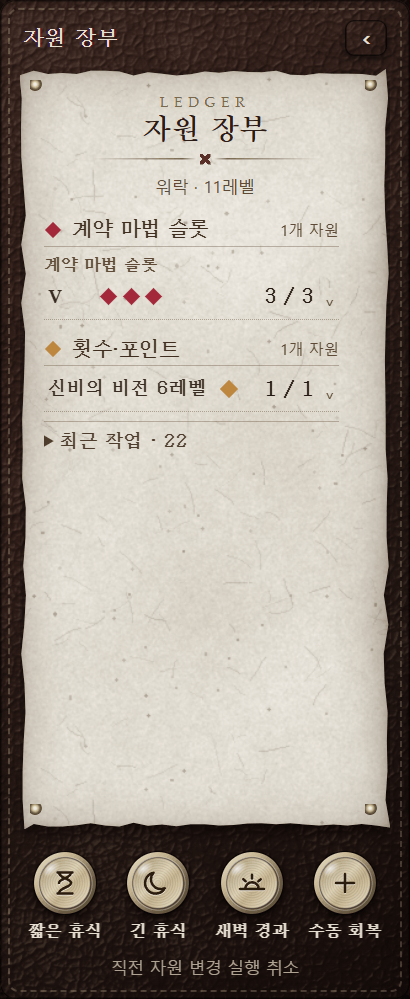

# v1.1 Phase 4 보고서 — 사용자 지정 디자인

- 기준: Phase 3 `e74463b` → 브랜치 `feat/v1.1-phase4`
- 범위: [V1_1_PLAN.md](V1_1_PLAN.md)의 Phase 4 두 항목. SQLite v6·IPC 채널 변경 없음, 앱 버전 0.6.0 유지.
- 상태: **1. 주문 슬롯 색상 — 구현·검증 완료. 2. 전용 커서 — 시안 제시, 사용자 승인 대기**(지시서: 기존 커서 에셋이 없으면 시안 승인 후 적용). 커서 적용과 Phase 4 전체 회귀 검증은 승인 뒤에 이어서 한다.

## 1. 주문 슬롯 색상

| 항목 | 내용 |
| --- | --- |
| 위치 | 관리 → 자원 관리 맨 위 “주문 슬롯 색상 · <캐릭터>” |
| 대상 | 그 캐릭터가 가진 일반 주문 슬롯·계약 마법 슬롯(없는 종류는 표시하지 않음) |
| 색 | 보석 팔레트 8색(사파이어=기본, 루비, 에메랄드, 자수정, 황옥, 청록석, 장미석, 흑요석) + 직접 선택 |
| 레벨별 | “레벨별로 지정”을 켜면 가진 슬롯 레벨마다 따로 지정 |
| 복원 | “기본 색상으로 복원”은 현재 캐릭터의 지정만 지움 |
| 저장 | 고르는 즉시 저장, 캐릭터별, 재시작 후 유지(`settings`의 새 `slot_colors` 키, [DATA_SCHEMA_V1_1.md](DATA_SCHEMA_V1_1.md)) |

가독성:

- 팔레트는 모두 양피지 바탕 대비 3:1 이상이다(가장 낮은 에메랄드 3.9:1).
- 직접 고른 색이 3:1 미만이면 경고하고 보석에 어두운 테두리를 더한다.
- 채운 보석(색)·빈 보석(빈 홈 모양)·“2 / 3” 숫자·“소진” 표시는 그대로라 색만으로 상태를 전달하지 않는다.
- 기본 색은 지금과 같은 사파이어라 색을 바꾸지 않은 캐릭터는 겉모습이 같다. 변경 전후 장부 화면을 픽셀 비교했을 때 보석 줄은 동일했다.
- 색은 화면 표시에만 쓰이며 슬롯 수·사용·회복 계산과 사용 기록·Undo에는 영향이 없다.

| 화면 | 변경 전 | 변경 후 |
| --- | --- | --- |
| 자원 관리 |  |  |
| 자원 장부 |  |  |

### 검증(`scripts/v11-p4-e2e.mjs` 7개 검사, 사본 데이터·재시작 포함)

| 지시서 체크 항목 | 확인한 내용 | 결과 |
| --- | --- | --- |
| 주문 슬롯 색상 저장 및 복원 | 종류 색(루비)·레벨 색(에메랄드) 적용, 장부 보석·그룹 아이콘 실제 칠해진 색 확인, 기본 색상 복원 | 통과 |
| 캐릭터별 설정 독립성 | 다른 캐릭터(일반 슬롯)는 기본 색에서 시작, 자수정 지정 후 서로 영향 없음, 복원은 현재 캐릭터만 | 통과 |
| 자원 상태 가독성 | 색 지정 상태에서 슬롯 사용 → 숫자·빈 홈·“소진” 표시 유지, 저대비 직접 색은 경고+테두리 | 통과 |
| 계산 무영향 | 색 변경 전후 revision·이벤트·자원 값 동일, 사용·Undo 정상 | 통과 |
| 앱 재시작 후 설정 유지 | 재시작 후 두 캐릭터 색과 저장 형태 확인 | 통과 |
| 화면 배율 | 125%·150%에서 편집기가 가로 스크롤 없이 동작 | 통과 |

단위 테스트: `tests/SlotColorsUI.test.tsx`(대비·대체 규칙, 편집기 저장·레벨·복원·직접 색·잠금, 장부 보석), `tests/store.test.ts`(별도 키·형식 검증).

실행 환경별 결과와 회귀는 아래 4절.

## 2. 전용 커서 — 시안(승인 대기)

프로젝트에 커서 에셋이 없어 지시서대로 **시안만 만들었고 앱에는 적용하지 않았다.**

- 미리보기: [docs/design/cursors/preview.html](docs/design/cursors/preview.html) — 100·125·150% 크기, 가죽·양피지 위, 빨간 점이 클릭 지점. 아래 “직접 움직여 보기”에서 버튼·카드·손패 드래그·검색 칸 위로 실제 커서를 움직여 볼 수 있다(시안 A·B·시스템 커서 전환).
- 생성 스크립트: `scripts/design/cursors.mjs`(SVG 원본 `docs/design/cursors/*.svg`).

| | 기본 | 클릭 가능 | 손패 드래그 가능 | 드래그 중 |
| --- | --- | --- | --- | --- |
| 모양 | 화살표 | 검지를 편 장갑 | 편 손 | 쥔 주먹 |
| 클릭 지점 | 화살표 끝 (1, 1) | 검지 끝 (8, 1) | 손 중심 (12, 12) | 손 중심 (12, 12) |

- **시안 A · 철과 금:** 어두운 철 바탕에 금테. 가죽 매트·금속 장식과 같은 계열이며 양피지 위에서 특히 또렷하다.
- **시안 B · 상아와 잉크:** 상아색 바탕에 잉크 테, 루비 소매. 어두운 가죽 위에서 더 잘 보인다.
- 크기는 100%에서 24px(Windows 기본 커서와 비슷한 크기)이고 화면 배율에 맞춰 커진다. 실제 크기 비교: [sheet-actual.png](docs/design/cursors/sheet-actual.png)(위 두 줄 100%, 아래 두 줄 150%).

승인 후 적용 계획:

1. 고른 시안을 1×·2× PNG로 만들어 `image-set()`과 정확한 클릭 지점으로 지정한다(배율에서 흐려지지 않게).
2. 기본·버튼/카드·손패(잡기)·드래그 중에만 적용하고, 검색·이름 입력 같은 텍스트 칸은 시스템 텍스트 커서를 그대로 둔다.
3. 환경 설정에 “시스템 기본 커서 사용”을 두고 재시작 후 유지한다(기존 `effects` 키).
4. E2E로 요소별 커서 종류, 클릭 지점 픽셀(시각적 끝점과 일치), 100·125·150%, 카드 선택·드래그 동작을 확인하고 Phase 4 전체 회귀를 다시 돌린다.

## 3. 변경 파일

`src/shared/slot-colors.ts`(신규), `src/components/SlotColorEditor.tsx`(신규), `src/components/ResourceManager.tsx`, `src/components/ResourcePanel.tsx`, `src/App.tsx`, `src/shared/contracts.ts`, `electron/store.ts`, `src/theme-playmat.css`, 테스트·E2E, 커서 시안(`scripts/design/cursors.mjs`, `docs/design/cursors/`), 문서.

## 4. 실행 환경·회귀

| 환경 | Phase 4(슬롯 색상) E2E |
| --- | --- |
| 빌드 번들(`dist/`) | 7/7 통과 |
| Windows 개발 모드(Vite `--dev`) | 7/7 통과 |
| 패키징 EXE(`release/win-unpacked/DnD TCG-fy.exe`, `npm run pack:win`) | 7/7 통과 |

- `npm run lint` 통과(경고 0), `npm run typecheck` 통과.
- `npm test`: **443/443 통과**(새 `tests/SlotColorsUI.test.tsx` 5개, `store.test` 1개 추가). 이전 단계와 같이 `tests/p11.test.tsx`·`tests/P4BUI.test.tsx`는 Node 22.20에서 로드되지 않았다.
- 기존 E2E(빌드 번들): 메인 38개 PASS, P4-A, P4-B, P4-C, P5, v1.1 Phase 1·2·3 모두 통과. 메인 E2E는 패키징 EXE에서도 38개 PASS.
- 패키징은 첫 시도가 실패하고 20초 뒤 자동 재시도에서 성공했다(첫 시도 로그는 재시도에 덮어써져 원인은 확인하지 못함, Phase 2 때는 EXE 파일 잠금이었다). EXE 검사는 재시도로 만든 EXE에서 실행했다.

## 5. 미검증·제한

- **커서 전체(유형별 표시·클릭 지점·배율·카드 선택/드래그와의 관계):** 시안 승인 전이라 앱에 적용하지 않았다. **미검증**.
- **실제 Windows 디스플레이 배율:** Chromium `--force-device-scale-factor`로 재현했다. **미검증**.
- **NSIS 설치 파일:** 다시 만들지 않았다(폴더형 EXE만). **미검증**.
- Node 24가 필요한 테스트 파일 2개는 이전 단계와 같이 이 PC에서 로드되지 않는다.
