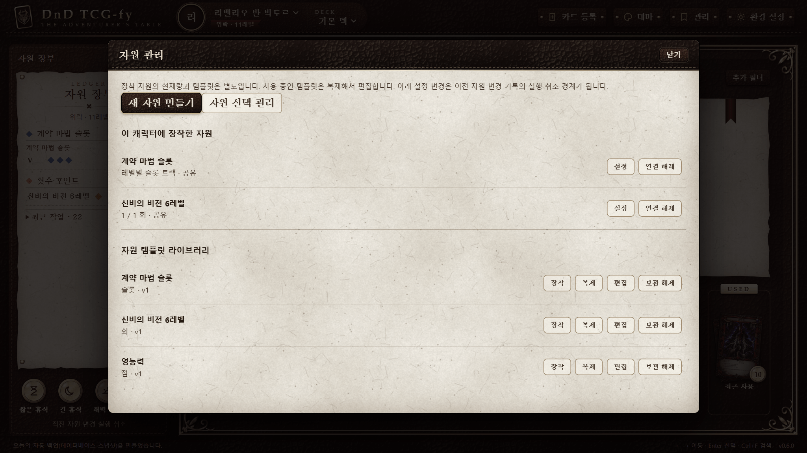
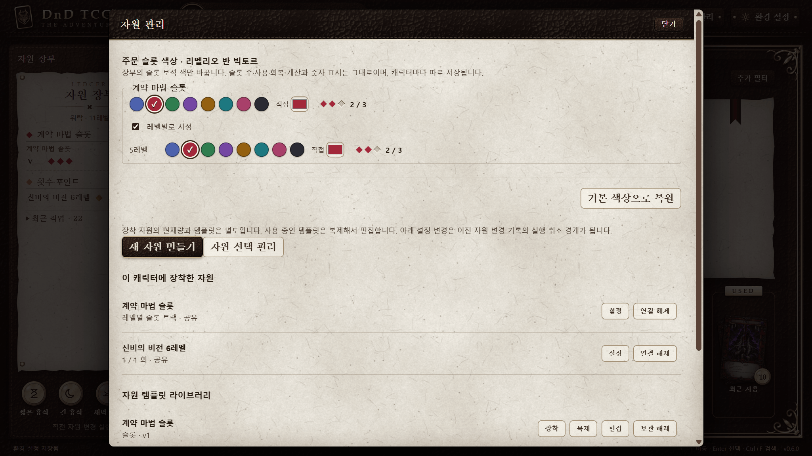
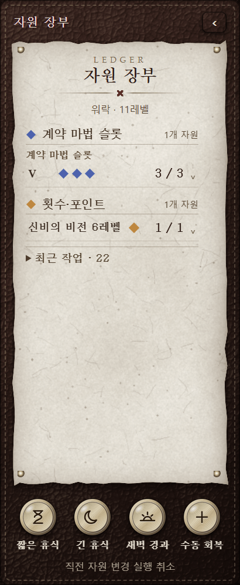
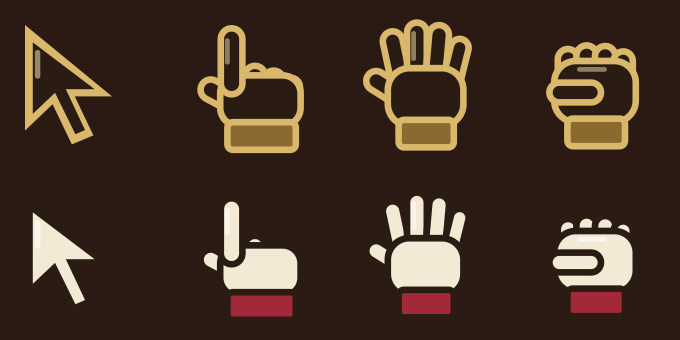

# v1.1 Phase 4 보고서 — 사용자 지정 디자인

- 기준: Phase 3 `e74463b` → 브랜치 `feat/v1.1-phase4`
- 범위: [V1_1_PLAN.md](V1_1_PLAN.md)의 Phase 4 두 항목. SQLite v6·IPC 채널 변경 없음, 앱 버전 0.6.0 유지.
- 상태: **구현·검증 완료, 사용자 최종 검수 대기.** 1. 주문 슬롯 색상, 2. 전용 커서(사용자가 고른 시안 A 적용). 승인 없이 새 기능이나 다음 버전을 시작하지 않는다.

## 1. 주문 슬롯 색상

| 항목 | 내용 |
| --- | --- |
| 위치 | 관리 → 자원 관리 맨 위 “주문 슬롯 색상 · <캐릭터>” |
| 대상 | 그 캐릭터가 가진 일반 주문 슬롯·계약 마법 슬롯(없는 종류는 표시하지 않음) |
| 색 | 보석 팔레트 8색(사파이어=기본, 루비, 에메랄드, 자수정, 황옥, 청록석, 장미석, 흑요석) + 직접 선택 |
| 레벨별 | “레벨별로 지정”을 켜면 가진 슬롯 레벨마다 따로 지정 |
| 복원 | “기본 색상으로 복원”은 현재 캐릭터의 지정만 지움 |
| 저장 | 고르는 즉시 저장, 캐릭터별, 재시작 후 유지(`settings`의 새 `slot_colors` 키, [DATA_SCHEMA_V1_1.md](DATA_SCHEMA_V1_1.md)) |

가독성:

- 팔레트는 모두 양피지 바탕 대비 3:1 이상이다(가장 낮은 에메랄드 3.9:1).
- 직접 고른 색이 3:1 미만이면 경고하고 보석에 어두운 테두리를 더한다.
- 채운 보석(색)·빈 보석(빈 홈 모양)·“2 / 3” 숫자·“소진” 표시는 그대로라 색만으로 상태를 전달하지 않는다.
- 기본 색은 지금과 같은 사파이어라 색을 바꾸지 않은 캐릭터는 겉모습이 같다. 변경 전후 장부 화면을 픽셀 비교했을 때 보석 줄은 동일했다.
- 색은 화면 표시에만 쓰이며 슬롯 수·사용·회복 계산과 사용 기록·Undo에는 영향이 없다.

| 화면 | 변경 전 | 변경 후 |
| --- | --- | --- |
| 자원 관리 |  |  |
| 자원 장부 |  |  |

### 검증(`scripts/v11-p4-e2e.mjs` 7개 검사, 사본 데이터·재시작 포함)

| 지시서 체크 항목 | 확인한 내용 | 결과 |
| --- | --- | --- |
| 주문 슬롯 색상 저장 및 복원 | 종류 색(루비)·레벨 색(에메랄드) 적용, 장부 보석·그룹 아이콘 실제 칠해진 색 확인, 기본 색상 복원 | 통과 |
| 캐릭터별 설정 독립성 | 다른 캐릭터(일반 슬롯)는 기본 색에서 시작, 자수정 지정 후 서로 영향 없음, 복원은 현재 캐릭터만 | 통과 |
| 자원 상태 가독성 | 색 지정 상태에서 슬롯 사용 → 숫자·빈 홈·“소진” 표시 유지, 저대비 직접 색은 경고+테두리 | 통과 |
| 계산 무영향 | 색 변경 전후 revision·이벤트·자원 값 동일, 사용·Undo 정상 | 통과 |
| 앱 재시작 후 설정 유지 | 재시작 후 두 캐릭터 색과 저장 형태 확인 | 통과 |
| 화면 배율 | 125%·150%에서 편집기가 가로 스크롤 없이 동작 | 통과 |

단위 테스트: `tests/SlotColorsUI.test.tsx`(대비·대체 규칙, 편집기 저장·레벨·복원·직접 색·잠금, 장부 보석), `tests/store.test.ts`(별도 키·형식 검증).

실행 환경별 결과와 회귀는 아래 4절.

## 2. 전용 커서 — 시안 A “철과 금” 적용

프로젝트에 커서 에셋이 없어 지시서대로 시안 두 가지(A 철과 금, B 상아와 잉크)를 먼저 제시했고, 사용자가 **시안 A**를 골라 적용했다.

| 상태 | 쓰이는 곳 | 클릭 지점(100%) |
| --- | --- | --- |
| 기본 화살표 | 앱 전체 | 화살표 끝 (2, 2) |
| 검지를 편 장갑 | 버튼·카드·요약(펼치기)·선택 상자·라벨·IN PLAY 미리보기 | 검지 끝 (8, 2) |
| 편 손 | 손패 빈 곳(드래그로 넘길 수 있음) | 손 중심 (12, 12) |
| 쥔 주먹 | 손패를 드래그하는 동안 | 손 중심 (12, 12) |
| 시스템 텍스트 커서 | 검색·이름 등 글자 입력 칸(그대로 유지) | — |
| 시스템 금지 커서 | 비활성 버튼(그대로 유지) | — |

- 크기는 100%에서 24px이다. 1×·1.5×·2× PNG를 `image-set()`으로 지정해 배율에서도 흐리지 않다. 클릭 지점은 1× 기준 짝수 좌표라 1.5×·2×에서도 정확히 정수 픽셀이다.
- 환경 설정에 **“시스템 기본 커서 사용”**(기본 끔)을 두었고 재시작 후에도 유지된다(`effects.systemCursor`). 화면: [환경 설정](docs/screenshots/v1.1-p4/after-settings.png)
- 커서는 그림만 바꾸며 클릭 판정은 그대로다.
- 원본: `scripts/design/cursors.mjs`(시안 생성, `--apply a`로 앱 에셋 생성), `docs/design/cursors/`(시안·미리보기), `src/assets/cursors/`(적용 에셋·클릭 지점).

### 검증(Electron이 Windows로 보내는 실제 커서를 받아 확인)

| 지시서 체크 항목 | 확인한 내용 | 결과 |
| --- | --- | --- |
| 커서 유형별 표시 | 빈 곳=화살표, 버튼·카드=장갑, 손패 빈 곳=편 손, 드래그 중=주먹이 모두 전용(custom) 커서로 전달, 텍스트 칸=`text`, 비활성 버튼=`not-allowed` | 통과 |
| 커서 핫스팟 및 클릭 위치 | 전달된 클릭 지점이 에셋 정의×배율과 같고, 그 픽셀이 그림의 끝(칠해짐, 바로 위·왼쪽 위는 투명). 손은 손바닥 안 | 통과 |
| Windows 화면 배율 | 100%: 24px·(2,2)/(8,2)/(12,12). 125%: 1.5× 그림 36px·(3,3)/(12,3)/(18,18). 150%: 36px·같은 지점 | 통과 |
| 기존 카드 선택 및 드래그 동작 | 전용 커서 상태에서 카드 클릭 선택·✕ 해제, 손패 드래그, 전체 회귀 E2E(메인·P4-A·B·C·P5·v1.1 1~3) | 통과 |
| 앱 재시작 후 설정 유지 | 시스템 커서로 바꾼 뒤 재시작해도 Windows 커서(`hand`·`grab`), 되돌리면 전용 커서 | 통과 |

참고: 125%에서는 Chromium이 1.5× 그림(36px)을 골라 그대로 쓴다. 클릭 지점은 정확하지만 커서가 정배율(30px)보다 약간 크게 보인다.

## 3. 변경 파일

`src/shared/slot-colors.ts`(신규), `src/components/SlotColorEditor.tsx`(신규), `src/assets/cursors/`(신규), `src/components/ResourceManager.tsx`, `src/components/ResourcePanel.tsx`, `src/App.tsx`, `src/shared/contracts.ts`, `electron/store.ts`, `src/theme-playmat.css`, 테스트·E2E, 커서 시안·생성기(`scripts/design/cursors.mjs`, `docs/design/cursors/`), 문서.

## 4. 실행 환경·회귀

`scripts/v11-p4-e2e.mjs` 9개 검사(슬롯 색상 7 + 커서 2), 사본 데이터·재시작 포함:

| 환경 | Phase 4 E2E |
| --- | --- |
| 빌드 번들(`dist/`) | 9/9 통과 |
| Windows 개발 모드(Vite `--dev`) | 9/9 통과 |
| 패키징 EXE(`release/win-unpacked/DnD TCG-fy.exe`, `npm run pack:win`) | 9/9 통과 |

Phase 4 전체 회귀(커서 적용 후 최종 코드):

- `npm run lint` 통과(경고 0), `npm run typecheck` 통과.
- `npm test`: **444/444 통과**(Phase 4에서 `tests/SlotColorsUI.test.tsx` 5개, 커서 옵션 1개, `store.test` 1개 추가). `tests/p11.test.tsx`·`tests/P4BUI.test.tsx`는 이 PC의 Node 22.20에서 로드되지 않았다(변경 전에도 같음, 프로젝트 요구는 Node 24).
- 기존 E2E(빌드 번들, 전용 커서 적용 상태): 메인 38개 PASS, P4-A, P4-B, P4-C, P5, v1.1 Phase 1(8)·2(9)·3(11)·4(9) 모두 통과. 메인 E2E는 패키징 EXE에서도 38개 PASS.
- 슬롯 색상만 있던 중간 커밋(`15ad5de`)에서도 같은 회귀를 한 번 돌려 통과했다. 그때 패키징 첫 시도가 실패하고 재시도에서 성공했으며, 이번 최종 패키징은 첫 시도에 성공했다.

## 5. 미검증·제한

- **실제 Windows 디스플레이 배율:** 배율은 Chromium `--force-device-scale-factor`로 재현했고, 커서는 Electron이 운영체제로 넘기는 이미지·배율·클릭 지점으로 확인했다. Windows 설정에서 배율을 바꾼 실제 화면과 화면에 그려진 커서를 눈으로 본 것은 **미검증**이다. 직접 확인을 권한다.
- **Windows 커서 크기·색 접근성 설정(마우스 포인터 크게 등):** 전용 커서는 이 설정을 따르지 않는다. 필요하면 “시스템 기본 커서 사용”을 쓴다. 설정과의 상호작용은 **미검증**.
- **NSIS 설치 파일:** 다시 만들지 않았다(폴더형 EXE만). **미검증**.
- **터치·펜:** 커서가 없는 입력이라 대상이 아니며 **미검증**.
- Node 24가 필요한 테스트 파일 2개는 이전 단계와 같이 이 PC에서 로드되지 않는다.
