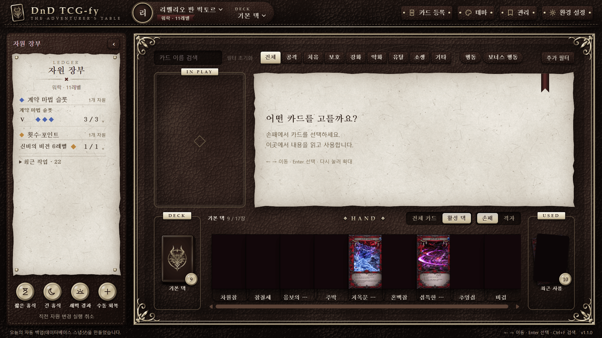
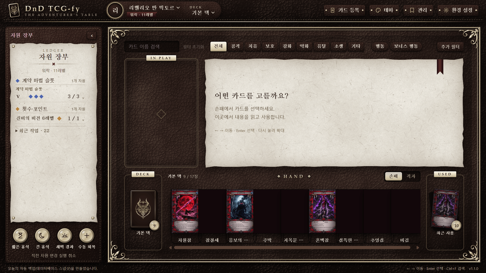
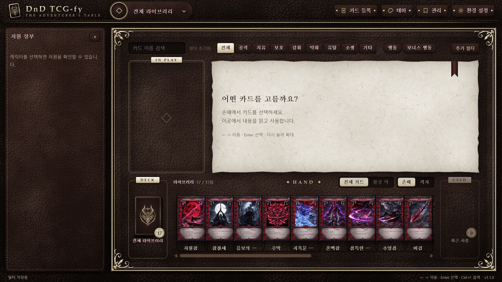
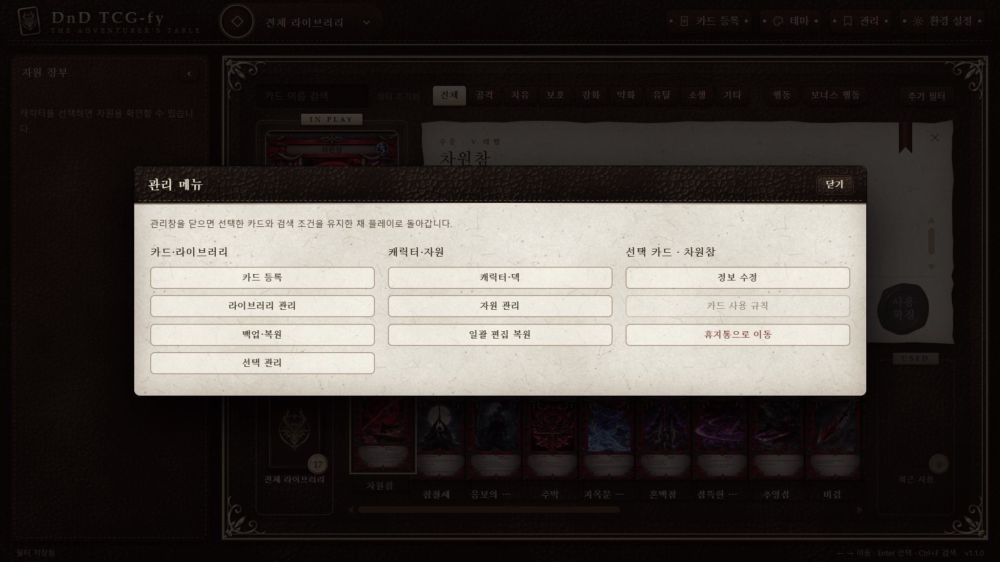
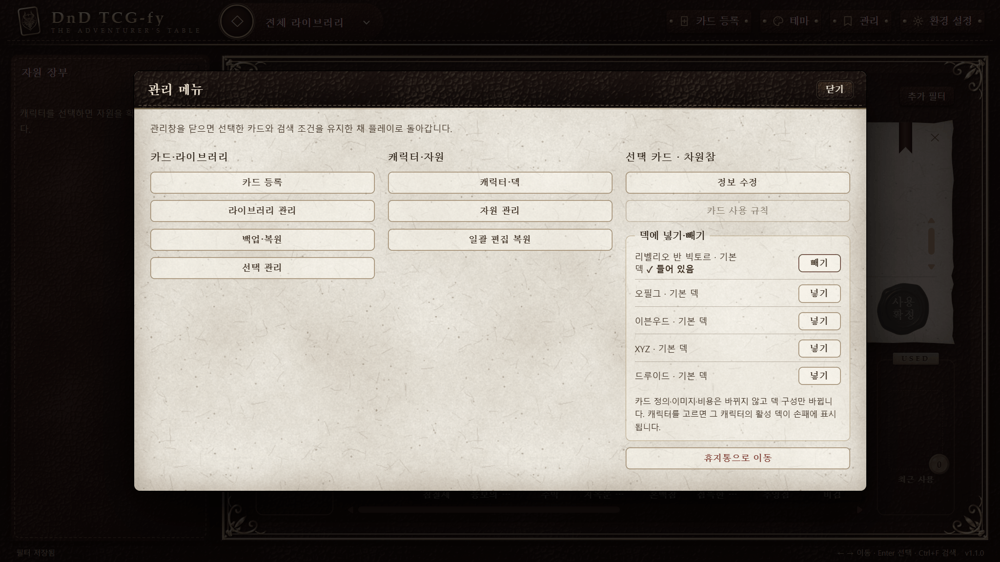
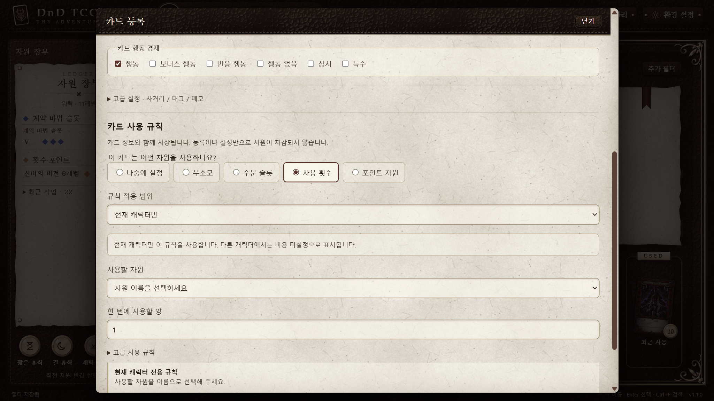
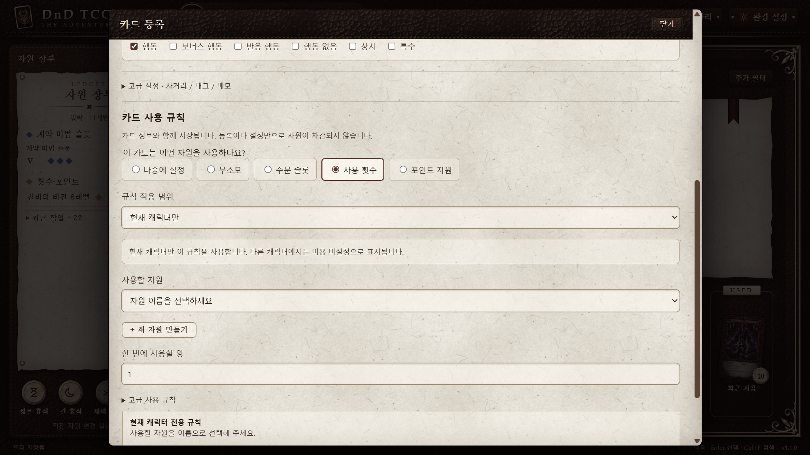

# v1.2 Phase 1 보고서 — UI 구조·카드 등록 흐름

- 기준: 1.1.0 `d68ae01` → 브랜치 `feat/v1.2-phase1`
- 범위: [V1_2_PLAN.md](V1_2_PLAN.md)의 Phase 1 두 항목. SQLite v6 유지(DDL·마이그레이션·새 설정 키 없음), 새 IPC 채널 없음, 앱 버전 1.1.0 유지.
- 상태: **구현·검증 완료, 사용자 승인 대기.** Phase 2는 승인 전까지 시작하지 않는다.

## 1. ‘전체 카드’·‘활성 덱’ 버튼

### 분석(삭제 전 보고)

| 질문 | 확인 결과 |
| --- | --- |
| ‘전체 카드’와 ‘전체 라이브러리’가 같은 목록인가 | 카드 목록은 같다(삭제되지 않은 모든 카드). 다만 ‘전체 카드’는 **캐릭터를 선택한 채** 모든 카드를 보여 주고, ‘전체 라이브러리’는 **캐릭터 선택을 해제**한다. 그래서 자원 장부·사용 가능 표시·USED 더미·카드 등록 대상이 달라진다. |
| ‘활성 덱’이 캐릭터·덱 선택과 중복되는가 | 중복된다. 다만 1.1.0은 캐릭터를 바꿔도 범위를 유지해서, ‘전체 카드’ 상태로 캐릭터를 고르면 덱이 아니라 모든 카드가 나왔고 그때 ‘활성 덱’ 버튼이 필요했다. |
| 대체할 수 없는 기능 | ‘전체 카드’ 상태에서만 ① 덱 밖 카드를 골라 관리 → ‘활성 덱에 추가’로 덱을 꾸미기, ② 덱 밖 카드를 그 캐릭터 자원으로 사용·비용 설정이 됐다. ‘전체 라이브러리’에서는 캐릭터가 없어 둘 다 안 되고, 선택 관리 → 일괄 작업 → ‘추가할 덱’으로만 덱에 넣을 수 있었다. |

지시서대로 삭제 전에 이 차이를 보고했고, 사용자가 **“제거 + 덱 넣기 경로”**를 골랐다.

### 바뀐 점

| 항목 | 변경 전 | 변경 후 |
| --- | --- | --- |
| 손패 머리 | [전체 카드][활성 덱] + [손패][격자] | [손패][격자]만. 왼쪽 표시는 덱 이름 또는 **전체 라이브러리** |
| 캐릭터 선택 | 이전 범위를 유지(모든 카드가 나올 수 있음) | 고르면 항상 그 캐릭터의 **활성 덱**. 덱이 없는 캐릭터(예외)만 모든 카드 |
| ‘전체 라이브러리’ | 모든 카드(캐릭터 없음) | 같음 |
| 덱 꾸미기 | ‘전체 카드’에서 카드 선택 → 관리 → 활성 덱에 추가 | ‘전체 라이브러리’에서 카드 선택 → 관리 → 선택 카드 칸의 **덱에 넣기·빼기**(캐릭터 · 덱마다 [넣기]/[빼기], 들어 있으면 ✓). 캐릭터 선택 상태의 ‘활성 덱에서 빼기’는 그대로 |
| 빈 덱 | “조건에 맞는 카드가 없어요” | “이 덱에 아직 카드가 없어요” + 카드 등록 또는 전체 라이브러리 → 관리 → 덱에 넣기 안내 |
| 없어진 것 | — | 덱 밖 카드를 캐릭터 자원으로 바로 사용·비용 설정(덱에 넣은 뒤 가능, 사용자 확인) |

- 카드 데이터와 덱 구성은 바꾸지 않는다. 덱 넣기·빼기는 기존 `setDeckCards`이고 카드 정의·이미지·비용은 그대로다.
- 저장된 보기 설정: `library_state.viewScope`는 그대로 저장한다. 1.1.0이 저장할 수 있었던 “캐릭터 + 전체” 상태는 화면에서 덱 보기로 해석하고 **저장값은 고치지 않는다**. 그래서 1.1.0으로 돌아가도 같은 DB가 열린다([DATA_SCHEMA_V1_2.md](DATA_SCHEMA_V1_2.md)).
- 필터·검색·선택 관리·일괄 작업(‘추가할 덱’ 목록 포함)은 그대로 동작한다.

## 2. 카드 등록 중 새 자원 만들기

1. 카드 등록 → 카드 사용 규칙에서 **사용 횟수** 또는 **포인트 자원**을 고른다.
2. ‘사용할 자원’ 아래 **+ 새 자원 만들기** 버튼(또는 목록 맨 아래 “+ 새 자원 만들기…”).
3. 등록 창 위에 **새 자원 만들기** 창이 겹쳐 열린다. 이름·종류(사용 횟수/포인트)·단위·최대치·무제한·회복 조건(짧은 휴식·긴 휴식·새벽 경과·수동 회복, 회복 안 함/전량/정량)을 입력한다. 회복 조건 칸은 자원 관리와 같은 컴포넌트다.
4. **자원 만들고 선택** → 등록 창으로 돌아와 그 자원이 비용으로 자동 선택된다(`새 자원 · 지팡이 충전 · 최대 7회 (카드 저장 시 생성)`). 카드 이름·이미지·분류 등 입력과 스크롤 위치는 그대로다. **새 자원 고치기**·**새 자원 취소**도 있다.
5. **카드 저장**에서 카드와 자원이 함께 저장된다.

| 지시서 요구 | 구현 |
| --- | --- |
| 기존 엔진·검증 재사용 | 화면 검증은 `templateDraftSchema`, 저장은 자원 관리와 같은 `create_resource`(템플릿 + 캐릭터 장착 + “<이름> 자원 생성” 기록) |
| 적용 범위 표시 | 창 안 “적용 범위 · <캐릭터> 전용 자원”: 이 캐릭터에 장착되는 캐릭터 공유 자원, 현재량은 이 캐릭터만, 처음엔 최대치. 템플릿은 템플릿 라이브러리에 저장되어 다른 캐릭터도 장착 가능(현재량 별개). 카드 규칙 적용 범위(공통/현재 캐릭터만) 안내는 그대로 |
| 입력 보존 | 등록 창을 닫지 않고 위에 겹쳐 엶 |
| 중복 방지 | 같은 이름(공백·대소문자 무시)의 자원이 있으면 만들기 버튼을 막고 **기존 ‘이름’ 선택**을 제안. 저장 때 서버도 다시 검사. 같은 등록 요청의 재전송은 한 번만 처리 |
| 자동 연결 | 만든 자원이 비용으로 선택되고, 저장 때 초안 ID를 실제 자원 ID로 바꿔 연결 |
| 등록 취소 시 임시 자원 없음 | 저장 전에는 등록 창 안의 초안일 뿐이라 DB에 아무것도 생기지 않음. 비용에 연결하지 않은 초안도 만들지 않음 |
| 저장된 자원 임의 삭제 금지 | 삭제 경로 없음(이미 있는 자원은 건드리지 않음) |
| 저장 일관성 | 카드·덱 연결·자원·템플릿·비용 연결·영수증이 **하나의 트랜잭션**. 실패하면 모두 취소 |
| 기존 기능 유지 | 자원 관리 화면, 무소모·주문 슬롯·업캐스팅·홈브루·고급 규칙(초안 자원도 고급 규칙에서 선택 가능) |

- 등록 중에는 **횟수·포인트 자원만** 만든다. 슬롯 트랙과 카드·아이템 전용 범위는 지금처럼 자원 관리에서 만든다. 캐릭터를 선택하지 않으면 버튼이 꺼지고 이유를 안내한다.
- 새 자원을 만든 등록은 자원 관리에서 만든 것과 같이 “자원 생성” 기록이 남고, 그 이전 자원 변경의 실행 취소 경계가 된다(기존 규칙).
- 데이터 계약: [DATA_SCHEMA_V1_2.md](DATA_SCHEMA_V1_2.md) (`initialRules.newResources`). 결정 기록: [DECISIONS.md](DECISIONS.md) 2026-11-18 v1.2 Phase 1.

## 3. 변경 전후

같은 데이터(`repository-data` 사본), 1366×768, 100%.

| 화면 | 변경 전 | 변경 후 |
| --- | --- | --- |
| 손패 머리 |  |  |
| 메인(캐릭터 선택) |  |  |
| 전체 라이브러리 |  |  |
| 전체 라이브러리 → 관리 |  |  |
| 등록 · 사용 횟수 |  |  |

변경 후 추가 화면: [새 자원 만들기 창](docs/screenshots/v1.2-p1/after-new-resource-form.png) · [만든 뒤 등록 창](docs/screenshots/v1.2-p1/after-registration-new-resource.png)

## 4. 검증 결과

`scripts/v12-p1-e2e.mjs` 9개 검사(`repository-data` 사본, 재시작 포함):

| 지시서 체크 항목 | 확인한 내용 | 결과 |
| --- | --- | --- |
| 전체 카드·활성 덱 버튼 필요성 분석 | 위 1절 표. 대체할 수 없는 두 기능을 삭제 전에 보고, 사용자 선택에 따라 진행 | 보고·승인 |
| 버튼 제거 후 카드 탐색 | 버튼·“카드 범위” 그룹 없음. 리벨리오 선택 = 기본 덱 9/17장, 전체 라이브러리 = 17/17장, 다시 캐릭터 = 9/17장. 검색·필터 초기화 동작. 재시작 후 유지. 1.1.0식 “캐릭터 + 전체” 저장값은 덱 보기로 열리고 저장값은 그대로 | 통과 |
| 버튼 제거 후 카드 관리 | 전체 라이브러리 → 카드 선택 → 관리 → `XYZ · 기본 덱에 넣기` → ✓ 들어 있음/빼기, 그 덱만 바뀌고 카드 정의·다른 덱 동일, XYZ 선택 시 1장. 다시 빼면 빈 덱 안내. 선택 관리 전체 선택·일괄 ‘추가할 덱’ 목록(덱 5개) 그대로 | 통과 |
| 카드 등록 중 새 자원 생성·자동 연결 | ‘지팡이 충전’(최대 7회, 새벽 +3)을 등록 창에서 만들고 저장 → 리벨리오에 캐릭터 공유 7/7, 템플릿 1개 추가, 카드가 활성 덱에 들어가고 비용이 그 자원에 연결, “지팡이 충전 자원 생성” 기록. 그 카드를 사용하면 7→6, Undo로 7 | 통과 |
| 등록 취소 | 새 자원 창 취소 → 선택 없음. 초안을 만든 뒤 등록 창 취소 → 카드·자원·템플릿·revision 모두 그대로 | 통과 |
| 저장 실패 처리 | 등록 창이 열린 동안 다른 자원이 바뀌어(오래된 revision) 저장이 거부되면 카드·자원·템플릿·연결 모두 없음, 입력은 그대로. ‘연결 자원 다시 불러오기’ 후 저장 성공 | 통과 |
| 중복 자원 생성 방지 | ‘ 지팡이 충전 ’ 입력 시 경고·만들기 버튼 꺼짐 → ‘기존 지팡이 충전 선택’으로 기존 자원 연결. 초안을 만든 뒤 다른 경로로 같은 이름 자원이 생기면 저장 전체가 거부되고 카드·자원이 하나도 늘지 않음 | 통과 |
| 무소모·주문 슬롯·업캐스팅·자원 관리 | 무소모 등록, 계약 슬롯(업캐스팅) 등록 정상. 자원 관리 → 새 자원 만들기(공용 회복 칸으로 바꾼 화면)가 같은 템플릿(짧은 휴식 +2, 긴 휴식 전량) 저장 | 통과 |
| 기존 데이터·자원 상태 보존 | 재시작 후 새 카드·자원 유지, 기존 카드 17장 정의 동일, 이미지 파일 SHA-256 동일, 기존 자원은 일부러 바꾼 1개 외 동일, `play_events`는 추가만, 외래 키·`quick_check` 정상 | 통과 |
| 화면 배율 | 1280×720에서 100/125/150% 새 자원 창 가로 넘침 없음 | 통과 |

단위 테스트: `tests/V12P1UI.test.tsx` 11개(범위·덱 넣기 화면 4, 등록 중 새 자원 화면 7), `tests/registration.test.ts` 6개 추가(한 트랜잭션 생성·여러 카드·롤백·재전송·중복·거부 조건).

### 실행 환경별

| 환경 | Phase 1 E2E |
| --- | --- |
| 빌드 번들(`dist/`) | 9/9 통과 |
| Windows 개발 모드(Vite `--dev`) | 9/9 통과 |
| 패키징 EXE(`release/win-unpacked/DnD TCG-fy.exe`, `npm run pack:win`) | 9/9 통과 |

### 회귀·품질 게이트

- `npm run lint` 통과(경고 0), `npm run typecheck` 통과.
- `npm test`: **461/461 통과**(이번에 17개 추가). `tests/p11.test.tsx`·`tests/P4BUI.test.tsx`는 이전 단계와 같이 이 PC의 Node 22.20에서 로드되지 않는다(프로젝트 요구 Node 24).
- 기존 E2E(최종 빌드 번들): 메인 38개 PASS, P4-A, P4-B(20·50·200장), P4-C, P5(6단계), v1.1 Phase 1(8)·2(9)·3(11)·4(9) 모두 통과. 메인 E2E는 패키징 EXE(앱 버전 1.1.0, packaged)에서도 38개 PASS.
- **E2E 수정(검사 의도는 그대로):** 기존 E2E 일부는 “캐릭터 선택 + 덱 밖 카드”를 손패에서 고르거나 사용했다(이번에 없어진 기능). 그 카드를 먼저 그 캐릭터의 덱에 넣도록 바꿨다. 메인 E2E는 ‘전체 카드’·‘활성 덱’ 버튼 대신 전체 라이브러리 → 관리 → 덱에 넣기로 같은 덱 구성을 만들고 확인한다. P3.1·P4-C는 다른 캐릭터가 쓰는 카드를 그 캐릭터 덱에 넣고, P4-B는 성능 측정용 카드를 측정 캐릭터의 덱에 넣고, 일괄 작업 검사는 A 덱에서 뺀 카드를 전체 라이브러리에서 B 덱에 추가한다. 도우미는 `scripts/navigation-helpers.mjs`의 `putInDeck`·`showWholeLibrary`.
- 패키징은 첫 시도에 성공했다.

## 5. 미검증·제한

- **덱 밖 카드 바로 사용:** 사용자 선택에 따라 없어졌다. 덱에 넣으면 이전처럼 사용·비용 설정할 수 있다.
- **등록 중 만들 수 있는 자원 종류:** 횟수·포인트(캐릭터 공유)만. 슬롯 트랙과 카드·아이템 전용 자원은 자원 관리에서 만든다.
- **실제 Windows 디스플레이 배율 설정:** Chromium 배율(`setZoomFactor`)로 재현했고, Windows 설정을 바꾼 실제 화면은 **미검증**.
- **NSIS 설치 파일:** 다시 만들지 않았다(폴더형 EXE만 검증). **미검증**.
- **스크린 리더·터치:** 접근성 이름과 포커스 이동만 확인했고 실제 낭독기·터치는 **미검증**.
- Node 24가 필요한 테스트 파일 2개는 이 PC에서 로드되지 않는다(변경 전과 같음).
