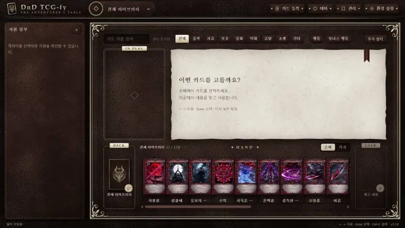
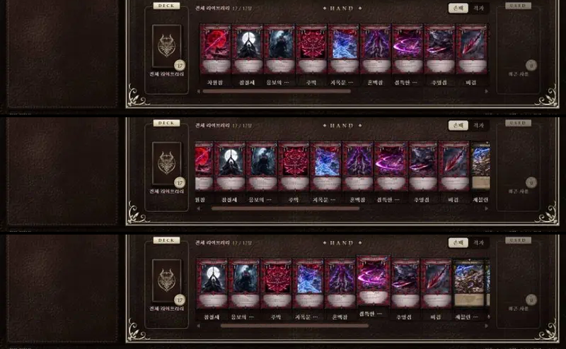
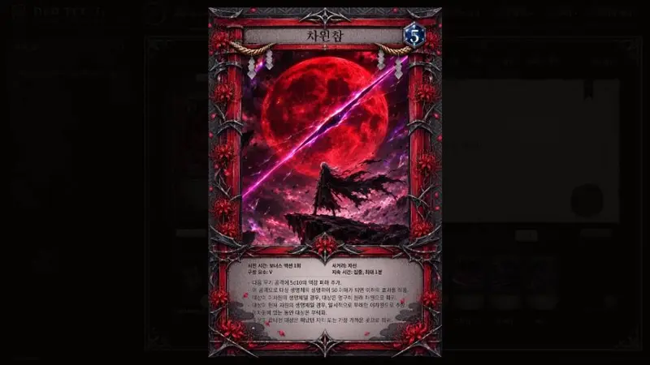

# v1.2 Phase 2 보고서 — 카드 상호작용·조작감

- 기준: Phase 1 `5d162ed` → 브랜치 `feat/v1.2-phase2`
- 범위: [V1_2_PLAN.md](V1_2_PLAN.md)의 Phase 2 두 항목. SQLite v6 유지, 새 IPC 채널 없음, 새 설정 키 `hand_scroll` 하나, 앱 버전 1.1.0 유지.
- 상태: **구현·검증 완료, 사용자 승인 대기.** Phase 3(테마 리디자인)은 승인 전까지 시작하지 않는다.

## 1. 손패 드래그 관성

| 항목 | 동작 |
| --- | --- |
| 관성 조건 | 놓기 직전 약 100ms의 마우스 이동 속도가 0.35px/ms(초당 350px) 이상일 때만. 느리게 끌거나 놓기 전 80ms 이상 멈췄으면 지금처럼 그 자리에서 멈춤 |
| 움직임 | 끈 방향 그대로, 놓을 때 속도에서 시작해 부드럽게 감속(지수 감속, 시간 상수 325ms). 되돌아오거나 튕기지 않음 |
| 제한 | 시작 속도 최대 4px/ms, 거리 최대 1,300px(손패 폭의 1.25배를 넘지 않음). 처음·끝 카드에 닿으면 그 자리에서 정지 |
| 다시 입력 | 관성 중 누르기·휠·방향키 → 즉시 정지. **빠르게 움직이는 중의 클릭은 멈추기만 하고 카드를 고르지 않음**(움직이는 카드를 잘못 고르는 것 방지). 멈춘 뒤의 클릭은 평소처럼 선택, 다시 누르면 확대 |
| 정리 | 필터·검색 변경(표시 카드가 바뀜), 손패/격자 전환, 옵션 끄기, 화면에서 사라짐 → 남은 관성 즉시 정지 |
| 렌더링 | 관성은 `requestAnimationFrame`에서 스크롤 위치만 바꾸고 React 상태를 바꾸지 않음. 관성 중 손패 안 DOM 변경 0건(E2E 측정) |
| 설정 | 환경 설정 **“손패 관성 스크롤”**(기본 켬, 재시작 후 유지). 앱 “모션 줄이기” 또는 Windows 동작 줄이기면 꺼지고 체크 상자도 잠김 |

- 저장: `settings`의 새 키 `hand_scroll`(`{ "inertia": false }`). 1.1.0은 `effects` 키를 엄격하게 검사해서, 거기에 필드를 더하면 1.1.0이 같은 DB를 열지 못한다. 그래서 별도 키로 두었다([DATA_SCHEMA_V1_2.md](DATA_SCHEMA_V1_2.md)).
- 계산은 `src/shared/hand-inertia.ts`(순수 함수, 단위 테스트), 동작은 `src/components/HandSurface.tsx`.

## 2. 확대 카드 3D 기울임 유지 범위

| 항목 | 동작 |
| --- | --- |
| 범위 | 카드 바깥 **화면 짧은 변의 8%, 60~100px**(CSS px라 배율도 반영). 1366×768 → 61px, 1920×1080 → 86px, 1280×720 125%·150% → 60px |
| 범위 안 | 카드 밖에서도 기울임 유지. 카드 밖 위치는 가장 가까운 가장자리 값으로 계산해 최대 6°를 넘지 않음 |
| 범위 밖 | 0.35초에 걸쳐 정면으로 복귀(갑자기 튀지 않음). 창 밖으로 나가도 같음 |
| 바깥 클릭 | 그대로 종료. 범위 판정은 확대 화면 전체의 포인터 이동 계산이고 화면에 요소를 덮지 않으므로 클릭을 가로채지 않음. 카드 클릭은 종료하지 않음 |
| 옵션·모션 | “확대 카드 3D 기울임” 끄기, 모션 줄이기·Windows 동작 줄이기면 기울이지 않음(기존과 같음) |
| 원본 | 기울임은 이미지에만 걸리고 비율·크기는 그대로 |

## 3. 실제 조작 화면

같은 데이터(`repository-data` 사본), 1366×768, 100%, 전체 라이브러리(17장).

| 장면 | 변경 전(Phase 1 빌드) | 변경 후 |
| --- | --- | --- |
| 빠르게 끌다 놓기(같은 입력) | 놓은 자리 213px에서 정지, **놓은 뒤 이동 0px** | 213px → **630px(손패 끝)까지 이어서 이동 후 정지**, 놓은 뒤 417px |
| 느리게 끌다 멈춘 뒤 놓기 | 0px | 0px(변화 없음) |
| 카드 오른쪽 가장자리 밖 40px | 기울임 해제(`none`) | **6° 유지** |
| 카드 밖 150px | 기울임 없음 | 정면 복귀(`none`) |
| 바깥 클릭 종료 | 종료 | 종료 |

- 관성 움직임(화면 녹화, CDP screencast 27프레임·0.8초): 
- 같은 녹화의 놓은 순간 / 중간 / 정지(위→아래): 
- 가장자리 기울임(녹화 80프레임·1.9초: 카드 안 → 가장자리 → 밖 45px 유지 → 밖 160px 복귀): 
- 카드 밖 40px 정지 화면: [변경 전](docs/screenshots/v1.2-p2/before-tilt-outside-40.png) · [변경 후](docs/screenshots/v1.2-p2/after-tilt-outside-40.png) / 밖 150px: [변경 전](docs/screenshots/v1.2-p2/before-tilt-outside-150.png) · [변경 후](docs/screenshots/v1.2-p2/after-tilt-outside-150.png)
- 수치 기록: [변경 전](docs/screenshots/v1.2-p2/before-traces.json) · [변경 후](docs/screenshots/v1.2-p2/after-traces.json). 변경 전 화면 녹화는 Phase 1 빌드로 다시 만들 수 없어 수치·정지 화면으로 대신했다(같은 입력의 스크롤 위치 기록).
- Playwright의 Electron 녹화(`recordVideo`)는 이 PC에서 앱 실행이 멈춰 쓰지 못했고, Chromium 화면 전송(CDP screencast) 프레임을 WebP 애니메이션으로 묶었다.

## 4. 검증 결과

`scripts/v12-p2-e2e.mjs` 7개 검사(`repository-data` 사본, 재시작 포함):

| 지시서 체크 항목 | 확인한 내용 | 결과 |
| --- | --- | --- |
| 빠른 드래그 | 놓은 뒤 같은 방향으로 계속 이동(검사 기준 40px 초과, 3절 기록에서는 417px), 프레임마다 속도가 줄어듦, 되돌아오지 않음 | 통과 |
| 느린 드래그 | 느리게 끌다 멈추고 놓기 0px, 계속 느리게 움직이며 놓기(약 0.15px/ms) 0px | 통과 |
| 손패 경계 | 끝 근처에서 끌면 마지막 위치에 정확히 멈춤(넘침 없음), 처음 방향도 0에서 멈춤 | 통과 |
| 관성 중 재입력 | 누르기 → 즉시 정지·카드 선택 안 됨, 휠 → 정지 후 휠 이동만 적용, 방향키 → 정지 | 통과 |
| 선택·확대 충돌 | 멈춘 뒤 클릭 = 선택, 다시 클릭 = 확대, 선택 카드에서 시작한 드래그는 확대하지 않음 | 통과 |
| 필터·보기 전환 | 관성 중 검색어 입력·손패→격자 전환 시 즉시 정지 | 통과 |
| 관성 ON/OFF·저장 | 끄면 놓은 자리에서 정지, DB `hand_scroll = {"inertia":false}`, `effects` 변화 없음, 재시작 후에도 꺼짐, 다시 켜면 관성 | 통과 |
| 모션 감소 | 앱 “모션 줄이기” → 체크 상자 꺼짐·잠김·관성 없음. Windows 동작 줄이기(에뮬레이션) → 관성 없음 | 통과 |
| 3D 기울임 유지 범위 | 카드 안 기울임, 바깥 (여백−15px) 지점 6° 유지(좌우), 여백 밖 → 0.35초 전환으로 정면(90ms 시점엔 아직 기울어 있음, 450ms 뒤 `none`) | 통과 |
| 확대 화면 바깥 클릭 종료 | 여백 안·카드 밖 클릭 → 종료, 카드 클릭 → 유지 | 통과 |
| 기울임 옵션·모션 감소 | 기울임 끔, 모션 줄이기 → 어디서도 기울지 않음 | 통과 |
| 화면 크기·배율 | 1920×1080 여백 86px, 1280×720 125%·150% 여백 60px(CSS px), 안쪽 유지·바깥 복귀 | 통과 |
| 20·50·200장 탐색 성능 | 아래 표. 모든 경우 관성 중 손패 안 DOM 변경 0건(React 재렌더링 없음) | 통과 |

### 20·50·200장 관성 프레임 간격(ms, 중앙값 / 95% / 최대)

카드는 E2E가 기존 이미지를 돌려 써서 추가한 것이다. 화면 주사율에 따라 프레임 간격이 4.2ms(240Hz)나 16.7ms(60Hz)로 달랐다.

| 실행 | 20장 | 50장 | 200장 |
| --- | --- | --- | --- |
| 빌드 번들(단독) | 16.7 / 25.3 / 37.4 | 20.8 / 33.3 / 50.2 | 16.7 / 33.4 / 41.8 |
| 빌드 번들(전체 회귀 중) | 4.3 / 12.5 / 37.3 | 8.4 / 20.8 / 33.3 | **20.7 / 83.3 / 95.9** |
| 개발 모드 | 4.2 / 24.9 / 41.5 | 4.2 / 24.9 / 28.9 | 4.2 / 25.0 / 58.3 |
| 패키징 EXE | 4.2 / 20.7 / 41.7 | 4.2 / 16.6 / 37.6 | 4.2 / 12.4 / 41.8 |

- 200장은 전체 회귀 중 한 번 95% 83ms·최대 96ms로 느렸고 다른 세 번은 95% 12~33ms였다. 원인은 확인하지 못했다(같은 실행에서도 DOM 변경은 0건). 기존 P4-B 성능 E2E(20·50·200장 필터·휠·드래그)도 통과했다.

단위 테스트: `tests/V12P2UI.test.tsx` 7개(관성 속도·거리·감속, 기울임 여백·범위·최대각, 설정 저장·모션 줄이기 잠금), `tests/store.test.ts` 1개(`hand_scroll` 별도 키, `effects` 형식 유지, 잘못된 값 거부).

### 실행 환경별

| 환경 | Phase 2 E2E |
| --- | --- |
| 빌드 번들(`dist/`) | 7/7 통과(단독·전체 회귀 두 번) |
| Windows 개발 모드(Vite `--dev`) | 7/7 통과 |
| 패키징 EXE(`release/win-unpacked/DnD TCG-fy.exe`, `npm run pack:win`) | 7/7 통과 |

### 1.1.0으로 되돌려도 열리는지(실제 1.1.0 빌드)

`d68ae01`(1.1.0)을 별도 작업 폴더에서 빌드해, v1.2가 쓴 DB(기울임·커서 `effects`, `hand_scroll`, 새 자원과 함께 등록한 카드, 전체 라이브러리에서 넣은 덱)를 열었다. 1.1.0이 오류 없이 열고 설정·카드·덱·새 자원(5/5)·비용 연결을 그대로 읽었으며 `hand_scroll`은 무시했다. 다시 v1.2로 열면 `hand_scroll`이 남아 있었다. 통과.

### 회귀·품질 게이트

- `npm run lint` 통과(경고 0), `npm run typecheck` 통과.
- `npm test`: **469/469 통과**(이번에 8개 추가). `tests/p11.test.tsx`·`tests/P4BUI.test.tsx`는 이 PC의 Node 22.20에서 로드되지 않는다(변경 전과 같음).
- 기존 E2E(빌드 번들): 메인 38개 PASS, v1.2 Phase 1(9), v1.1 Phase 1(8)·2(9)·3(11)·4(9), P4-A, P4-B, P4-C, P5(6) 모두 통과. 메인 E2E는 패키징 EXE에서도 38개 PASS.
- **E2E 수정:** v1.1 Phase 3 E2E는 “커서가 카드를 벗어나면 바로 정면”을 확인했는데, 이번 지시서가 이 동작을 바꿨다. 이제 “카드 바로 밖은 유지, 여백 밖은 정면”을 확인한다. 나머지 검사는 그대로다.
- 패키징은 첫 시도에 성공했다.

## 5. 미검증·제한

- **실제 마우스·터치패드 조작:** 관성은 Playwright가 보내는 마우스 입력으로 검증했다. 손으로 끄는 실제 마우스·터치패드의 감각(속도 기준 0.35px/ms, 감속 325ms가 알맞은지)은 **미검증**이라 직접 써 보고 조정 의견을 주시면 반영하겠다. 터치·펜 드래그는 기존처럼 관성 대상이 아니다(마우스만).
- **Windows 동작 줄이기:** 실제 Windows 설정을 바꾼 것이 아니라 Chromium 에뮬레이션(`prefers-reduced-motion`)으로 확인했다.
- **실제 Windows 디스플레이 배율 설정:** Chromium 배율로 재현했고 Windows 설정을 바꾼 화면은 **미검증**.
- **변경 전 화면 녹화:** Phase 1 빌드 녹화는 없고 같은 입력의 스크롤 기록·정지 화면으로 대신했다.
- **NSIS 설치 파일:** 다시 만들지 않았다(폴더형 EXE만 검증). **미검증**.
