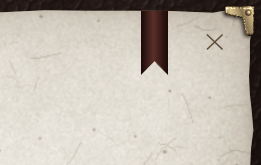
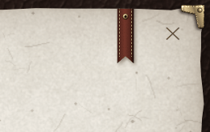
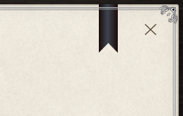
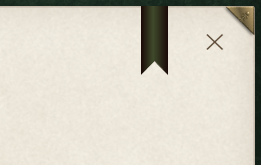
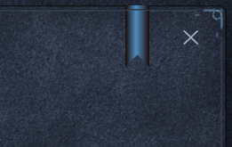
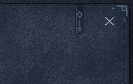
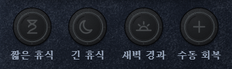

# v1.2 Phase 4 보고서 · v1.2 최종 보고 — 책갈피·회복 버튼

- 기준: Phase 3 `cca4752`(디자인 승인됨) → 브랜치 `feat/v1.2-phase4`
- 범위: [V1_2_PLAN.md](V1_2_PLAN.md)의 Phase 4 두 항목. SQLite·IPC·설정 형식 변경 없음, **회복 로직 변경 없음**, 앱 버전 1.1.0 유지.
- 상태: **구현·검증 완료, 사용자 최종 검수 대기.** 승인 없이 새 기능이나 다음 버전 작업을 시작하지 않는다.

## 1. 카드 세부사항란 책갈피

위치(카드 페이지 오른쪽 위, 닫기 버튼 왼쪽)와 장식 역할은 그대로다. 크기는 18×46px에서 20×50px로 조금 키웠다. 그림은 테마마다 다른 벡터(SVG)라 어떤 배율에서도 선명하다.

| 테마 | 형태 | 재질·디테일 |
| --- | --- | --- |
| 적갈 가죽 | 두께감 있는 가죽 끈, V자로 자른 끝 | 양쪽 가장자리 새들 스티치, 황동 아일릿, 가장자리 음영(두께), 페이지에 닿는 그림자 |
| 흑단과 은 | 가는 비단 리본 | 광택 띠가 있는 짙은 회흑색 비단, 가는 직조 결, 음각 고리와 흑옥 마름모를 단 은 끝장식 |
| 숲의 펠트 | 넓은 펠트 탭, 톱니(핑킹) 끝 | 펠트 섬유 질감, 가장자리 바느질, 무광 청동 압정으로 고정 |
| 아케인 블루 | **석판에 새긴 음각 탭**(가죽·금속 아님) | 파인 홈의 안쪽 음영과 밝은 아랫입술, 하늘빛 발광 표식(마름모·선·원) |

- 페이지 위에 놓인 책갈피(가죽·비단·펠트)는 접촉 그림자를, 새긴 탭(아케인 블루)은 그림자 대신 안쪽 음영을 쓴다.
- 제목·종류 표기·속성·태그·닫기 버튼·설명을 가리지 않는다(아래 E2E가 1366×768, 1280×720 125%·150%, 1100×700, 200%에서 확인).

## 2. 자원 장부 회복 버튼

짧은 휴식·긴 휴식·새벽 경과·수동 회복 네 버튼의 기능·라벨·클릭 영역은 그대로이고, 아이콘 뒤의 원형 장식(토큰)을 테마마다 다르게 만들었다(벡터 SVG).

| 테마 | 토큰 | 아이콘 |
| --- | --- | --- |
| 적갈 가죽 | 망치 자국이 있는 황동 돌기, 리벳 8개를 박은 두꺼운 테 | 어두운 음각 |
| 흑단과 은 | 정밀하게 톱니를 낸 은 베젤 + 흑단 원판(나뭇결) + 은 점 4개 | 은 상감(밝은 은색) |
| 숲의 펠트 | 무광 청동, 참나무 잎 16장의 화환 돋을새김, 녹청 | 어두운 음각 |
| 아케인 블루 | 석재 원판, 하늘빛으로 빛나는 음각 고리와 눈금 8개(금속 없음) | 하늘빛 발광 |

상태(테마마다): **기본**, **호버**(토큰이 살짝 떠오르고 밝아짐 — 흑단은 차가운 은빛 반사, 펠트는 광택 없이 따뜻하게, 아케인 블루는 발광이 강해짐), **누름**(가라앉고 작아짐, 아케인 블루는 발광이 가장 밝아짐), **비활성**(회색조로 어두워지고 아이콘이 흐려짐, 아케인 블루는 발광이 꺼짐), **키보드 포커스**(기존 외곽선). 모션 줄이기면 움직임 없이 밝기만 바뀐다.

아이콘 명암비(토큰 그림을 렌더링해 아이콘 주변 고리의 평균색과 비교): 적갈 가죽 5.62:1, 흑단과 은 14.05:1, 숲의 펠트 6.53:1, 아케인 블루 11.23:1. 숲의 펠트는 처음 시안에서 3.7:1이라 청동 바탕을 밝히고 아이콘을 짙게 해 기준(4.5:1)을 넘겼다.

## 3. 변경 전후

같은 데이터(`repository-data` 사본), 1366×768, 이 PC의 150% 디스플레이 배율로 저장. 회복 버튼은 왼쪽부터 기본 · ‘짧은 휴식’ 호버 · ‘긴 휴식’ 누름 · 전체 비활성.

| 테마 | 책갈피 전 | 책갈피 후 |
| --- | --- | --- |
| 적갈 가죽 |  |  |
| 흑단과 은 |  |  |
| 숲의 펠트 |  |  |
| 아케인 블루 |  |  |

| 테마 | 회복 버튼 전(기본) | 후: 기본 | 후: 호버 | 후: 누름 | 후: 비활성 |
| --- | --- | --- | --- | --- | --- |
| 적갈 가죽 |  |  |  |  |  |
| 흑단과 은 |  |  |  |  |  |
| 숲의 펠트 |  |  |  |  |  |
| 아케인 블루 |  |  |  |  |  |

고배율(200% 장치 배율, 1024×576 창): [적갈 회복](docs/screenshots/v1.2-p4/after-oxblood-rest-200.png) · [흑단 회복](docs/screenshots/v1.2-p4/after-ebony-rest-200.png) · [펠트 회복](docs/screenshots/v1.2-p4/after-verdant-rest-200.png) · [아케인 회복](docs/screenshots/v1.2-p4/after-abyss-rest-200.png) / 책갈피: [적갈](docs/screenshots/v1.2-p4/after-oxblood-bookmark-200.png) · [흑단](docs/screenshots/v1.2-p4/after-ebony-bookmark-200.png) · [펠트](docs/screenshots/v1.2-p4/after-verdant-bookmark-200.png) · [아케인](docs/screenshots/v1.2-p4/after-abyss-bookmark-200.png). 좁은 창에서는 라벨이 두 줄로 접히고 잘리지 않는다.

전체 보드(변경 후): [적갈 가죽](docs/screenshots/v1.2-p4/after-oxblood-board.png) · [흑단과 은](docs/screenshots/v1.2-p4/after-ebony-board.png) · [숲의 펠트](docs/screenshots/v1.2-p4/after-verdant-board.png) · [아케인 블루](docs/screenshots/v1.2-p4/after-abyss-board.png)

## 4. 검증

`scripts/v12-p4-e2e.mjs` 6개 검사(`repository-data` 사본):

| 지시서 체크 항목 | 확인한 내용 | 결과 |
| --- | --- | --- |
| 테마별 책갈피 표현 | 네 테마가 각자의 책갈피 SVG를 쓰고 실제로 로드됨 | 통과 |
| 책갈피가 텍스트·버튼을 가리지 않음 | 제목·종류·속성·태그·닫기 버튼·설명과 겹치지 않음(1366×768 및 아래 크기·배율) | 통과 |
| 버튼의 기본·호버·누름 상태(+비활성·포커스) | 토큰의 transform/filter가 호버·누름·비활성에서 각각 바뀌고 키보드 포커스 외곽선이 보임, 네 테마 모두 | 통과 |
| 회복 기능 회귀 | 테마마다 계약 슬롯 1개를 쓴 뒤 ‘짧은 휴식’ → ‘회복 확정’으로 되돌아옴(마우스), ‘긴 휴식’은 키보드 Enter로 확인 창이 열림 | 통과 |
| 테마별 재질 및 디자인 일관성 | 토큰·책갈피가 Phase 3 재질과 같은 언어(1·2절), 아케인 블루에 금속·가죽 없음(단위 테스트도 확인) | 통과(자동) · **검수 대기** |
| 고배율 및 작은 화면 가독성 | 1280×720 125%·150%, 1100×700, 200%에서 책갈피가 글자와 겹치지 않고 회복 라벨이 잘리지 않음, 아이콘 명암비 ≥4.5:1, 벡터라 선명 | 통과 |
| 기존 카드·자원·설정 보존 | 카드 이미지 바이트 동일, 회복 버튼 크기가 네 테마에서 동일, 회복 결과는 기존 규칙 그대로 | 통과 |

단위 테스트: `tests/V12ThemeAssets.test.ts` 3개(테마마다 재질·프레임·페이지 모서리·토큰·책갈피 파일이 있고 CSS에 연결됨, SVG가 외부 링크·이미지·스크립트 없이 자체 완결, 아케인 블루가 금속 에셋을 가리키지 않음).

### 실행 환경별

| 환경 | Phase 4 E2E |
| --- | --- |
| 빌드 번들(`dist/`) | 6/6 통과 |
| Windows 개발 모드(Vite `--dev`) | 6/6 통과 |
| 패키징 EXE(`release/win-unpacked/DnD TCG-fy.exe`, `npm run pack:win`) | 6/6 통과(Phase 3 E2E도 EXE에서 6/6) |

회귀·품질 게이트:

- `npm run lint` 통과(경고 0), `npm run typecheck` 통과, `npm test` **472/472 통과**(이번에 3개 추가, Node 24 전용 2개 파일은 이전과 같이 로드되지 않음).
- 기존 E2E(빌드 번들, 한 번에 순서대로): 메인 38개 PASS, v1.2 Phase 1(9)·2(7)·3(6), v1.1 Phase 1(8)·2(9)·3(11)·4(9), P4-A, P4-B, P4-C, P5(6) 모두 통과. 메인 E2E는 패키징 EXE에서도 38개 PASS.
- 패키징은 첫 시도에 성공했다.

## 5. 미검증·제한

- **디자인 최종 승인:** 토큰과 책갈피의 질감·형태는 사용자 검수가 필요하다.
- 실제 Windows 디스플레이 배율 설정 화면은 Chromium 장치 배율(`--force-device-scale-factor`)로 재현했다(**미검증**). NSIS 설치 파일은 만들지 않았다(**미검증**).
- 사용 확정 밀랍 인장과 DECK 더미 장수 동전은 지시서 범위 밖이라 바꾸지 않았다(아케인 블루의 장수 표시는 Phase 3에서 석재 표시로 바꿨다).
- 이 PC의 Node 22.20에서 Node 24 전용 테스트 파일 2개는 이전과 같이 로드되지 않는다.

## 6. v1.2 전체 정리

| 단계 | 브랜치·커밋 | 내용 | 상태 |
| --- | --- | --- | --- |
| Phase 1 | `feat/v1.2-phase1` `5d162ed` | ‘전체 카드/활성 덱’ 버튼 제거(전체 라이브러리에서 덱 넣기·빼기), 카드 등록 중 새 자원 만들기(한 트랜잭션) | 승인됨 |
| Phase 2 | `feat/v1.2-phase2` `ad74657` | 손패 관성 스크롤(설정 `hand_scroll`), 확대 카드 기울임 유지 범위 | 승인됨 |
| Phase 3 | `feat/v1.2-phase3` `cca4752` | 네 테마 재질·프레임·코너·페이지·상단 버튼 리디자인, ‘아케인 블루’ | 디자인 승인됨 |
| Phase 4 | `feat/v1.2-phase4` (이 커밋) | 테마별 책갈피·회복 버튼 | **최종 검수 대기** |

- 데이터: SQLite v6 그대로, 마이그레이션 없음. 새 설정 키는 `hand_scroll` 하나이고, 실제 1.1.0 빌드가 v1.2가 쓴 DB를 그대로 여는 것을 Phase 2에서 확인했다([DATA_SCHEMA_V1_2.md](DATA_SCHEMA_V1_2.md)).
- 브랜치는 Phase 순서대로 이어져 있고 아무것도 푸시·병합하지 않았다. 앱 버전은 아직 1.1.0이다. 최종 승인 뒤 원하시면 1.2.0 버전 지정과 설치 파일 제작을 따로 진행할 수 있다(승인 전에는 하지 않는다).
