# v1.3 Phase 1 보고서 — 단일 카드 등록·이미지 없는 카드

- 기준: 1.2.0 커밋 `042d533`, 브랜치 `feat/v1.3-phase1`. 앱 버전은 1.2.0 그대로다.
- SQLite v6 그대로이고 새 설정 키는 없다. IPC 계약에 선택 필드 `addToDeck` 하나와 채널 `assets:discard` 하나를 더했다([DATA_SCHEMA_V1_3.md](DATA_SCHEMA_V1_3.md)).
- 계획과 1.3.x 메모 배치는 [V1_3_PLAN.md](V1_3_PLAN.md), 결정은 [DECISIONS.md](DECISIONS.md).

## 0. 기준선 확인

| 확인 항목 | 결과 |
| --- | --- |
| Git | `feat/v1.2-phase4`의 1.2.0 커밋 `042d533`, 작업 트리 깨끗함 |
| 이미지 없는 카드 저장 | **이미 된다.** `imageAssetId`가 선택 항목이고 DB 열도 `NULL`을 허용한다. 바꿀 것은 표시뿐이다 |
| 이미지 없는 카드 표시 | 어두운 판에 ◇, 이름, 유형, “등록된 이미지가 없습니다.” 문구. IN PLAY 확대 버튼이 비활성이고, 다시 눌러도 확대되지 않았다 |
| 등록 화면 | 사용 규칙·주문 슬롯·홈브루·새 자원 만들기·한 트랜잭션 저장이 이미 있다. 그래서 배치만 정리하고 저장 경로는 그대로 쓴다 |
| 새로 찾은 문제 | 이미지를 고르는 순간 원본이 `assets/`에 복사된다. 등록을 취소하거나 목록에서 빼도 파일과 DB 행이 남았다 |
| 첨부 포토배시 | 이번 메시지에 없었다. 열려 있던 디자인 캔버스는 11월 17일의 이전 플레이 매트 시안이다. Phase 1에는 필요 없고, Phase 3 전에 받아야 한다 |

## 1. 단일 카드 등록 화면

| 항목 | 변경 전 | 변경 후 |
| --- | --- | --- |
| 배치 | 한 칸으로 길게: 안내 → 이미지 → 이름 → 유형 → 역할 → 행동 경제 → 고급(사거리·태그·메모) → 사용 규칙 | 두 칸: **왼쪽** 실시간 카드 미리보기와 이미지 선택·빼기, **오른쪽** 기본 정보 → 태그 → 사용 규칙·비용 → 접힌 세부 설정. 좁은 창(760px 미만)에서는 한 칸 |
| 미리보기 | 없음(이미지 고른 뒤 작은 썸네일만) | 이미지가 있으면 그 이미지, 없으면 기본 카드 면. 이름·유형·주문 레벨·행동 경제를 고치면 바로 반영 |
| 태그 | 고급 설정 안에 숨어 있음 | 기본 정보 바로 아래. 새 태그도 그 자리에서 추가 |
| 드문 항목 | 고급 설정 · 사거리 / 태그 / 메모 | **세부 설정 · 사거리 / 설명**(사거리·거리·설명). 처음엔 접혀 있음 |
| 덱 연결 | 맨 위 안내 문장(바꿀 수 없음) | 저장 버튼 옆 **“등록하면 ‘캐릭터 · 덱’에 넣기”** 체크(기본 켬). 끄면 라이브러리에만 등록. 활성 덱이 없으면 그렇다고 안내 |
| 이미지 한 장 | 이미지별 목록의 “카드 이름 1” | 일반 **카드 이름** 칸 하나. 파일 이름으로 채우되, 먼저 입력한 이름은 덮어쓰지 않음. **이미지 빼기**로 이미지 없는 카드로 되돌림 |
| 이미지 두 장 이상 | 이미지별 이름 목록 | 그대로(Phase 2에서 다시 만듦). 한 장 상태에서 입력한 이름은 첫 이미지의 이름으로 이어짐 |
| 정보 수정 | 같은 긴 양식 | 같은 두 칸 배치. 사용 규칙과 덱 연결은 없음. 이미지 없는 카드는 **이미지 선택**으로 나중에 이미지를 넣음 |
| 비용 설정 | 등록 창 안에서 가능(새 자원 만들기 포함) | 그대로. 다른 관리 화면으로 가지 않고 비용까지 정함 |

화면 문구·접근성 이름은 기존 E2E가 쓰는 것을 유지했다(카드 이름·카드 유형·카드 역할·카드 행동 경제·카드 태그·사거리·거리 (ft, 선택)·주문 레벨 (선택)·새 태그·태그 추가·카드 저장·N장 등록·교체 이미지 파일·교체 이미지 미리보기, `.editor-advanced`). 이미지 한 장일 때의 이름 칸만 “카드 이름 1”에서 “카드 이름”으로 바뀌어, 이를 쓰던 E2E 5개를 고쳤다.

## 2. 이미지 없는 카드의 기본 디자인

- **구성:** 위 띠에 카드 이름(최대 3줄), 가운데 유형 아이콘 원형 문장, 아래 띠에 유형(주문이면 “주문 · 1레벨”, “주문 · 소마법”)과 행동 경제. 테두리는 바깥 장식선과 안쪽 가는 선 두 겹이다.
- **아이콘:** 기존 6개 유형에만 하나씩 붙였다. 새 유형은 만들지 않았다.
  - 주문: 반짝이는 별
  - 공격: 검
  - 직업 특성: 문장 방패
  - 재주: 별 메달
  - 아이템: 물약 병
  - 기타: 마름모
  - 이 프로젝트에서 그린 인라인 SVG 선 아이콘이고, 외부 이미지·폰트는 쓰지 않았다.
- **테마:** 바탕은 각 테마의 재질(가죽·흑단 목재·펠트·석재), 선과 아이콘은 각 테마의 장식 색(금·은·무광 청동·하늘빛)이다. 아케인 블루는 금속 없이 하늘빛 선으로 그린다.
- **크기:** 모든 치수를 카드 너비 기준(컨테이너 단위)으로 정해서, 손패(약 80px)부터 확대 화면(최대 560px)까지 이미지처럼 비율대로 커진다. 종횡비는 기존 카드와 같은 1 : 1.458이다.
- **문구:** 카드 면에 “등록된 이미지 없음” 같은 문구를 쓰지 않는다.
  - 이미지 파일을 **읽지 못한** 카드(파일 누락·손상)만 같은 기본 면 아래에 “이미지 파일을 읽을 수 없습니다.”를 붙인다. 이것은 실제 오류다.
- **동작:** 이미지 카드와 같다.
  - 선택하면 테두리가 밝아지고 강조된다. 호버도 같고, 쓸 수 없는 카드는 카드 뒷면이 덮인다.
  - 다시 누르거나 IN PLAY를 누르면 확대된다. 큰 기본 면이 나오고, 기울임·전환 효과·ESC·바깥 클릭이 이미지 카드와 같다.
  - 사용 확정과 Undo도 그대로다.
- **이미지 교체:** 나중에 정보 수정에서 이미지를 넣으면 바로 이미지 카드가 된다.

## 3. 데이터 처리

| 요구 | 결과 |
| --- | --- |
| 카드·비용·자원 참조·덱 연결 저장 일관성 | 기존 등록 트랜잭션을 그대로 쓴다(카드·덱 연결·새 자원·비용 연결·영수증을 한 번에 저장) |
| 저장 실패 시 부분 등록·고아 참조 방지 | 그대로. 실패하면 모두 취소된다(기존 테스트 유지) |
| 등록 취소 시 불필요한 데이터 방지 | 고른 이미지를 **이미지 빼기**·**제외**·**취소**·정보 수정의 **교체 취소** 때 지운다. 저장한 뒤에도 쓰이지 않은 이미지는 지운다 |
| 무소모·비용 미설정 구분, 주문 슬롯·홈브루·업캐스팅·다운캐스팅 | 등록 규칙 화면과 엔진은 바꾸지 않았다 |
| 덱 연결을 끈 등록 | `addToDeck: false`. 창을 연 뒤 활성 덱이 바뀌었는지는 그대로 검사한다 |

**이미지 정리의 안전장치** (`assets:discard`). 아래 조건을 모두 만족하는 이미지만 지운다. 그 밖의 이미지는 절대 지우지 않는다.

- 이번 실행에서 가져온 이미지다.
- 카드(휴지통 카드 포함)가 쓰지 않는다.
- 카드 이미지 기록에 없다.
- 내 카드 뒷면이 쓰지 않는다.
- 카드 뒷면 설정을 읽을 수 없으면 아무것도 지우지 않는다.
- 렌더러가 다른 이미지를 지정해도 무시한다.
- 이전 실행에서 이미 남은 이미지는 자동으로 지우지 않는다.

## 4. 변경 전후

모두 `repository-data` 사본, 1366×768에서 찍었다. 이미지 없는 카드 6장(유형마다 1장)을 넣었다.

| 화면 | 변경 전 | 변경 후 |
| --- | --- | --- |
| 등록 창(이미지 없음) | 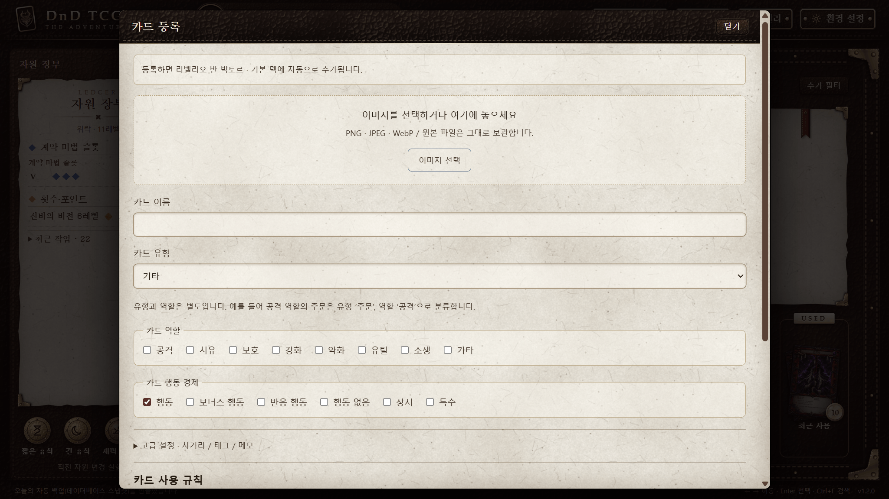 | 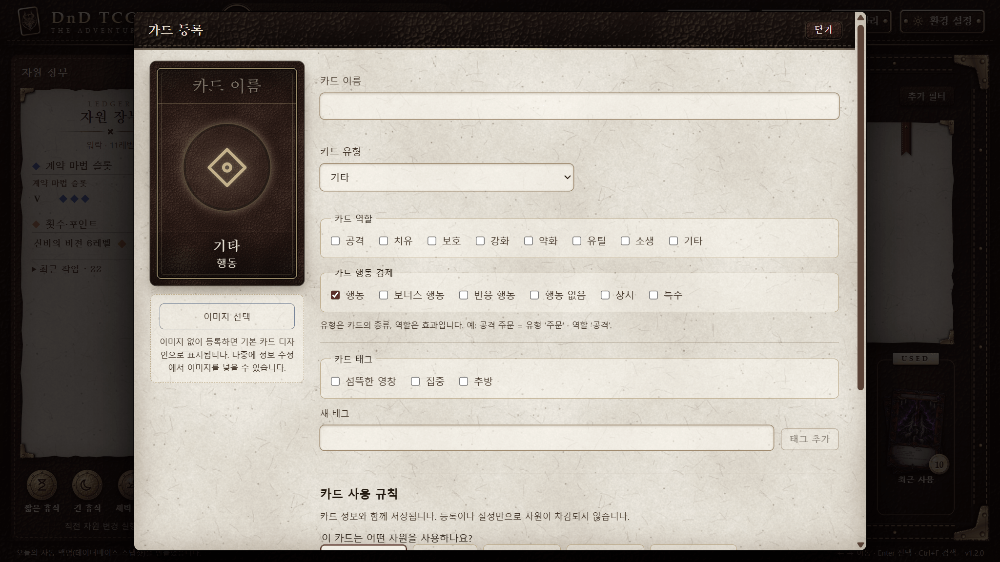 |
| 등록 창(사용 규칙까지) | 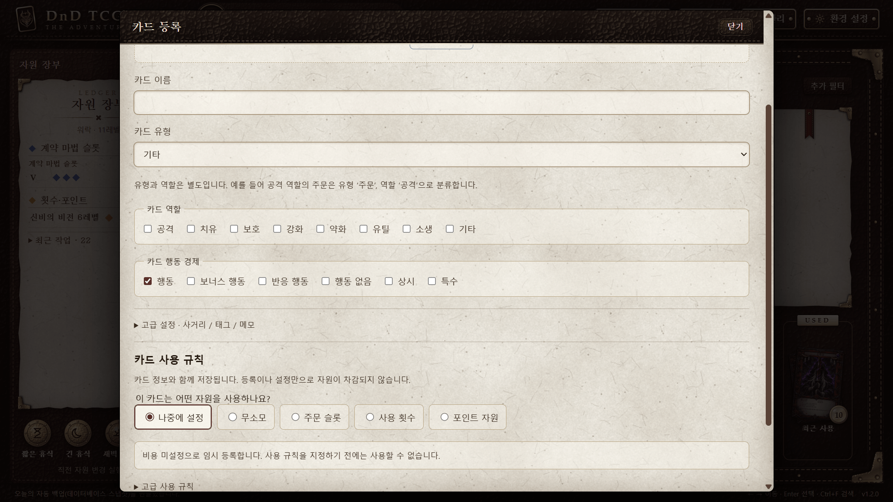 | 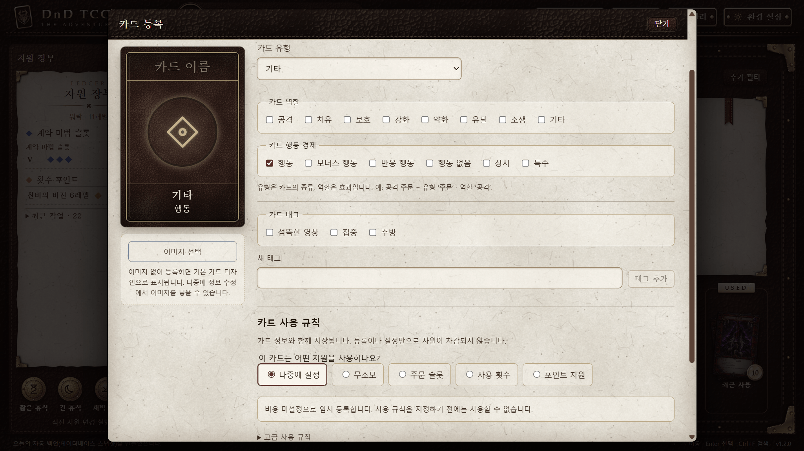 |
| 등록 창(이미지 한 장) | 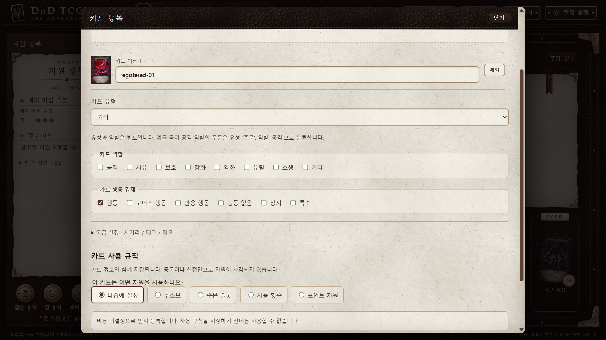 | 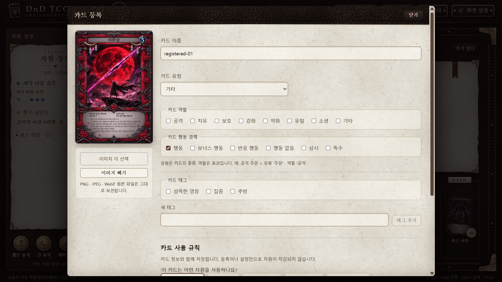 |
| 메인 · 적갈 가죽 | 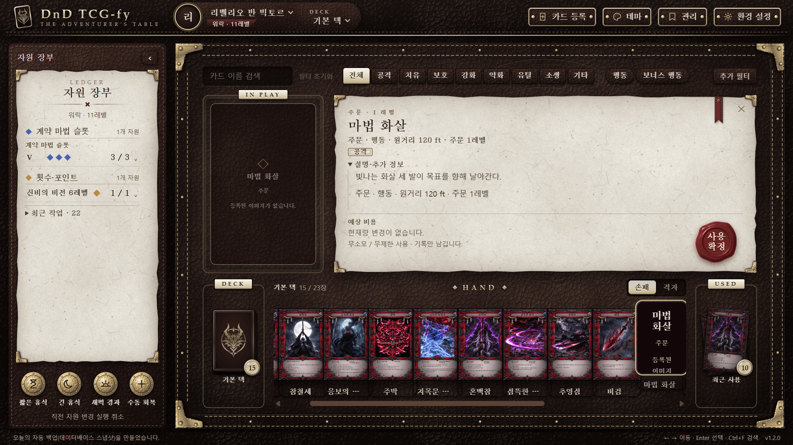 | 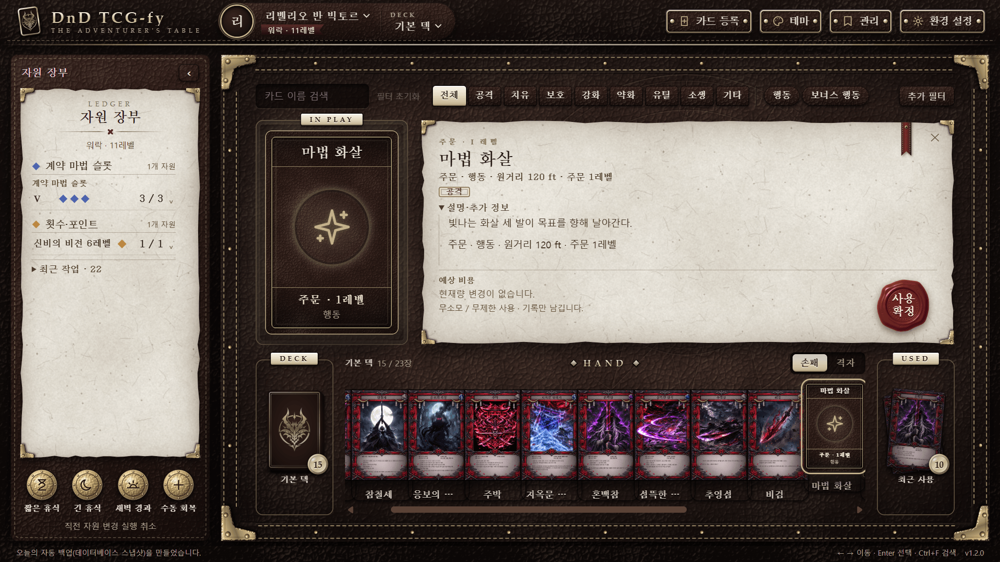 |
| 손패 · 적갈 가죽 | 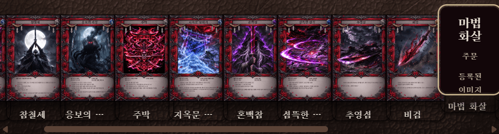 | 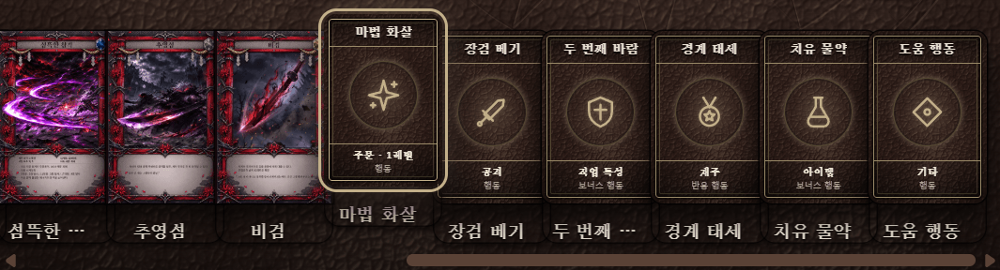 |
| 손패 · 흑단과 은 | 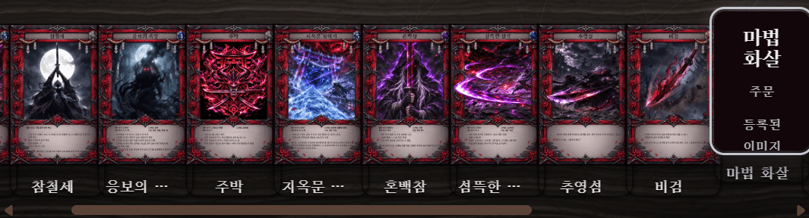 | 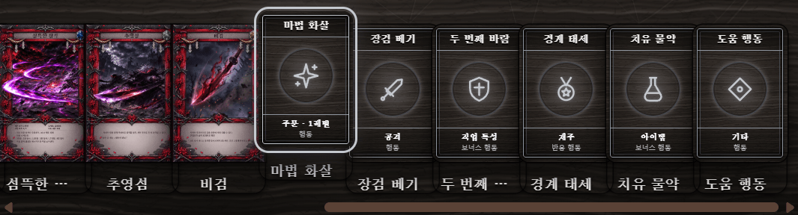 |
| 손패 · 숲의 펠트 | 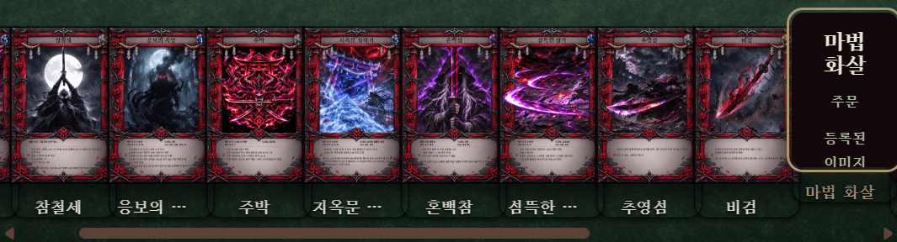 | 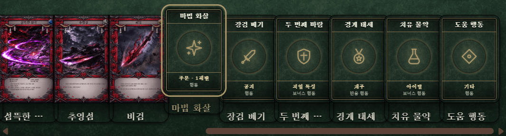 |
| 손패 · 아케인 블루 | 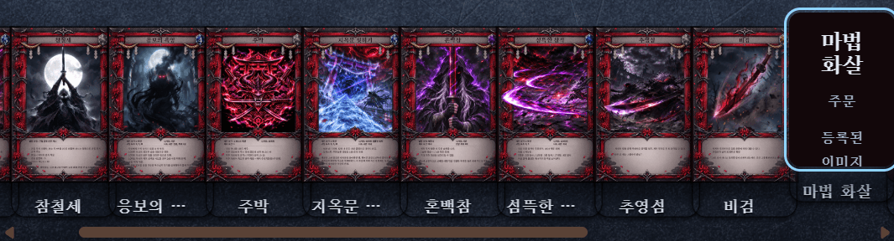 | 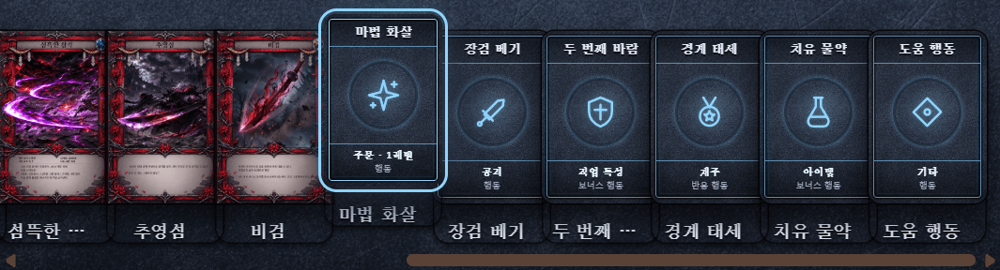 |
| 이미지 없는 카드 다시 누르기 | 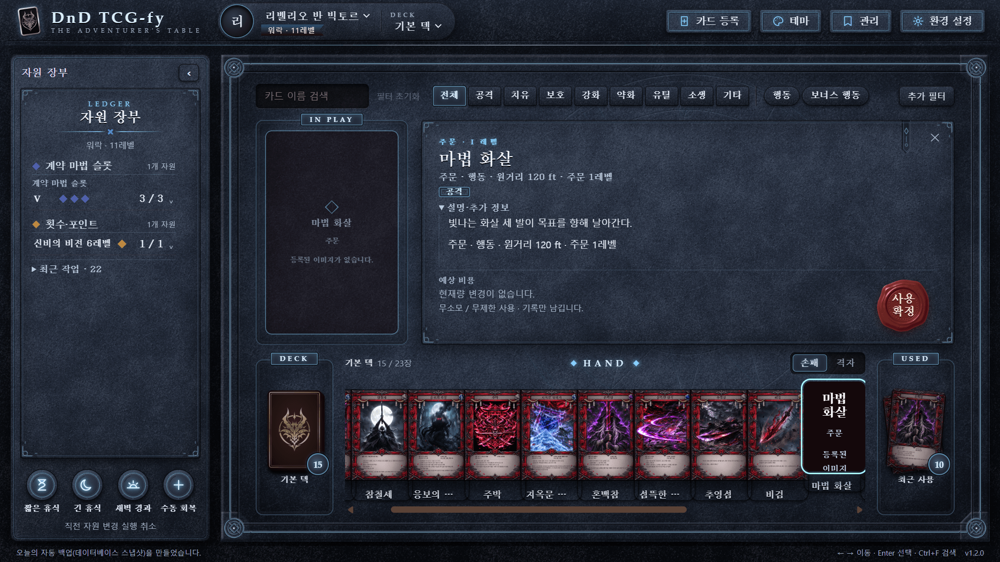 (확대 안 됨) | 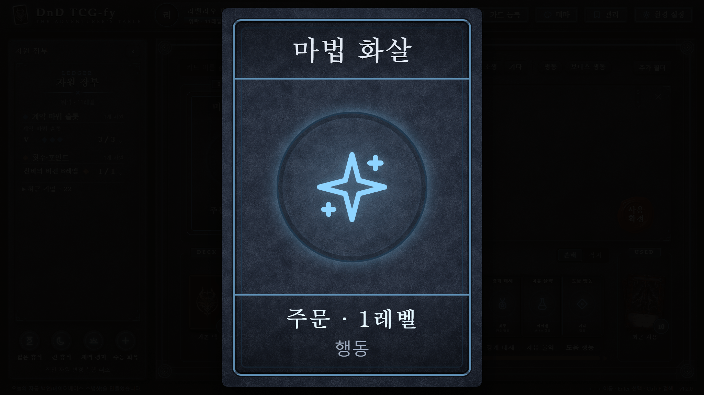 |

흑단과 은·숲의 펠트·아케인 블루의 메인 화면은 `docs/screenshots/v1.3-p1/{before,after}-{ebony,verdant,abyss}-board.png`에 있다.

## 5. 검증 결과

| 지시서 검증 항목 | 확인한 내용 | 결과 |
| --- | --- | --- |
| 이미지 있는 카드 등록 | 이미지 한 장 → “카드 이름” 하나 → 저장. 저장된 원본이 원래 파일과 바이트 단위로 같고, 손패에 이미지 면이 나온다 | 통과 |
| 이미지 없는 카드 등록 | 이미지 없이 주문 1레벨 + 계약 마법 슬롯 비용으로 저장. DB `image_asset_id`는 NULL, 활성 덱에 들어감. 손패·IN PLAY에 기본 면이 나오고 “이미지 없음” 문구는 없다 | 통과 |
| 비용 설정 | 등록 창 안에서 주문 슬롯(계약)·무소모 지정. 새 자원 만들기는 v1.2 테스트로 회귀 확인 | 통과 |
| 카드 사용 및 확대 | 이미지 없는 카드: 다시 누르기와 IN PLAY로 확대(종횡비 1.458 유지, ESC·바깥 클릭 닫힘). 사용 확정이 계약 슬롯 1칸을 쓰고 Undo로 복구 | 통과 |
| 데이터 저장 및 재실행 | 재시작 후 새 카드 4장 유지, 기본 면 그대로, 원래 카드 행과 이미지 파일 모두 그대로. `foreign_key_check` 비어 있음, `quick_check` ok | 통과 |
| 기존 카드 호환 | 기존 이미지 카드 표시·편집·교체·휴지통, 깨진 이미지 안내(메인 E2E 38개) | 통과 |
| 등록 취소·저장 실패 | 이미지 빼기·취소가 그 복사본(파일·DB 행)만 지우고 다른 이미지는 그대로. 저장 실패 롤백은 기존 테스트 유지 | 통과 |
| 덱 연결 | 체크 끄면 라이브러리에만 등록. 창을 연 뒤 덱이 바뀌면 저장 거부 | 통과 |
| 테마 | 네 테마 모두 기본 면을 각자의 장식 색으로 그림(테두리 색 4가지가 모두 다름), 이름이 넘치지 않음 | 통과 |
| 화면 크기·배율 | 1280×720에서 100/125/150% 배율로 가로 넘침 없음, 저장 버튼 접근 가능 | 통과 |

**자동 검사**

- `npm run lint`, `npm run typecheck`를 통과했다.
- `npm test`는 486/486 통과다. 이번에 14개를 추가했다:
  - `V13P1UI.test.tsx` 10개
  - `discard-imports.test.ts` 3개
  - `registration.test.ts` 1개
- Node 24 전용 2개 파일(`p11.test.tsx`, `P4BUI.test.tsx`)은 이 PC의 Node 22에서 로드되지 않는다(이전과 같음).

**E2E** (모두 `repository-data` 사본으로 실행했고, 실제 `%APPDATA%`는 건드리지 않았다)

- **새 `scripts/v13-p1-e2e.mjs` 7개 검사:** 빌드 번들, 개발 모드(Vite), 패키징 EXE에서 모두 통과.
- **전체 회귀 13종:** 빌드 번들과 패키징 EXE에서 모두 통과.
  - 메인 38
  - v1.2 Phase 1~4: 9 / 7 / 6 / 6
  - v1.1 Phase 1~4: 8 / 9 / 11 / 9
  - P4-A·B·C
  - P5 6단계
- **E2E 수정:**
  - 이미지 한 장 이름 칸(“카드 이름”)에 맞춰 기존 E2E 5개를 고쳤다.
  - 처음 번들 회귀에서 메인 E2E가 정보 수정의 “교체 이미지 미리보기” 이름을 찾지 못해 멈췄다. 이름을 되살린 뒤 38개 모두 통과했다.
- **마지막 손질 후 다시 돌린 것:** 태그 칸 아래 겹친 구분선을 지운 뒤 다시 빌드·패키징했다. 최종 EXE에서 Phase 1 7개, 메인 38개, P5 6단계가 모두 통과했고, lint·typecheck·단위 테스트 486/486도 다시 통과했다.

## 6. 바뀐 파일

- **화면**
  - `src/components/CardFace.tsx`: `DefaultCard`, `KindIcon`, `kindLine`
  - `src/components/CardEditor.tsx`: 두 칸 배치, 덱 연결 체크, 이미지 정리
  - `ImageLightbox.tsx`: 기본 면 확대
  - `CardGallery.tsx`, `SelectedCardPanel.tsx`: 모든 카드 확대
  - `src/theme-playmat.css`: v1.3 Phase 1 구역
- **메인 프로세스**
  - `electron/assets.ts`: 이번 실행 가져오기 목록
  - `electron/library-store.ts`: `queueUnusedImports`, `addToDeck`
  - `electron/main.ts`, `electron/preload.ts`, `src/shared/contracts.ts`: `assets:discard`, `addToDeck`
- **테스트**
  - `tests/V13P1UI.test.tsx`, `tests/discard-imports.test.ts`, `tests/registration.test.ts`
  - `scripts/v13-p1-e2e.mjs`
  - 기존 E2E 5개 이름 칸 수정
- **문서:** `V1_3_PLAN.md`, `DATA_SCHEMA_V1_3.md`, `DECISIONS.md`, `CLAUDE.md`, 이 보고서, `docs/screenshots/v1.3-p1/`
- **에셋:** 새 이미지 파일은 없다. 아이콘 6개는 코드 안의 SVG 경로다. 사용자 카드 이미지는 바꾸지 않았다.

## 7. 알려진 한계·미검증

- **미검증:** 실제 Windows 디스플레이 배율 설정 화면(Chromium 배율로만 재현), 터치·펜 입력.
- 등록 창을 연 채 앱을 강제 종료하면 그때 고른 이미지는 남는다. 이전 버전에서 취소하며 남은 이미지도 그대로 둔다(추측해서 지우지 않음).
- 이미지 두 장 이상의 등록 화면은 그대로다. Phase 2에서 템플릿·개별 수정·결과 표시와 함께 다시 만든다.
- **Phase 3 전에 필요한 것:**
  - 지시서의 최종 UI 포토배시 이미지
  - 1.3.x 메모 2번(덱 우측·최근 사용 좌측)과 지시서의 배치(덱 좌측 IN PLAY 아래, USED 우측 하단) 중 어느 쪽을 따를지 결정

## 8. 커밋

`feat/v1.3-phase1` 브랜치(푸시·병합 안 함). 커밋 해시는 커밋 후 V1_3_PLAN.md 상태 기록에 남긴다.
