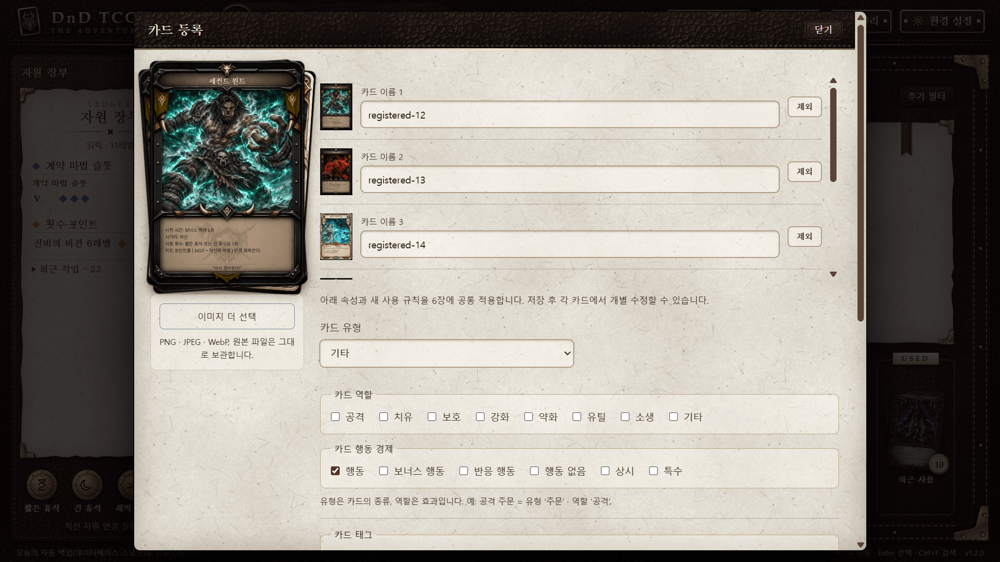
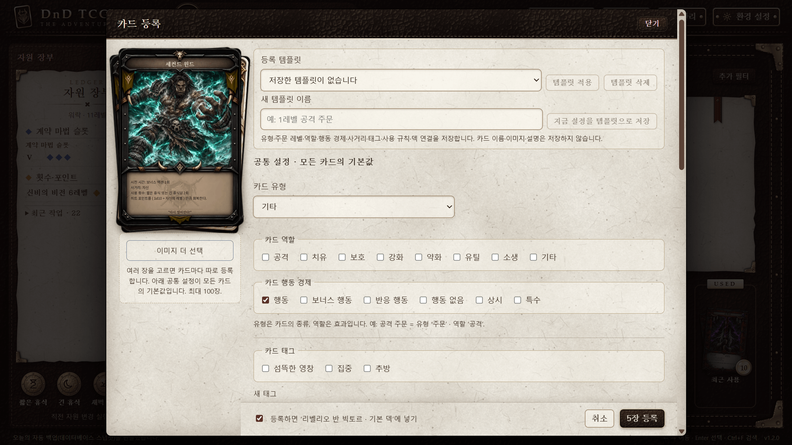
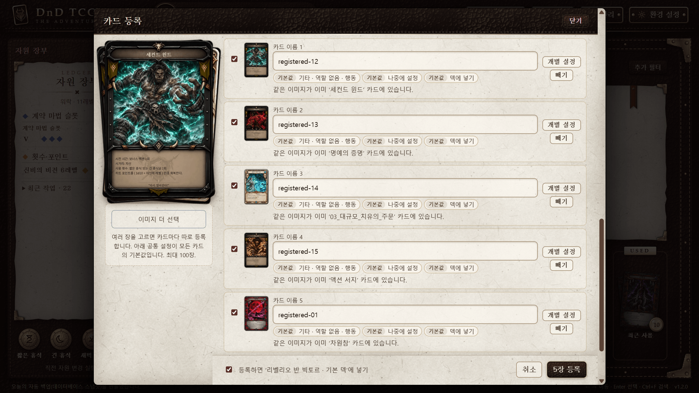
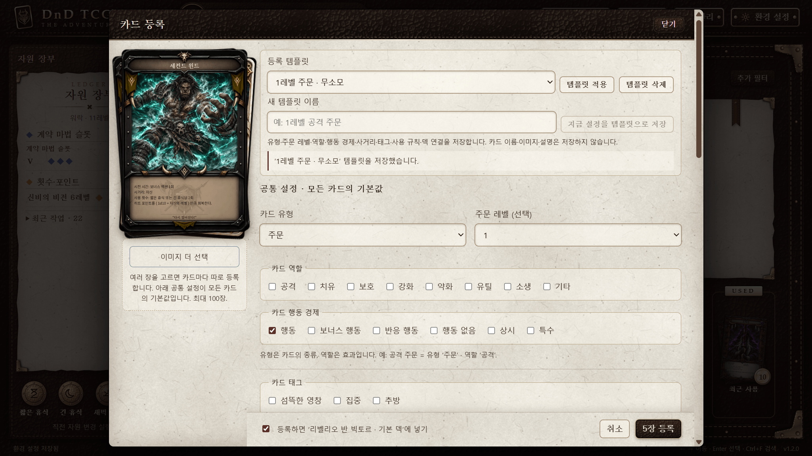
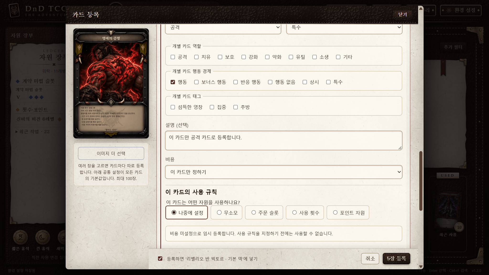
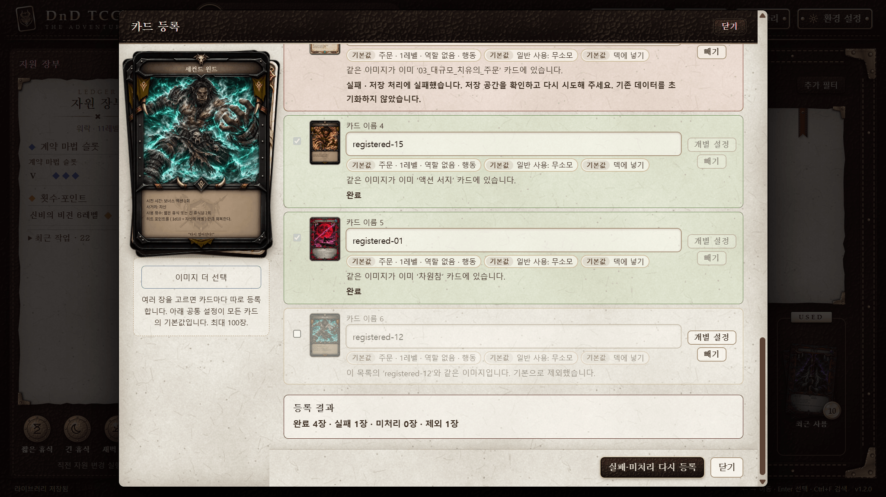
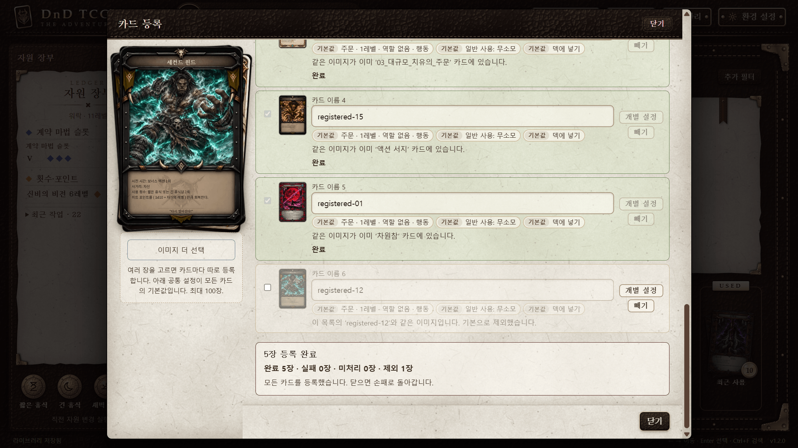
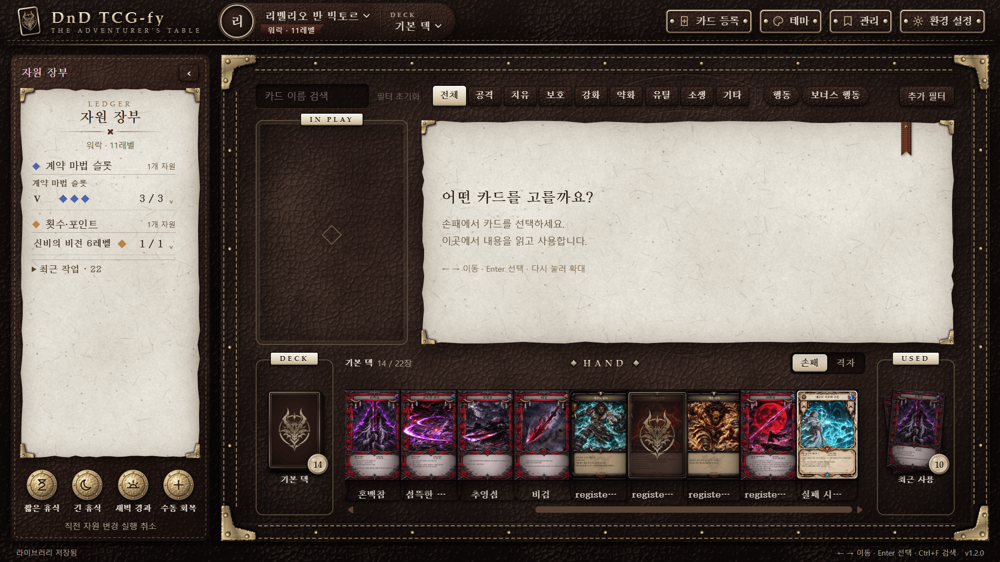

# v1.3 Phase 2 보고서 — 다중 카드 등록·등록 템플릿

- 기준: Phase 1 커밋 `c23ebf6`, 브랜치 `feat/v1.3-phase2`. 앱 버전은 1.2.0 그대로다.
- SQLite v6 그대로다. 새 설정 키는 `registration_templates` 하나이고 새 IPC 채널은 없다. 계약은 [DATA_SCHEMA_V1_3.md](DATA_SCHEMA_V1_3.md), 결정은 [DECISIONS.md](DECISIONS.md)에 있다.

## 0. 기존 구현과의 차이

| 항목 | Phase 1까지 | Phase 2 |
| --- | --- | --- |
| 여러 장 등록 | 이미지별 이름만 따로. 나머지 속성·비용·덱은 모두 같고, 한 트랜잭션으로 전부 저장하거나 전부 실패 | 공통 설정 + 카드별 개별 설정(속성·설명·비용·덱). 카드마다 따로 저장하고 카드별 결과를 보여 줌 |
| 실패 | 한 장만 문제여도 전체가 저장되지 않고 이유만 표시 | 실패한 카드만 실패. 나머지는 저장. 원인을 표시하고 실패·미처리만 다시 등록 |
| 같은 이미지 | 확인 안 함 | 같은 목록의 반복 이미지는 기본 제외. 이미 쓰는 카드가 있으면 경고(휴지통 포함) |
| 템플릿 | 없음 | 공통 설정을 이름 붙여 저장·적용·삭제(최대 20개). 한 장 등록에서도 사용 |
| 최종 확인 | 없음(바로 저장) | 장수·덱·비용 종류·개별 설정·새 자원·중복 경고를 보여 준 뒤 “등록 시작” |

## 1. 여러 장 등록의 흐름

1. **이미지 선택:** 등록 창에서 두 장 이상 고르면(또는 이미 고른 한 장에 더 고르면) 일괄 등록 화면이 된다. 최대 100장이고, 지원 형식은 PNG·JPEG·WebP 그대로다.
2. **목록·미리보기:** 오른쪽 아래 “카드별 확인” 목록에 카드마다 다음이 나온다.
   - 포함 체크
   - 썸네일
   - 이름(“카드 이름 N”)
   - 속성·비용·덱 요약. 각 요약에는 공통 설정을 따르면 **기본값**, 이 카드만 바꿨으면 **개별** 표시가 붙는다.
   - 같은 이미지 경고
   - 진행 상태
   - **개별 설정**을 누르면 그 카드 이미지가 왼쪽 미리보기에 크게 나온다.
3. **공통 속성:** 위쪽의 “공통 설정 · 모든 카드의 기본값”이 모든 카드에 적용된다.
   - 한 장 등록과 같은 칸을 쓴다: 유형, 주문 레벨, 역할, 행동 경제, 태그, 사용 규칙(새 자원 만들기 포함), 사거리, 덱 연결.
   - 설명은 카드마다 다르므로 개별 설정에서 적는다.
4. **카드별 수정:** 개별 설정에서 다음을 이 카드만 다르게 정한다.
   - “이 카드의 속성을 따로 정하기”(유형·주문 레벨·사거리·역할·행동 경제·태그)
   - 설명
   - 비용(공통 규칙 따르기 / 이 카드만 정하기)
   - 덱 연결(공통 따르기 / 넣기 / 넣지 않기)
   - **기본값으로 되돌리기**로 한 번에 공통 설정으로 돌아간다.
5. **비용·덱 확인:** 요약에 실제 비용(“일반 사용: 무소모”, “지팡이 충전 1회” 등)과 덱 연결이 보인다. 저장할 수 없는 카드는 **확인 필요 · 이유**로 표시된다. 예: 이름 없음, 슬롯 비용인데 레벨이 없는 카드.
6. **최종 확인:** “N장 등록”을 누르면 바로 저장하지 않고 다음을 보여 준다.
   - 등록할 장수와 제외한 장수
   - 덱에 넣을 장수와 라이브러리에만 넣을 장수
   - 비용 종류별 장수
   - 개별 설정한 카드 수
   - 새 자원 생성 여부
   - 같은 이미지가 포함된 장수
   - 확인이 필요한 카드가 있으면 넘어가지 않고 그 카드를 열어 준다.
7. **등록 실행:** “등록 시작”을 누르면 한 장씩 저장하고 진행률을 보여 준다. **중단**하면 남은 카드는 미처리가 된다.
8. **결과:**
   - 완료·실패·미처리·제외 장수를 보여 주고, 실패한 카드에는 원인을 표시한다.
   - **실패·미처리 다시 등록**으로 다시 시도한다.
   - 완료한 카드는 잠겨서 다시 등록되지 않는다.
   - 실패한 카드는 고친 뒤 다시 시도할 수 있다.

## 2. 데이터 처리

| 요구 | 구현 |
| --- | --- |
| 이미지별 독립 카드 | 카드마다 기존 등록 트랜잭션을 하나씩 쓴다(카드·덱 연결·비용·자원 연결·영수증) |
| 부분 실패 시 성공 항목 보존 | 한 장의 실패는 그 트랜잭션만 취소한다. 앞뒤 카드는 그대로 |
| 성공·실패·미처리 구분 | 카드마다 상태. 세 장이 연속으로 실패하면 공통 원인일 수 있어 멈추고 나머지는 미처리 |
| 안전한 재시도·중복 방지 | 카드마다 고정된 요청 ID. 같은 내용으로 다시 보내면 등록 영수증이 같은 결과를 돌려줘서 두 번 만들어지지 않는다. 저장된 카드는 다시 보내지 않는다 |
| 자원 엔진 | 별도 계산 없이 한 장 등록과 같은 규칙 생성기·저장 경로를 쓴다. 무소모·비용 미설정 구분, 일반·계약 슬롯, 홈브루 범위, 포인트 범위를 그대로 지원한다 |
| 새 자원 | 공통 규칙의 새 자원은 그것을 쓰는 첫 카드와 함께 한 번만 만들고, 뒤 카드는 그 자원에 연결한다 |
| 자원 번호(revision) | 앞 카드의 비용 저장이 번호를 올리므로 카드마다 새로 읽는다 |
| 원본 이미지 보존 | 가져온 원본을 바이트 그대로 보관한다(E2E에서 해시로 확인) |
| 저장하지 않은 이미지 | 제외·빼기·실패 후 포기한 이미지는 창을 닫을 때 Phase 1의 정리 경로로 지운다. 저장된 이미지와 이전 데이터는 건드리지 않는다 |
| 이미지 교체 기능 | 정보 수정의 교체 흐름은 그대로이고, 일괄 등록은 새 카드에만 쓴다 |

**고급 규칙:** 일괄 등록의 공통·개별 비용은 기본 유형만 쓴다(나중에 설정·무소모·주문 슬롯·사용 횟수·포인트). 여러 사용 방식 같은 고급 규칙은 등록 뒤 카드 사용 규칙에서 정한다. 한 장 등록에는 고급 규칙 편집이 그대로 있다.

## 3. 등록 템플릿

- **저장:** 이름(최대 40자)을 적고 “지금 설정을 템플릿으로 저장”을 누른다.
  - 담는 것: 유형, 주문 레벨, 역할, 행동 경제, 사거리, 태그, 사용 규칙(종류·적용 범위·슬롯 계열·홈브루·양·포인트 범위), 덱 연결
  - 담지 않는 것: 카드 이름, 이미지, 설명
  - 같은 이름이면 새 설정으로 바꾼다.
- **적용:** 공통 설정(여러 장)이나 한 장 등록 칸을 채운다. 적용한 뒤에도 각 칸과 각 카드를 자유롭게 고칠 수 있다.
- **자원:** 캐릭터마다 자원 ID가 달라서 이름으로 저장하고, 적용할 때 현재 캐릭터의 같은 이름 자원을 찾는다. 없으면 비워 두고 “찾지 못했습니다”라고 알린다. 지워진 태그도 빼고 알린다.
- **삭제:** 확인을 한 번 받은 뒤 지운다. 이미 등록한 카드에는 영향이 없다.
- **저장 위치:** 설정의 별도 키 `registration_templates`이다. 1.2.0은 이 키를 읽지 않는다.

## 4. 변경 전후

모두 `repository-data` 사본, 1366×768에서 찍었다. 이미지 6장은 `artifacts/p4-b-input`의 실제 카드 이미지 5장과 그중 1장을 한 번 더 고른 것이다. 그래서 기존 카드와 같은 이미지 경고와 반복 이미지 제외가 함께 보인다.

| 화면 | 변경 전 (Phase 1) | 변경 후 |
| --- | --- | --- |
| 여러 장 선택 직후 |  |  |
| 카드 목록 |  |  |

변경 후에만 있는 화면:

| 화면 | 스크린샷 |
| --- | --- |
| 템플릿 저장 |  |
| 카드별 개별 설정(유형·설명·비용) |  |
| 등록 전 최종 확인 |  |
| 결과 · 한 장 실패(시연용으로 실패를 주입) |  |
| 실패·미처리 다시 등록 후 |  |
| 등록 후 손패 |  |

## 5. 검증 결과

| 지시서 검증 항목 | 확인한 내용 | 결과 |
| --- | --- | --- |
| 소량 등록 | 이미지 6장: 공통 설정(주문 1레벨·공격·무소모) 적용, 반복 1장 제외 → 5장 등록 | 통과 |
| 대량 등록 | 50장을 템플릿으로 한 번에 등록. 모두 활성 덱에 들어가고 비용이 연결됨(약 2초) | 통과 |
| 공통 설정·개별 설정 | 둘째 카드만 유형 공격·설명·나중에 설정, 셋째 카드만 라이브러리에만. 나머지는 공통값. 목록의 기본값/개별 표시와 최종 확인의 장수가 맞음 | 통과 |
| 중복 이미지 | 같은 목록의 반복 이미지는 기본 제외. 기존 카드와 같은 이미지는 카드 이름으로 경고(휴지통 포함). “이미 등록된 이미지 N장 제외” 버튼 | 통과 |
| 실패 항목 재시도 | 한 장에 저장 실패를 주입: 그 카드만 실패하고 원인 표시, 나머지 4장 저장. 원인을 없앤 뒤 다시 등록하면 그 카드만 한 번 저장(중복 없음) | 통과 |
| 미처리 | 모든 저장이 실패하도록 주입: 3장 연속 실패 후 멈추고 2장 미처리. 다시 등록으로 5장 모두 한 번씩 저장 | 통과 |
| 카드 원본 보존 | 저장된 카드의 원본이 고른 파일과 바이트 단위로 같음. 기존 카드 행과 이미지 파일은 재시작 후에도 그대로 | 통과 |
| 저장하지 않은 이미지 | 창을 닫으면 제외한 반복 이미지만 지워지고(파일·DB 행), 저장된 이미지는 남음 | 통과 |
| 활성 덱 연결 | 공통 “넣기” 4장은 덱에, 개별 “넣지 않기” 1장은 라이브러리에만 | 통과 |
| 템플릿 | 저장 → 재시작 → 한 장 등록에 적용하면 주문 1레벨·사용 횟수·같은 이름 자원이 채워지고, 저장한 카드가 그 자원에 연결됨. 없는 자원·지워진 태그는 알림 | 통과 |
| 화면 크기·배율 | 1280×720, 100/125/150%에서 개별 설정을 연 채로 가로 넘침 없음, “N장 등록” 보임 | 통과 |
| 1.2.0 하위 호환 | 실제 1.2.0 빌드(`042d533`)로 v1.3이 쓴 DB를 엶: 이미지 없는 카드·라이브러리 전용 카드·일괄 등록 카드가 그대로 보이고 1.2.0이 설정을 저장한 뒤에도 v1.3 템플릿이 남음 | 통과 |

**자동 검사**

- `npm run lint`, `npm run typecheck`를 통과했다.
- `npm test`는 501/501 통과다. 이번에 15개를 추가했다:
  - `batch-registration.test.ts` 7개
  - `batch-store.test.ts` 3개
  - `V13P2UI.test.tsx` 5개
- Node 24 전용 2개 파일은 이 PC의 Node 22에서 로드되지 않는다(이전과 같음).

**E2E** (모두 `repository-data` 사본으로 실행했고, 실제 `%APPDATA%`는 건드리지 않았다)

- **새 `scripts/v13-p2-e2e.mjs` 6개 검사:** 빌드 번들, 개발 모드(Vite), 패키징 EXE에서 모두 통과.
  - 실패는 테스트 사본의 SQLite에 임시 트리거를 만들어 주입하고, 재시작 전에 지운다.
- **전체 회귀(빌드 번들):** 15종이 모두 통과했다.
  - v1.3 Phase 1·2, 메인 38, v1.2 Phase 1~4, v1.1 Phase 1~4, P4-A·B·C, P5
  - v1.2 Phase 2(손패 관성) E2E가 회귀 순서 안에서 번들·EXE 모두 “glide starts and ends” 한 줄에서 실패했다. 혼자 돌리면 매번 통과했다.
  - 원인은 검사 쪽이었다. 손패 움직임을 시작 전부터 정해진 1.6초 동안만 기록하는데, Playwright가 이동을 늦게 보내면 놓는 시점이 늦어져 미끄러짐이 기록 창보다 길어졌다. 앱 동작(속도·방향·끝 멈춤)은 같은 검사의 다른 단언이 그대로 확인했다.
  - 검사가 마지막 기록에서 아직 미끄러지는 중이면 끝날 때까지(최대 3초) 기다린 뒤 멈췄는지 확인하도록 고쳤다. 앱 코드는 바꾸지 않았다. 고친 뒤 EXE 2회·번들 1회 모두 7/7, 그리고 전체 EXE 회귀를 다시 돌렸다(아래).
- **기존 E2E 수정:** 여러 장 등록을 쓰던 메인·P4-B·P4-C E2E를 새 흐름(최종 확인 → 결과 → 닫기)으로 고쳤다.
- **패키징 EXE:** 같은 15종 전체 회귀가 모두 통과했다. 대부분의 로그에 packaged 모드가 찍혀 있고, P4-B·C도 `DND_TCG_EXECUTABLE`를 쓴다.
  - v1.3 Phase 2 6개, Phase 1 7개
  - 메인 38개
  - v1.2 Phase 1~4: 9 / 7 / 6 / 6
  - v1.1 Phase 1~4: 8 / 9 / 11 / 9
  - P4-A·B·C
  - P5 6단계

## 6. 바뀐 파일

- **화면**
  - `src/components/BatchRegistration.tsx`: 새 파일. 목록, 개별 설정, 최종 확인, 실행, 결과
  - `src/components/RegistrationTemplates.tsx`: 새 파일. 템플릿 막대
  - `src/components/FormChecks.tsx`: 새 파일. 체크 묶음 공용
  - `src/components/CardEditor.tsx`: 일괄 모드, 템플릿, 가져오기 시 일괄 항목 생성
  - `src/components/RegistrationRules.tsx`: 카드별 모드(“개별 …” 이름, 고급 편집 숨김)
  - `src/App.tsx`: 템플릿 저장 연결
  - `src/theme-playmat.css`: v1.3 Phase 2 구역
  - 대화상자 기본 버튼을 마우스로 가리킬 때 글자가 바탕에 묻히던 기존 문제도 고쳤다.
- **로직:** `src/shared/batch-registration.ts`(새 파일. 카드별 실제 값, 문제 확인, 요청 생성, 요청 ID 유지, 같은 이미지, 요약, 템플릿 변환)
- **계약·저장**
  - `src/shared/contracts.ts`: 템플릿 스키마, `AssetPreview.sha256`·`duplicates`
  - `electron/store.ts`: `registration_templates` 키
  - `electron/assets.ts`, `electron/library-store.ts`: 같은 이미지 카드 찾기
- **테스트**
  - `tests/batch-registration.test.ts`, `tests/batch-store.test.ts`, `tests/V13P2UI.test.tsx`
  - `scripts/v13-p2-e2e.mjs`
  - `scripts/navigation-helpers.mjs`의 `registerBatch`
  - 여러 장 등록을 쓰던 기존 E2E 3개(메인·P4-B·P4-C)를 새 흐름으로 고쳤다.
- **문서:** `V1_3_PLAN.md`, `DATA_SCHEMA_V1_3.md`, `DECISIONS.md`, `CLAUDE.md`, 이 보고서, `docs/screenshots/v1.3-p2/`
- **에셋:** 새 이미지 파일은 없다. 사용자 카드 이미지는 바꾸지 않았다.

## 7. 알려진 한계·미검증

- **미검증:** 실제 Windows 디스플레이 배율 설정 화면(Chromium 배율로만 재현), 터치·펜 입력.
- 등록 도중 앱을 강제 종료하면 이미 저장된 카드는 남고, 나머지 이미지는 다음에 다시 골라야 한다. 남은 가져오기 파일은 Phase 1과 같은 이유로 자동 삭제하지 않는다.
- 같은 이미지 경고는 바이트가 완전히 같은 파일만 찾는다. 크기나 형식을 바꾼 같은 그림은 찾지 못한다.
- 일괄 등록에서는 고급 사용 규칙을 쓰지 않는다(등록 후 카드 사용 규칙에서 설정).
- **Phase 3 전에 필요한 것:**
  - 최종 UI 포토배시 이미지
  - 1.3.x 메모 2번(덱 우측·최근 사용 좌측)과 지시서 배치 중 어느 쪽을 따를지 결정

## 8. 커밋

`feat/v1.3-phase2` 브랜치(푸시·병합 안 함). 해시는 승인 후 다음 단계 기록에 남긴다.
