# v1.3 Phase 3 · UI-P0 첫 번째 스크린샷 검수 — 플레이 보드 골격

- 기준: Phase 2 커밋 `d942418`, 브랜치 `feat/v1.3-phase3`. 앱 버전은 1.2.0 그대로이고 SQLite·IPC·설정은 바뀌지 않았다.
- 지시서대로 UI-P0은 **배치 구조**만 정한다. 손패 장수·더미 디자인(UI-P1), 세부·장부 여백(UI-P2), 재질·장식 정리(UI-P3)는 이 검수 뒤에 한다.

## 1. 확정을 부탁드리는 배치

```
┌───────────── 검색 · 역할 필터 · 행동 / 보너스 행동 / 반응 행동 · 추가 필터 ─────────────┐
│ IN PLAY        │  카드 세부(양피지 · 사용 확정)              │  자원 장부(회복 버튼)  │
│ (선택한 카드    │                                            │                        │
│  크게)          ├────────────────────────────────────────────┤                        │
│                 │  HAND                                      ├────────────────────────┤
├─────────────────┤                                            │  DECK                  │
│ USED            │                                            │                        │
└─────────────────┴────────────────────────────────────────────┴────────────────────────┘
```

- **왼쪽**(판 너비의 약 21%, 좁은 창은 약 19%): 위에 IN PLAY 대형 카드, 아래에 USED(최근 사용).
- **가운데:** 위에 카드 세부, 아래에 손패.
- **오른쪽**(약 21%): 위에 자원 장부, 아래에 DECK.
- **덱과 USED 위치:** 메모 2번 결정에 따라 지시서와 반대로 두었다(“덱 우측, 최근 사용 좌측”).
- **칸별 높이:** 칸마다 위아래 비율을 따로 정한다. 그래서 대형 카드는 왼쪽 칸 높이를 거의 다 쓰고, 손패는 가운데에서 세부보다 큰 몫을 받는다.
- **자원 장부:** 판 바깥 왼쪽 세로 패널에서 판 안 오른쪽 위로 옮겼다. 기능·접기·회복 버튼은 그대로이고, 접으면 오른쪽 칸이 좁아지고 DECK은 남는다.
- **메모 7번:** 필터 줄의 행동·보너스 행동 옆에 **반응 행동** 버튼을 더했다(추가 필터의 행동 경제와 같은 설정).
- **검수 요청:** 포토배시와 비교해 패널 위치, 크기 관계, 손패 비중이 맞는지 봐 주세요. 다르게 보이는 곳을 알려 주시면 UI-P1 전에 고칩니다.

## 2. IN PLAY와 USED의 실제 의미 (지시서 확인 요청 사항)

| 이름 | 지금 코드에서 뜻하는 것 | 처리 |
| --- | --- | --- |
| IN PLAY | 손패에서 **선택한 카드**. 읽고 비용을 고르고 사용 확정할 후보다. 선택만으로는 아무것도 차감하지 않는다 | 새 “플레이 중” 상태를 만들지 않는다. 판 위 이름표는 IN PLAY를 유지한다 |
| USED | 현재 캐릭터의 사용 기록 중 **카드 사용** 이벤트로 만든 “최근 사용” 더미. 누르면 전체 카드 사용 기록 | 버리기·드로우 규칙은 만들지 않는다. 메모 3번(초기화 버튼)은 UI-P1에서 기록 비우기처럼 표시만 정리하게 한다 |
| DECK | 활성 덱(또는 전체 라이브러리)의 장수와 카드 뒷면 | 메모 4번(누르면 셔플)과 6번(뒷면 등록을 관리 → 캐릭터·덱으로)은 UI-P1에서 한다 |

이름표 “IN PLAY”가 실제로는 “선택한 카드”라는 점이 마음에 걸리시면 “SELECTED”나 “선택한 카드”로 바꿀 수 있다. 지금은 지시서와 기존 디자인의 명칭을 따랐다.

## 3. 스크린샷 (변경 전 1.3 Phase 2 → 변경 후 UI-P0)

실제 장치 배율로 찍었다. 그래서 1280×720·150%는 853×480 CSS 픽셀 화면이다.

| 화면 | 변경 전 | 변경 후 |
| --- | --- | --- |
| 1920×1080 · 100% | 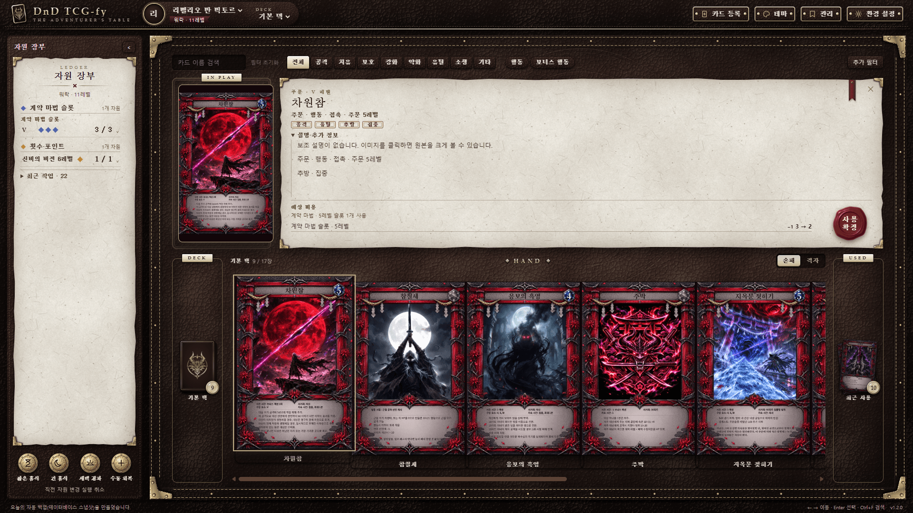 | 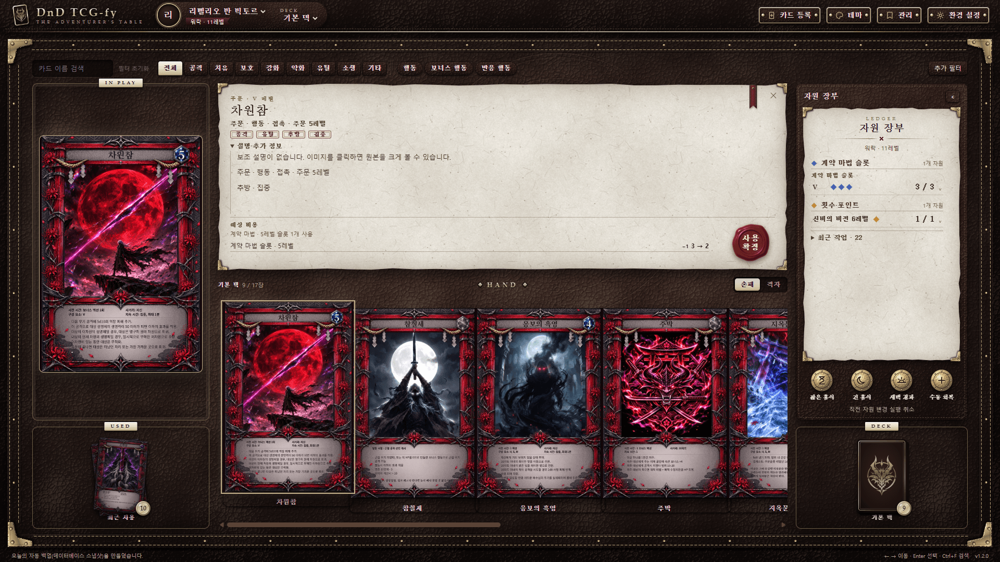 |
| 1366×768 · 100% |  |  |
| 1280×720 · 100% | 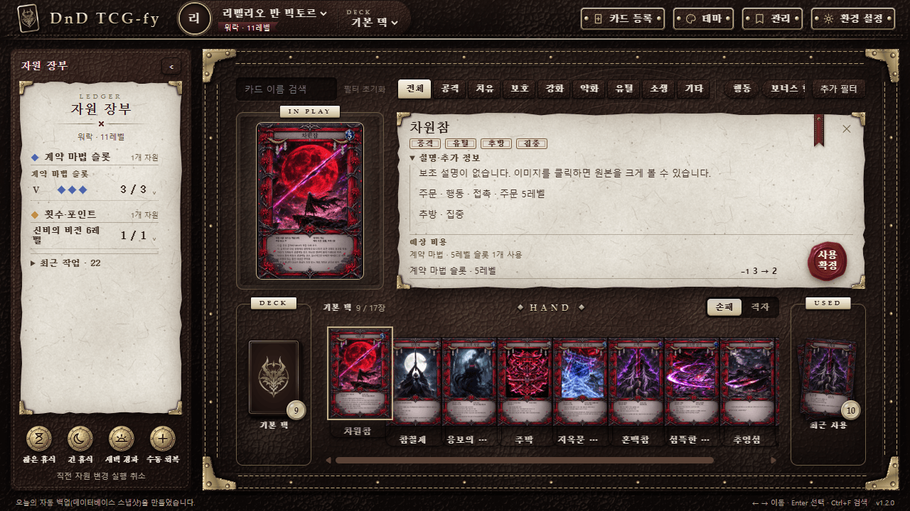 | 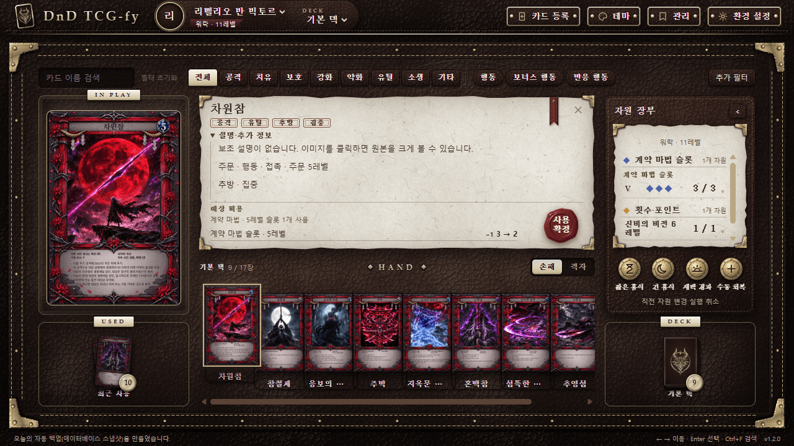 |
| 1920×1080 · 125% | 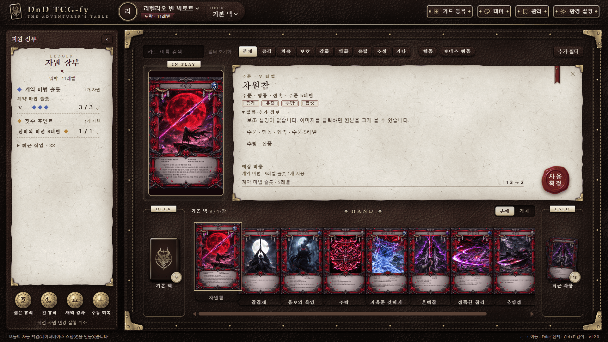 | 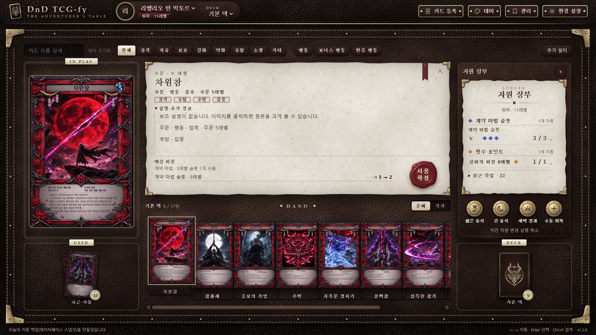 |
| 1366×768 · 125% | 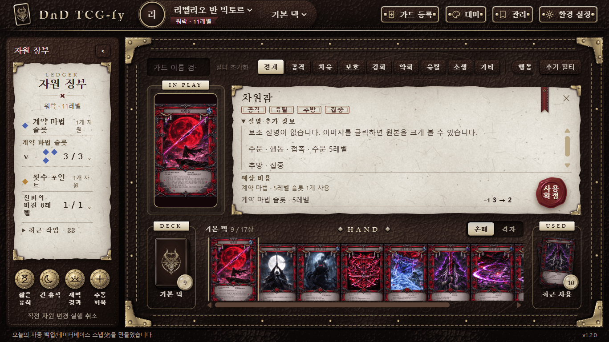 | 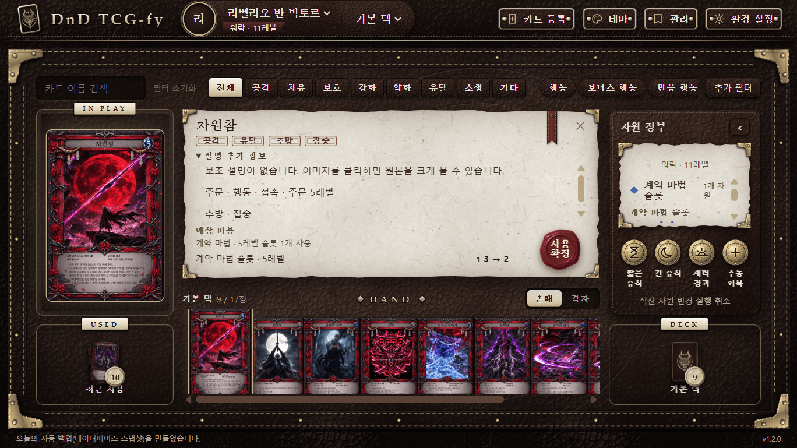 |
| 1280×720 · 150% | 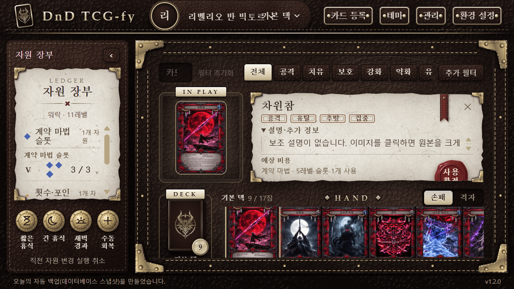 | 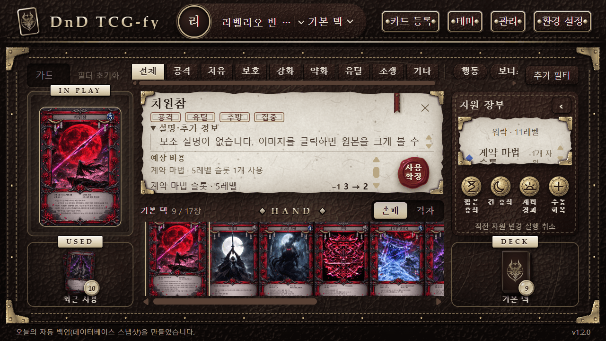 |
| 테마 · 적갈 가죽 | 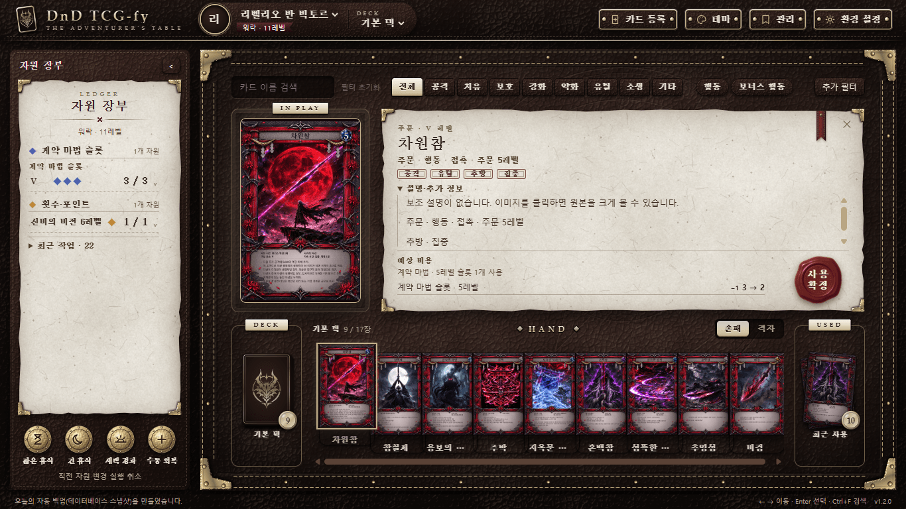 | 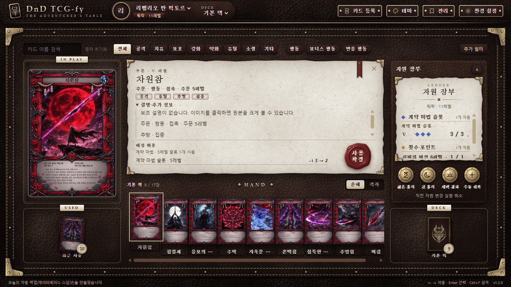 |
| 테마 · 흑단과 은 |  | 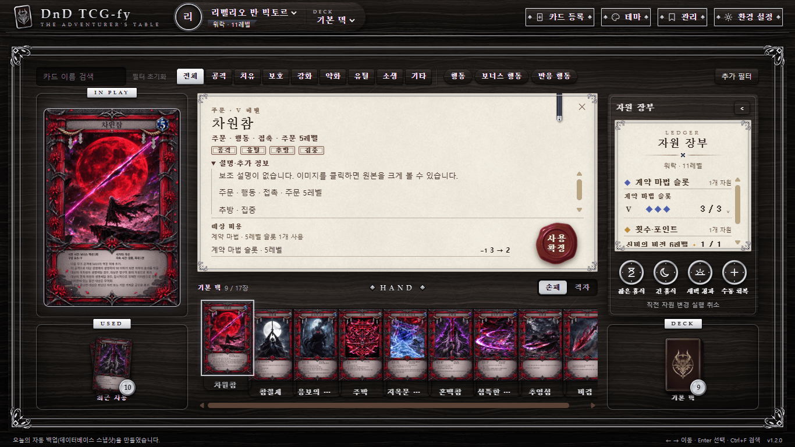 |
| 테마 · 숲의 펠트 | 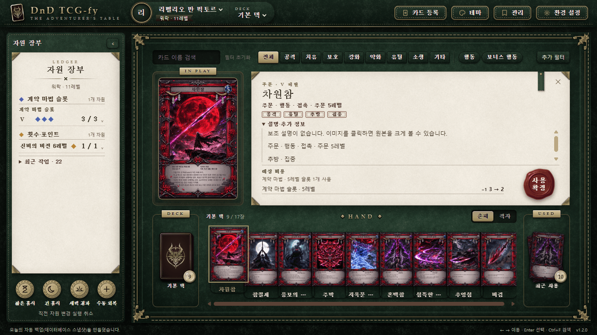 | 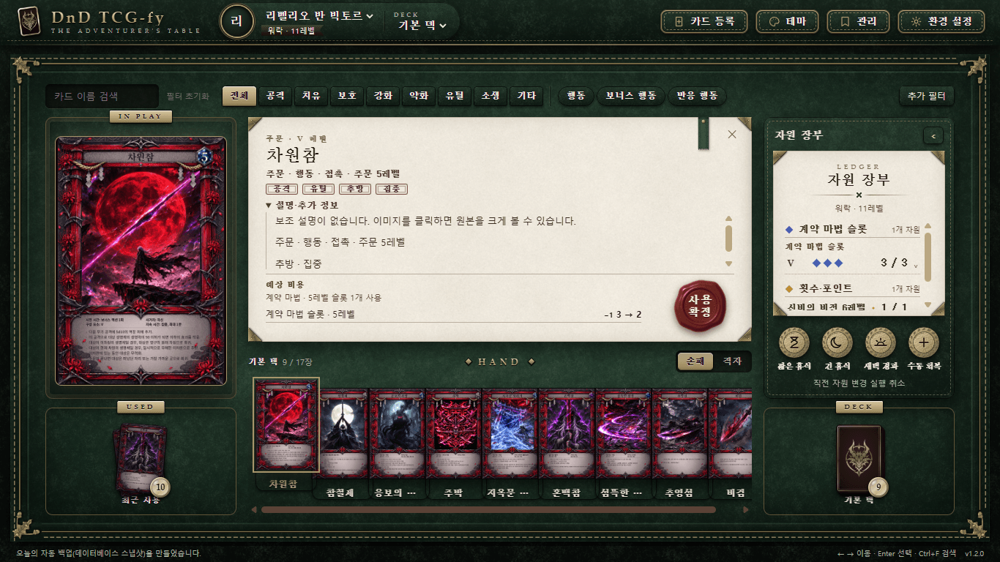 |
| 테마 · 아케인 블루 | 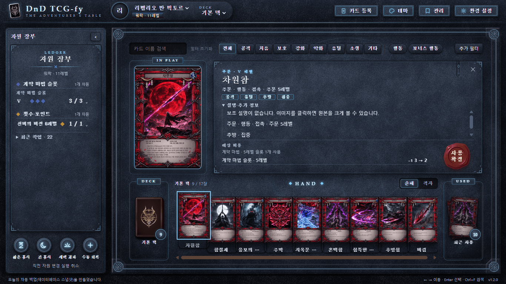 | 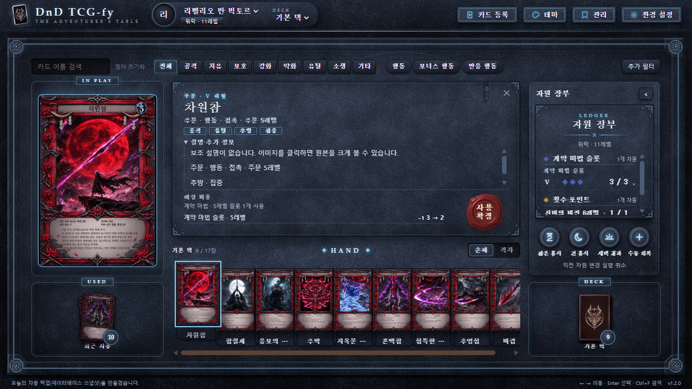 |

**잘림 제거:** 변경 전에는 1280×720·150%에서 사용 확정 인장과 덱 이름이 잘렸고, 필터 칩이 숨어 있었다. 지금은 다음과 같다.

- 짧은 창(높이 560px 이하)에서는 상단·판 테두리·카드 세부를 줄여서 인장, 회복 버튼, 두 더미가 모두 보인다.
- 좁은 창(폭 1000px 이하)에서는 필터 줄에 가로 스크롤 막대가 보이고, 캐릭터 이름은 말줄임으로 줄인다.

## 4. 검증

| 항목 | 결과 |
| --- | --- |
| 새 `scripts/v13-p3-e2e.mjs` 4개 검사(아래 항목) | 빌드 번들·개발 모드·패키징 EXE 모두 통과 |
| ↳ 세 칸 배치 | 1920×1080·1366×768·1280×720 × 100/125/150%와 최소 창 860×440에서 다음을 모두 확인: 칸 위치(왼/가운데/오른쪽, 위/아래), 겹침 없음, 판·창 밖으로 넘침 없음, IN PLAY 카드 비율 1:1.458, 인장·회복 버튼·두 더미가 모두 보임, 페이지 가로 스크롤 없음 |
| ↳ 반응 행동 버튼 | 같은 설정(`actions: ['reaction']`)으로 거르고, 필터를 바꿔도 패널이 움직이지 않음 |
| ↳ 장부 접기·펼치기 | 오른쪽 칸이 좁아지고 덱은 남으며, 가운데가 넓어짐 |
| ↳ 네 테마 | 같은 배치, 겹침·잘림 없음 |
| 단위 테스트 | 501/501 통과(Node 24 전용 2개 파일은 이 PC의 Node 22에서 로드 안 됨, 이전과 같음) |
| 전체 E2E 회귀(빌드 번들) | 16종 모두 통과 |
| 전체 E2E 회귀(패키징 EXE) | 15종 통과, v1.3 Phase 1 E2E는 이미지 정리 확인에서 한 번 실패. 원인은 검사 쪽 경쟁 조건이다. 정리 경로가 파일을 먼저 지우고 DB 행을 곧바로 지우는데, 검사가 파일이 사라진 순간 행을 봤다. Phase 1·2 E2E가 둘 다 지워질 때까지 기다리도록 고친 뒤 EXE에서 Phase 1 2회·Phase 2 1회 통과 |
| 기존 검사 수정 | 아래 3가지 |

**기존 검사를 고친 것**

- **P4-A:** “장부를 접어도 인장 위치 그대로”는 장부가 왼쪽일 때만 성립했다. 장부가 오른쪽으로 오면서 “높이·크기 그대로, 페이지 안, 눌리는 위치”로 바꿨다.
- **v1.1 Phase 2:** 선택 관리 모드에서 카드 세부를 줄이던 규칙이 새 구조에서 빠져 있었다. 그래서 손패가 좁아지던 것을 고쳤다(테스트는 그대로).
- **v1.2 Phase 4:** 좁은 카드 세부에서 태그·설명이 책갈피 아래로 들어가던 것을 고쳤다. 제목 영역의 오른쪽 여백을 늘리고, 짧은 창에서는 책갈피를 같은 비율로 짧게 했다(테스트는 그대로).

**미검증:** 실제 Windows 배율 설정 화면(장치 배율 인자로 재현).

## 5. 다음 단계에서 할 일 (검수 뒤)

- **UI-P1 카드 영역**
  - 손패 5~7장 표시와 겹침 조절
  - DECK·USED 더미 디자인 통일(넓은 칸에 맞는 크기)
  - 메모: 1 PNG 투명도, 3 최근 사용 초기화, 4 덱 셔플, 6 카드 뒷면 등록 위치 이동
- **UI-P2 정보 패널:** 세부 여백 10~15% 줄이기, 긴 설명 스크롤, 장부 가변 높이, 회복 버튼 통합
- **UI-P3 시각 마무리:** 이중 프레임·장식 밀도·그림자·타이포그래피, 테마별 대응, 메모 5 사용 확정 테마별 디자인 → **두 번째 스크린샷 검수**
- **UI-P4:** 플레이 흐름·화면 검증, 포토배시와의 차이 정리
