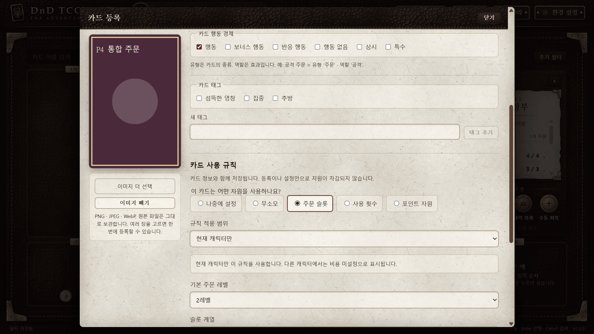
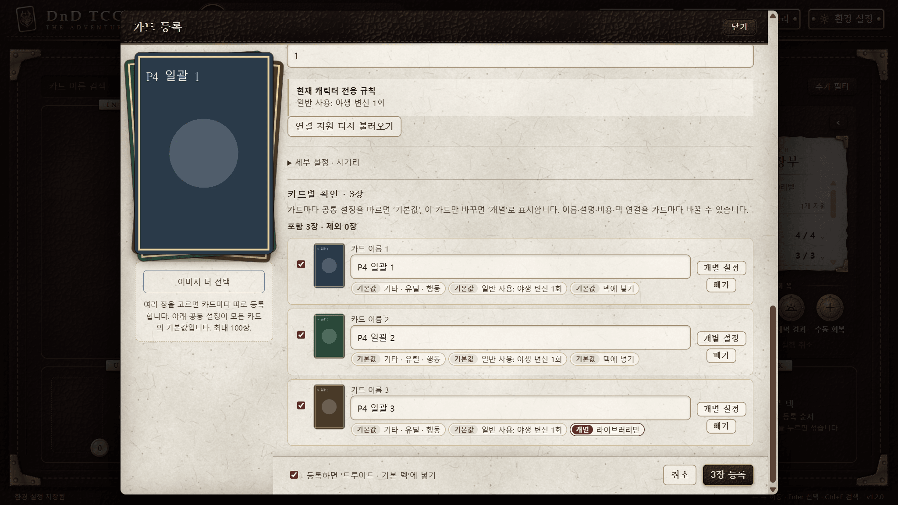
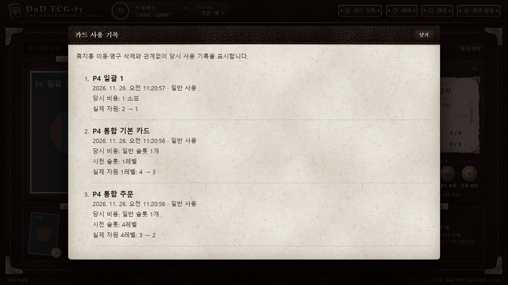
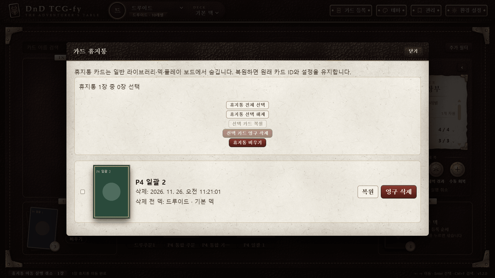
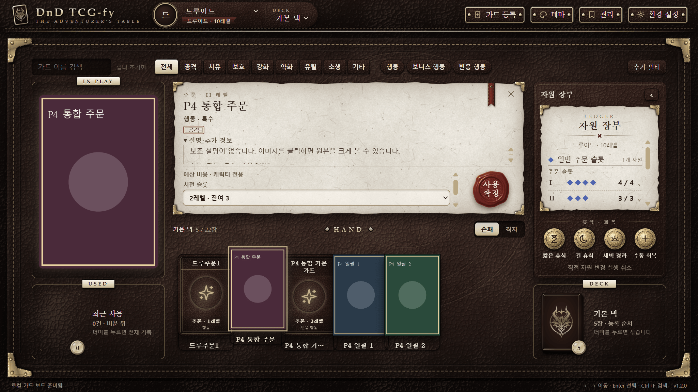
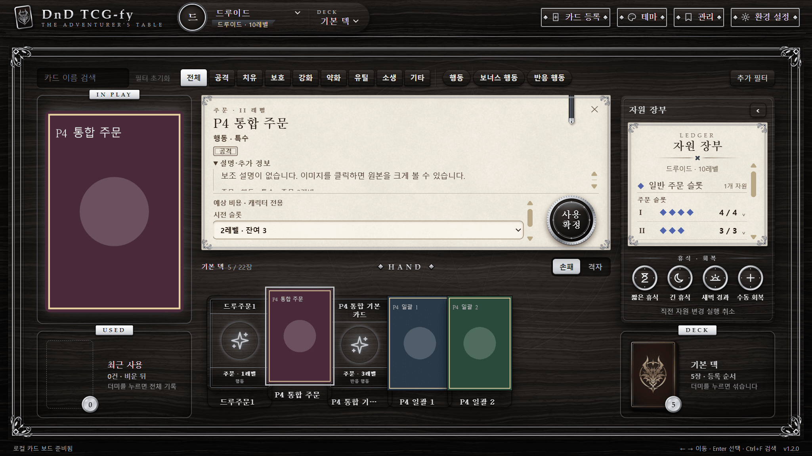
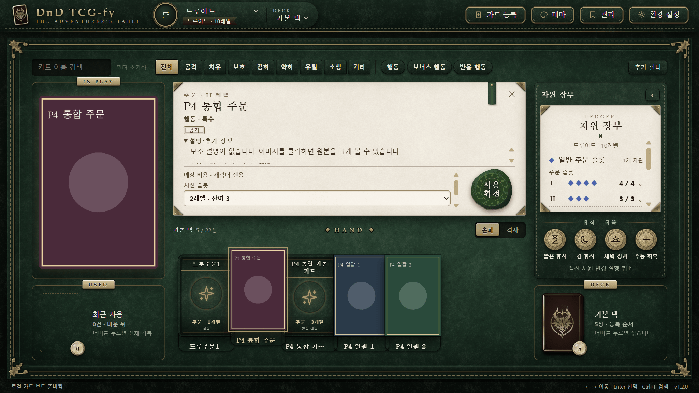
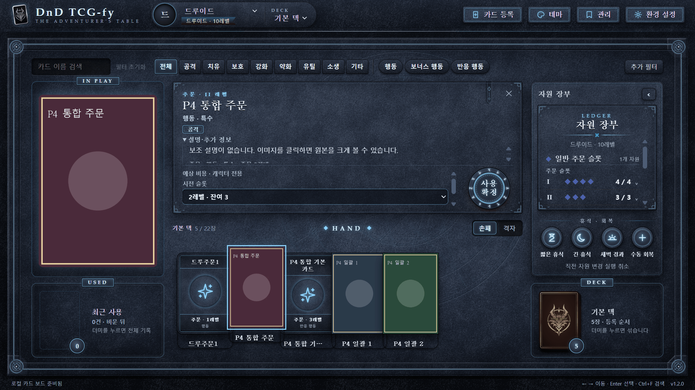

# v1.3 Phase 4 보고서 — 최종 통합·회귀 검증과 배포 후보

- 기준은 Phase 3 승인 커밋 `221c728`이고, 브랜치는 `feat/v1.3-phase4`다. 앱 버전은 아직 1.2.0이다(아래 [6장](#6-배포-후보)).
- **Phase 4에서는 앱 코드를 바꾸지 않았다.** 바뀐 것은 검증 스크립트·테스트·문서뿐이다. 그래서 여기서 검증한 앱은 Phase 3에서 승인한 앱과 같다.
- SQLite v6 그대로이고 마이그레이션은 없다. v1.3이 더한 데이터는 다음 세 가지뿐이다([DATA_SCHEMA_V1_3.md](DATA_SCHEMA_V1_3.md)).
  - 설정 키 `registration_templates`, `used_view`
  - 선택 필드 `saveCards.addToDeck`
- 지시서는 기능 테스트와 시각 검수를 나눠 보고하라고 했다. [1~4장](#1-기능-테스트--통합-시나리오)은 자동 기능 테스트, [5장](#5-시각-검수)은 화면 검수다.

## 1. 기능 테스트 — 통합 시나리오

새 E2E [`scripts/v13-p4-e2e.mjs`](scripts/v13-p4-e2e.mjs)는 저장소 데이터 **사본 하나**로 v1.3 기능을 실제 화면 조작으로 이어서 실행한다. 중간에 앱을 다시 실행해 결과가 남았는지도 확인한다. 카드는 드루이드(일반 주문 슬롯 1~5레벨)와 워락(계약 마법 슬롯)으로 사용한다.

| 순서 | 지시서 항목 | 확인한 것 |
| --- | --- | --- |
| 1 | 단일 카드 등록 · 카드 비용·자원 연결 · 활성 덱 연결 | 이미지 카드 1장을 일반 주문 슬롯 비용과 기본으로 켜진 덱 연결로 등록하면 드루이드 덱에 들어간다. 저장된 이미지 파일은 고른 파일과 바이트가 같다 |
| 2 | 이미지 없는 카드 | 3레벨 주문, 홈브루 규칙(1~5레벨, 기본 레벨 미만 허용). 손패에 기본 카드 디자인으로 보인다 |
| 3 | 다중 카드 등록 · 등록 템플릿 | 이미지 3장. 공통 설정(유형·역할·횟수 비용)을 템플릿으로 저장하고, 3번 카드만 개별 설정으로 덱에서 뺀다. 두 장은 덱에, 한 장은 라이브러리에만 들어간다 |
| 4 | 카드 검색 및 필터 | 검색하면 덱 보기에서 2장, 전체 라이브러리에서 3장이 나온다. 반응 행동 필터는 반응 카드만 남긴다 |
| 5 | 원본 카드 표시 | 확대하면 저장한 원본(640×933)을 썸네일이 아닌 원래 크기로 보여 준다 |
| 6 | 카드 선택·사용 확정 · 일반 주문 슬롯 · 업캐스팅 | 2레벨 주문에 2~5레벨 슬롯을 제시한다. 4레벨로 사용하면 4레벨 슬롯이 1 줄고, Undo로 돌아온다 |
| 7 | 홈브루 다운캐스팅 | 3레벨 주문을 1레벨 슬롯으로 사용하면 1레벨 슬롯이 1 준다 |
| 8 | 자원 소비 · 사용 기록 · Undo | 횟수 비용을 1 쓴다. USED가 3 늘고 전체 사용 기록에 세 카드가 있다. Undo는 마지막 사용(횟수)만 되돌리고 1레벨 슬롯은 그대로 둔다 |
| 9 | 자원 회복 | 긴 휴식 → 회복 확정으로 슬롯이 돌아온다 |
| 10 | 계약 마법 슬롯 | 워락의 계약 슬롯을 사용하고 Undo한다. 드루이드 자원은 바뀌지 않는다 |
| 11 | 휴지통 및 복원 | 관리 → 휴지통으로 이동하면 손패·덱에서 빠진다. 라이브러리 관리 → 휴지통 → 복원하면 같은 ID로 같은 덱에 돌아온다 |
| 12 | 사용자 데이터 저장 | USED를 비우고 테마를 숲의 펠트로 바꾼 뒤 다시 실행해 다음이 그대로인지 확인한다. 템플릿은 다시 실행한 뒤에도 등록 창을 채우고, 취소하면 아무것도 저장하지 않는다. 재실행 뒤 그대로인 것: 새 카드(같은 ID), 덱, 템플릿, 테마, 선택 캐릭터, 비운 USED, 자원 값, 기록 수 |
| 13 | 모든 기존 테마 | 네 테마에서 같은 보드가 레이아웃 계약을 지킨다(겹침·잘림·넘침 없음) |
| 14 | 데이터 무결성 | 원래 이미지 파일과 원래 카드 행이 바이트 단위로 같다. `integrity_check` ok, 외래 키 문제 없음, 스키마 v6 |

결과: 빌드 번들·개발 모드·패키징 EXE 모두 7개 검사 통과. EXE 첫 실행에서 한 번 실패했다. 사용 기록 창 목록을 창이 열리자마자 읽었기 때문이다(목록은 열린 뒤 따로 불러온다). 목록이 다 뜰 때까지 기다리도록 고친 뒤 EXE 2회·번들 1회 다시 통과했다.

## 2. 기능 테스트 — 기능별 회귀 18종

| 묶음 | 스크립트 | 빌드 번들 | 패키징 EXE |
| --- | --- | --- | --- |
| v1.3 Phase 4 통합 | `v13-p4-e2e` | 7 통과 | 7 통과(위 재실행) |
| v1.3 Phase 3 플레이 흐름(UI-P4) | `v13-p3-ux-e2e` | 8 통과 | 8 통과 |
| v1.3 Phase 3 배치·메모 | `v13-p3-e2e` | 9 통과 | 9 통과 |
| v1.3 Phase 2 여러 장 등록·템플릿 | `v13-p2-e2e` | 6 통과 | 6 통과 |
| v1.3 Phase 1 단일 등록·기본 카드 | `v13-p1-e2e` | 7 통과 | 7 통과 |
| 메인 시나리오(등록·자원·휴지통·마이그레이션 등) | `e2e` | 38 통과 | 38 통과 |
| v1.2 Phase 4 책갈피·회복 버튼 | `v12-p4-e2e` | 6 통과 | 6 통과 |
| v1.2 Phase 3 테마 재질 | `v12-p3-e2e` | 6 통과 | 6 통과 |
| v1.2 Phase 2 손패 관성·확대 기울임 | `v12-p2-e2e` | 7 통과 | 7 통과 |
| v1.2 Phase 1 화면 구조·등록 중 자원 | `v12-p1-e2e` | 9 통과 | 9 통과 |
| v1.1 Phase 1 필터 줄 | `v11-p1-e2e` | 8 통과 | 8 통과 |
| v1.1 Phase 2 메인 등록·선택 막대 | `v11-p2-e2e` | 9 통과 | 9 통과 |
| v1.1 Phase 3 확대·모션 | `v11-p3-e2e` | 11 통과 | 11 통과 |
| v1.1 Phase 4 슬롯 색·커서 | `v11-p4-e2e` | 9 통과 | 9 통과 |
| P4-A 사용 영역·업캐스팅 | `p4-a-e2e` | 통과 | 통과 |
| P4-B 손패·이미지 | `p4-b-e2e` | 통과 | 통과 |
| P4-C 등록 규칙 | `p4-c-e2e` | 통과 | 통과 |
| P5 데이터 보존(오프라인·강제 종료·백업·복원) | `p5-e2e` | 6 통과 | 6 통과 |

- 개발 모드(Vite + Electron): 통합 시나리오 7개 검사 통과. Phase 3 E2E 두 개는 Phase 3 때 개발 모드로 통과했다(그 뒤 앱 코드 변경 없음)
- 패키징: `npm run pack:win` 성공. 결과는 `release/win-unpacked/DnD TCG-fy.exe`(폴더형)이고, 위 EXE 열은 모두 이 파일로 돌렸다
- 단위 테스트: 510/510 통과. 1.2.0의 472개에서 38개가 늘었다. Node 24 전용 2개 파일은 이 PC의 Node 22에서 로드되지 않는다(이전과 같음). 린트와 타입 검사는 통과했다.

## 3. 기능 테스트 — 1.2.0으로 되돌렸을 때

[`scripts/v13-compat-120.mjs`](scripts/v13-compat-120.mjs)를 썼다. 실제 1.2.0 빌드(`042d533`을 임시 작업 트리에 다시 빌드)로 v1.3이 쓴 DB를 여는 검사다. 순서는 다음과 같다.

1. **v1.3이 쓴다:** 다음을 저장한다.
   - 이미지 없는 라이브러리 전용 카드
   - 한 장씩 저장한 카드 2장(여러 장 등록 방식)
   - 템플릿(`registration_templates`)
   - USED 비우기 표시(`used_view`)
2. **1.2.0이 연다:** 카드가 모두 보인다(이미지 없는 카드 포함). 경고나 오류 띠는 없다. 모르는 설정은 무시하고 자기 설정(보기 방식)을 저장한다.
3. **v1.3이 다시 연다:** 템플릿과 비운 USED가 그대로 남아 있다. 1.2.0이 바꾼 보기 방식도 유지된다. DB는 `quick_check`와 외래 키 검사를 통과하고 스키마는 v6이다.

결과: 빌드 번들 PASS · 패키징 EXE PASS

## 4. v1.3 최종 완료 기준 대조 (지시서 9장)

| 기준 | 상태 | 근거 |
| --- | --- | --- |
| 단일 카드 등록이 정상 작동 | 충족 | v13-p1, v13-p4 |
| 이미지 없는 카드는 기본 카드 디자인 | 충족 | v13-p1(손패·IN PLAY·확대), v13-p4 |
| 유형별 대표 아이콘 | 충족 | V13P1UI 단위 테스트(여섯 유형), Phase 1 화면 검수 |
| 여러 이미지를 한 번에 등록 | 충족 | v13-p2(6장·50장, 실패 주입과 재시도), v13-p4 |
| 공통 템플릿과 카드별 속성 수정 | 충족 | v13-p2, v13-p4(재실행 뒤 템플릿 적용) |
| 카드 비용·덱 연결 저장 | 충족 | v13-p1/p2/p4, v12-p1(등록 중 새 자원) |
| 기존 카드와 이미지 원본 보존 | 충족 | 모든 v1.3 E2E가 원본 이미지 해시와 카드 행 확인 |
| 첨부 포토배시와 핵심 배치 일치 | **확인 불가** | 포토배시를 받지 못했다. 지시서 글 기준으로 만들었고 사용자가 두 번 화면을 승인했다([Phase 3 보고서 3장](V1_3_P3_REPORT.md#3-포토배시와의-차이)) |
| 좌측 대형 카드와 덱 확인 | 충족(배치 변경) | 메모 2 결정으로 좌측은 IN PLAY·USED, 우측은 장부·DECK. v13-p3 |
| 중앙 세부와 우측 장부를 동시에 확인 | 충족 | v13-p3 레이아웃 계약(모든 크기·배율) |
| 손패가 카드 탐색의 중심 | 충족 | 보통 창에서 5~7장, 드래그·관성·휠·키보드. v13-p3-ux |
| 선택·확대·비용 선택·사용 확정 | 충족 | v13-p3-ux(모든 크기), v13-p4(업캐스팅·다운캐스팅) |
| USED 기존 기능 보존 | 충족 | 최근 사용 더미와 전체 기록이 그대로다. 비우기·되돌리기는 표시만 바꾼다. Undo한 사용도 남는 것은 1.2.0과 같은 동작이다(7장) |
| 카드 이미지 비율·품질 유지 | 충족 | IN PLAY·손패 1:1.458 검사, 원본 크기 확대(v13-p4) |
| 자원 수가 적거나 많아도 정상 | 충족 | 0·1·2·14개(23줄), v13-p3-ux. 짧은 창은 장부 안 스크롤(7장) |
| 다양한 창 크기에서 충돌 없음 | 충족 | 3 크기 × 3 배율 + 최소 창. 배율은 장치 배율 인자로 재현(7장) |
| 기존 테마 재질·기능 유지 | 충족 | v12-p3·p4, v13-p3, v13-p4 |
| 카드와 덱 데이터 보존 | 충족 | v13-p4 재실행, P5 데이터 보존, 1.2.0 하위 호환 |
| 자원량과 사용 기록 보존 | 충족 | v13-p4 재실행 |
| Undo 정상 | 충족 | v13-p1/p3-ux/p4, 메인 E2E |
| 설정이 재시작 후 유지 | 충족 | v13-p4(테마·USED·템플릿·선택 캐릭터), v12-p2(관성) |
| SQLite 무결성 | 충족 | v13-p3-ux·v13-p4·호환 검사 |
| 개발 모드와 설치형 EXE 정상 작동 | 부분 충족 | 개발 모드와 패키징 EXE(폴더형)는 확인했다. NSIS 설치 파일은 1.3.0을 만들 때 만든다(6장) |
| 전체 자동 테스트·타입·린트 통과 | 충족 | 2장 |
| Git 작업 트리와 최종 커밋 정리 | 충족 | 8장 |

## 5. 시각 검수

- **Phase별 화면 검수:**
  - Phase 1: 등록 화면, 기본 카드
  - Phase 2: 여러 장 등록
  - Phase 3: 배치(UI-P0), 시각 마무리(UI-P3), UI-P4 비교 화면
  - 셋 모두 사용자 승인을 받았다.
- **Phase 4 화면:** 통합 시나리오가 찍은 화면이다. 바뀐 화면은 없고 v1.3 전체를 한 데이터로 이어서 본 것이다.

| 장면 | 화면 |
| --- | --- |
| 단일 등록(이미지·일반 슬롯) |  |
| 여러 장 등록(템플릿·개별 설정) |  |
| 원본 확대 |  |
| 카드 사용 기록 |  |
| 휴지통 |  |
| 적갈 가죽 |  |
| 흑단과 은 |  |
| 숲의 펠트 |  |
| 아케인 블루 |  |

- **포토배시 일치도:** 이미지를 받지 못해 판단하지 못했다. 지시서 글과의 차이는 [Phase 3 보고서 3장](V1_3_P3_REPORT.md#3-포토배시와의-차이)에 있다.

## 6. 배포 후보

**후보:** `feat/v1.3-phase4`의 이 커밋이다. 앱 코드는 Phase 3 승인 커밋 `221c728`과 같다.

| v1.3 바뀐 점 | 보고서 |
| --- | --- |
| 단일 카드 등록 정리, 이미지 없는 카드의 기본 디자인과 유형 아이콘, 라이브러리 전용 등록 | [Phase 1](V1_3_P1_REPORT.md) |
| 여러 장 등록(공통·개별 설정, 같은 이미지 경고, 카드별 저장과 재시도), 등록 템플릿 | [Phase 2](V1_3_P2_REPORT.md) |
| 세 칸 플레이 보드(IN PLAY·USED / 세부·손패 / 장부·DECK), 1.3.x 메모 7개, 테마별 사용 확정 인장, 짧은 창 정리 | [Phase 3](V1_3_P3_REPORT.md) |

**데이터:**
- 위치는 그대로 `%APPDATA%\DnD TCG-fy`이고, SQLite v6이라 마이그레이션이 없다.
- 1.2.0으로 되돌려도 같은 DB를 연다(3장).

**사용자가 최종 승인과 배포를 요청하면 할 일**(1.2.0 때와 같은 순서):
1. `package.json`·잠금 파일·README의 버전을 1.3.0으로 올리고 `V1_3_RELEASE.md`를 쓴다.
2. `npm run dist:win`으로 `release/DnD-TCG-fy-Setup-1.3.0-x64.exe`를 만들고 크기와 SHA-256을 기록한다.
3. 같은 빌드의 패키징 EXE로 회귀 18종을 다시 돌리고 앱 버전 1.3.0을 확인한다.
4. 커밋한다. 푸시·병합은 요청이 있을 때만 한다.

**업그레이드 안내(초안):**
1. 관리 → 백업·복원 → ZIP으로 내보내기로 백업한다.
2. 앱을 닫는다.
3. 1.3.0 설치 파일을 같은 위치에 설치한다.
4. 상태 줄에서 `v1.3.0`을 확인한다.

## 7. 알려진 한계·미검증·결정이 필요한 점

- **결정 필요(1.2.0부터의 동작, 바꾸지 않음):** 카드를 쓴 뒤 Undo해도 그 사용은 USED 더미와 전체 사용 기록에 남는다. 자원은 Undo로 돌아오고, 최근 행동 목록에는 “… 실행 취소”가 따로 남는다. v1.3에 넣지 않았다. 바꾸려면 다음 버전 범위로 정해야 한다.
- **포토배시:** 받지 못해 일치도를 확인하지 못했다.
- **설치·업그레이드·제거 자동 검사(`p5-installer-check`):** 실행하지 않았다.
  - 이유: 이 PC에 사용자가 설치한 앱과 실제 데이터가 있어 검사가 설치본·바로가기를 덮어쓴다(1.2.0 때와 같음).
  - 대신 패키징 EXE로 회귀 전체를 돌렸다. 실제 설치·업그레이드는 다른 PC나 사용자 확인이 필요하다.
- **배율 재현:** Windows 배율은 장치 배율 인자로 재현했다. 실제 Windows 배율 설정 화면, 터치·펜, 손으로 해 보는 관성·셔플 느낌은 확인하지 않았다.
- **짧은 창의 장부:** 1280×720·150%와 최소 창에서는 장부 목록이 52~86 px라 자원 한두 줄씩 보이고 나머지는 스크롤한다.
- **Node 24 전용 단위 테스트 2개:** 이 PC(Node 22)에서는 로드되지 않는다.

## 8. 바뀐 파일과 커밋

**Phase 4**(앱 코드 변경 없음):
- `scripts/v13-p4-e2e.mjs`(새 파일): 통합 시나리오
- `scripts/v13-compat-120.mjs`(새 파일): 1.2.0 하위 호환. 이전에는 산출물 폴더의 임시 스크립트였고, 이번에 `used_view`까지 넣어 저장소에 넣었다
- `scripts/v13-p4-e2e.mjs` 보강: 사용 기록 창은 목록을 따로 불러오므로 목록이 다 뜰 때까지 기다린다(EXE 첫 실행 실패 원인)
- `tests/V13P2UI.test.tsx`: 여러 장 등록 UI 테스트 두 개의 제한 시간 정리
  - 문제: 안의 대기는 각각 최대 5 s인데 테스트 전체 제한도 기본 5 s였다. 병렬 실행이 몰리면 한 번 시간 초과가 났다(따로 돌리면 3 s 안에 통과).
  - 조치: 두 테스트의 전체 제한을 15 s로 맞췄다.
- 문서: `V1_3_PLAN.md`, `DECISIONS.md`, `CLAUDE.md`, 이 보고서, `docs/screenshots/v1.3-p4/`

**v1.3 커밋**(모두 브랜치에만 있고 `main`에 병합하거나 푸시하지 않았다):

| 단계 | 브랜치 | 커밋 |
| --- | --- | --- |
| Phase 1 | `feat/v1.3-phase1` | `c23ebf6` |
| Phase 2 | `feat/v1.3-phase2` | `d942418` |
| Phase 3 | `feat/v1.3-phase3` | `5f58df3` · `fc13c34` · `ef9870b` · `221c728` |
| Phase 4 | `feat/v1.3-phase4` | 이 보고서와 함께 커밋 |

**최종 검수:** 2026-11-26 사용자가 통과시켰다(“최종 검수 통과”). 1.3.0 배포 작업([6장](#6-배포-후보))은 사용자의 배포 요청을 기다린다. 새 기능이나 다음 버전은 승인 없이 시작하지 않는다.
